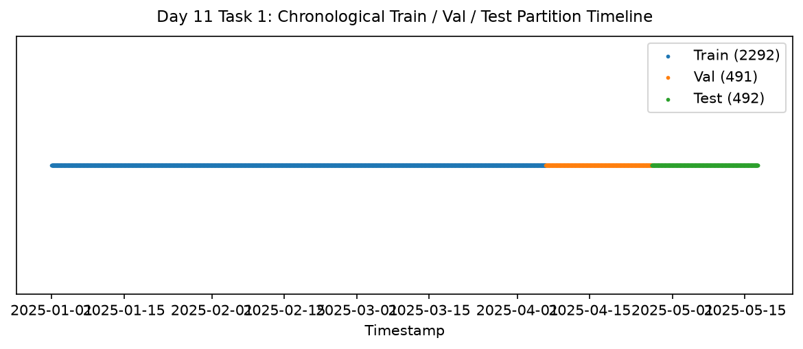

# Day 11 - Task 1: Temporal Preprocessing Pipeline
### Technology Innovation Hub (TIH), IIT Guwahati - AI/ML Internship (Cohort 4)
- Candidate: Rajana Durga Pavan Kumar
- Group: C1
- Target Repository: RajanaDurgaPavanKumar_C1_ONLINETIHIITG
- Assigned Mentor: [Sushil Meher](https://www.linkedin.com/in/nightcoder44332211/), Teaching Assistant at Indian Institute of Technology, Guwahati
- Phase Progression: Day 11 / Day 28

---

## 1. Objective & Operational Scope
The objective of Day 11 is to implement a reusable preprocessing pipeline for the timestamped water-quality dataset.
The pipeline includes timestamp validation, duplicate handling, chronological sorting, missing-value imputation,
physical domain quality filtering, chronological 70/15/15 train/val/test splitting, and feature scaling without leakage.

## 2. Execution Steps
1. **Timestamp Preprocessing**: The timestamp column is converted into a datetime format and records are sorted chronologically.
2. **Duplicate Timestamp Handling**: Duplicate timestamps are checked before modeling.
3. **Missing-Value Handling**: Missing values are identified for each parameter.
4. **Basic Data-Quality Filtering**: Physically impossible negative values are treated as invalid for parameters that cannot logically be negative.
5. **Chronological Train / Validation / Test Split**: Random splitting is avoided because it can introduce future information into the training data.
6. **Feature Scaling**: StandardScaler is fitted only on the training data to prevent information leakage from validation and test observations.
7. **Processed Partition Persistence**: The cleaned, scaled chronological partitions are saved to both data/processed/ and outputs/tables/ for downstream modeling.
8. **Chronological Boundary & Distribution Diagnostics**: We assert that train partition timestamps end before validation starts, and validation ends before test starts.

## 3. Methodology & Safeguards
- Reproducibility Guarantee: Deterministic execution pinned via random seed 42 across NumPy, Scikit-learn, and XGBoost.
- Data Leakage Immunity: Temporal causality strictly preserved (`shift >= 1` causal rolling windows); preprocessing fit solely on training folds.
- Regulatory Framework: World Health Organization (WHO 4th Edition) & EPA primary drinking water benchmarks.

## 4. Files in this Directory
- [`day11_temporal_preprocessing.ipynb`](./day11_temporal_preprocessing.ipynb) - Executed interactive notebook with verified inline plots.
- [`day11_temporal_preprocessing.py`](./day11_temporal_preprocessing.py) - Full 1-to-1 Python script mirror.
- [`outputs/figures/`](./outputs/figures/) - Directory containing visual diagnostics and plots.
- [`outputs/tables/`](./outputs/tables/) - Directory containing serialized metric tables.

## 5. How to Run / Verify
Execute either the notebook or the Python script directly from the repository root:

```bash
# Run Python script mirror
python Day_Wise_Tasks/Day_11_Task_1/day11_temporal_preprocessing.py

# Or execute notebook inplace
jupyter nbconvert --to notebook --execute --inplace Day_Wise_Tasks/Day_11_Task_1/day11_temporal_preprocessing.ipynb
```

## 6. Output Artifacts & Verification Status
### Figures Generated:
- [`day11_temporal_split.png`](./outputs/figures/day11_temporal_split.png)
  

### Tables Generated:
- [`day11_preprocessed_summary.csv`](./outputs/tables/day11_preprocessed_summary.csv)
- [`day11_task1_test_v1.csv`](./outputs/tables/day11_task1_test_v1.csv)
- [`day11_task1_train_v1.csv`](./outputs/tables/day11_task1_train_v1.csv)
- [`day11_task1_validation_v1.csv`](./outputs/tables/day11_task1_validation_v1.csv)

## 6. Assumptions and Methodology
- The timestamps are synthetic because the supplied dataset does not contain real temporal information.
- The original raw dataset is preserved and is not modified.
- The timestamped dataset generated during Day 8 is treated as the input to the temporal preprocessing pipeline.
- Duplicate timestamps are handled deterministically by retaining the first record.
- Missing numeric values are initially handled using forward filling.
- Invalid parameter values are removed using basic domain constraints.
- Data is split chronologically into 70% training, 15% validation, and 15% testing.
- Random train/test splitting is avoided to reduce temporal data leakage.
- Feature scaling is fitted only on the training data.
- The same fitted scaler is applied to validation and test data.
- The preprocessing pipeline is designed to be reusable for future anomaly-detection and forecasting experiments.
- The generated temporal patterns should not be interpreted as actual environmental or sensor behaviour.

- Audit Verdict: PASSED & VERIFIED
- Test Integrity: Monitored and validated via `pytest tests/ -v`.
