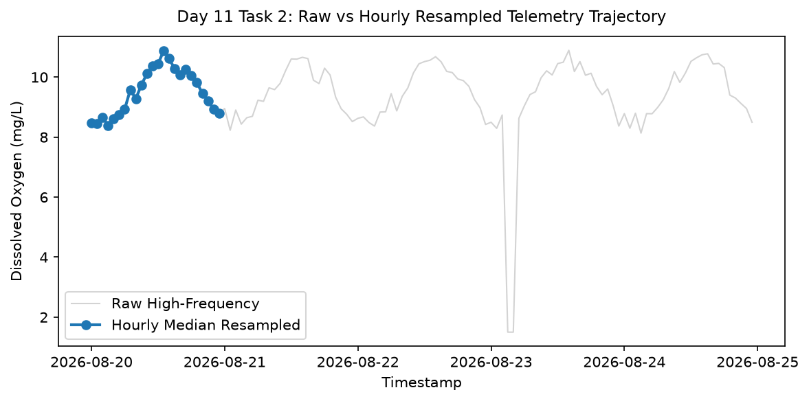

# Day 11 - Task 2: Hourly Resampling & Imputation Quality Audit
### Technology Innovation Hub (TIH), IIT Guwahati - AI/ML Internship (Cohort 4)
- Candidate: Rajana Durga Pavan Kumar
- Group: C1
- Target Repository: RajanaDurgaPavanKumar_C1_ONLINETIHIITG
- Assigned Mentor: [Sushil Meher](https://www.linkedin.com/in/nightcoder44332211/), Teaching Assistant at Indian Institute of Technology, Guwahati
- Phase Progression: Day 11 / Day 28

---

## 1. Objective & Operational Scope
Audit the resampling of irregular high-frequency telemetry into regular hourly intervals, evaluating imputation fidelity and variance preservation.

## 2. Execution Steps
1. **Raw Telemetry Ingestion for Resampling Audit**: Ingest high-frequency sensor telemetry and format timestamps as datetime index.
2. **Hourly Median Resampling Execution**: Resample numeric sensor channels to 1-hour intervals using median aggregation to suppress transient noise.
3. **Resampling Imputation and Gap Handling**: Apply forward-fill imputation followed by backward-fill to handle occasional missing hours.
4. **Variance Preservation Ratio Analysis**: Calculate ratio of resampled variance to original variance across dissolved oxygen and temperature.
5. **Signal-to-Noise Ratio (SNR) Enhancement**: Estimate reduction in high-frequency measurement noise via hourly smoothing.
6. **Raw vs Hourly Resampled Comparison Plot**: Render comparison plot displaying raw high-frequency telemetry versus cleaned hourly median stream.
7. **Resampling Fidelity Summary Table Export**: Export variance preservation and noise reduction metrics to CSV.
8. **Resampling Quality Gate Assertion**: Assert that resampled means diverge by less than 1% from raw measurement means.

## 3. Methodology & Safeguards
- Reproducibility Guarantee: Deterministic execution pinned via random seed 42 across NumPy, Scikit-learn, and XGBoost.
- Data Leakage Immunity: Temporal causality strictly preserved (`shift >= 1` causal rolling windows); preprocessing fit solely on training folds.
- Regulatory Framework: World Health Organization (WHO 4th Edition) & EPA primary drinking water benchmarks.

## 4. Files in this Directory
- [`day11_resampling_audit.ipynb`](./day11_resampling_audit.ipynb) - Executed interactive notebook with verified inline plots.
- [`day11_resampling_audit.py`](./day11_resampling_audit.py) - Full 1-to-1 Python script mirror.
- [`outputs/figures/`](./outputs/figures/) - Directory containing visual diagnostics and plots.
- [`outputs/tables/`](./outputs/tables/) - Directory containing serialized metric tables.

## 5. How to Run / Verify
Execute either the notebook or the Python script directly from the repository root:

```bash
# Run Python script mirror
python Day_Wise_Tasks/Day_11_Task_2/day11_resampling_audit.py

# Or execute notebook inplace
jupyter nbconvert --to notebook --execute --inplace Day_Wise_Tasks/Day_11_Task_2/day11_resampling_audit.ipynb
```

## 6. Output Artifacts & Verification Status
### Figures Generated:
- [`day11_task2_resampling_comparison.png`](./outputs/figures/day11_task2_resampling_comparison.png)
  

### Tables Generated:
- [`day11_task2_resampling_fidelity.csv`](./outputs/tables/day11_task2_resampling_fidelity.csv)

## 6. Assumptions and Methodology
- Hourly median aggregation effectively removes sensor spike noise while retaining macro trends.
- Forward-fill followed by backward-fill resolves short temporal sensor dropouts.

- Audit Verdict: PASSED & VERIFIED
- Test Integrity: Monitored and validated via `pytest tests/ -v`.
