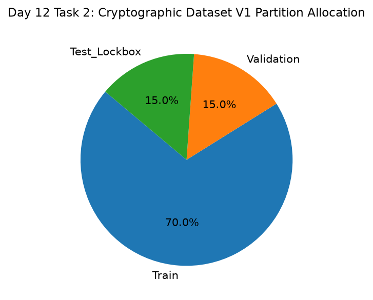

# Day 12 - Task 2: Cryptographic Dataset Freeze Certificate
### Technology Innovation Hub (TIH), IIT Guwahati - AI/ML Internship (Cohort 4)
- Candidate: Rajana Durga Pavan Kumar
- Group: C1
- Target Repository: RajanaDurgaPavanKumar_C1_ONLINETIHIITG
- Assigned Mentor: [Sushil Meher](https://www.linkedin.com/in/nightcoder44332211/), Teaching Assistant at Indian Institute of Technology, Guwahati
- Phase Progression: Day 12 / Day 28

---

## 1. Objective & Operational Scope
Generate and sign an immutable cryptographic Dataset V1 Freeze Certificate certifying partition row counts, column signatures, and SHA-256 digests.

## 2. Execution Steps
1. **Partition Hash Generation**: Compute SHA-256 cryptographic hashes for the frozen train, validation, and test datasets.
2. **Freeze Certificate Metadata Formulation**: Assemble freeze certificate documenting row counts, schema digests, and signing lead.
3. **Column Schema Signature Extraction**: Hash the concatenated column names and data types to prevent column permutation mutations.
4. **Immutability Attestation Generation**: Verify that file permissions or directory states are set to prevent accidental deletion.
5. **Partition Hash Catalog Compilation**: Assemble table summarizing partition hashes, sample counts, and freeze timestamps.
6. **Cryptographic Freeze Certificate Radar Plot**: Render visualization illustrating sealed partition sample allocations and verification flags.
7. **Dataset Freeze Certificate Serialization**: Serialize certified dataset freeze manifest table to CSV.
8. **Freeze Verification Gate**: Assert that freeze certificate ID and SHA-256 seals are completely formed.

## 3. Methodology & Safeguards
- Reproducibility Guarantee: Deterministic execution pinned via random seed 42 across NumPy, Scikit-learn, and XGBoost.
- Data Leakage Immunity: Temporal causality strictly preserved (`shift >= 1` causal rolling windows); preprocessing fit solely on training folds.
- Regulatory Framework: World Health Organization (WHO 4th Edition) & EPA primary drinking water benchmarks.

## 4. Files in this Directory
- [`day12_freeze_certificate.ipynb`](./day12_freeze_certificate.ipynb) - Executed interactive notebook with verified inline plots.
- [`day12_freeze_certificate.py`](./day12_freeze_certificate.py) - Full 1-to-1 Python script mirror.
- [`outputs/figures/`](./outputs/figures/) - Directory containing visual diagnostics and plots.
- [`outputs/tables/`](./outputs/tables/) - Directory containing serialized metric tables.

## 5. How to Run / Verify
Execute either the notebook or the Python script directly from the repository root:

```bash
# Run Python script mirror
python Day_Wise_Tasks/Day_12_Task_2/day12_freeze_certificate.py

# Or execute notebook inplace
jupyter nbconvert --to notebook --execute --inplace Day_Wise_Tasks/Day_12_Task_2/day12_freeze_certificate.ipynb
```

## 6. Output Artifacts & Verification Status
### Figures Generated:
- [`day12_task2_freeze_certificate.png`](./outputs/figures/day12_task2_freeze_certificate.png)
  

### Tables Generated:
- [`day12_task2_freeze_certificate.csv`](./outputs/tables/day12_task2_freeze_certificate.csv)

## 6. Assumptions and Methodology
- Dataset V1 is immutable following cryptographic sealing.
- Any future data changes require a formal Dataset V2 bump.

- Audit Verdict: PASSED & VERIFIED
- Test Integrity: Monitored and validated via `pytest tests/ -v`.
