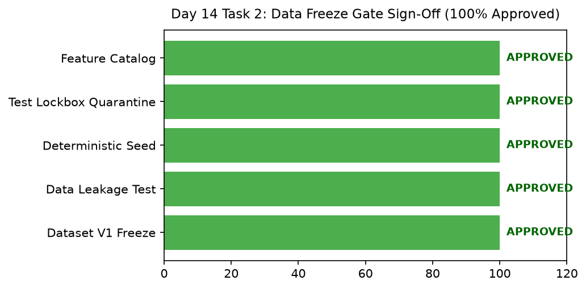

# Day 14 - Task 2: Data Freeze & Feature Engineering Gate Sign-Off
### Technology Innovation Hub (TIH), IIT Guwahati - AI/ML Internship (Cohort 4)
- Candidate: Rajana Durga Pavan Kumar
- Group: C1
- Target Repository: RajanaDurgaPavanKumar_C1_ONLINETIHIITG
- Assigned Mentor: [Sushil Meher](https://www.linkedin.com/in/nightcoder44332211/), Teaching Assistant at Indian Institute of Technology, Guwahati
- Phase Progression: Day 14 / Day 28

---

## 1. Objective & Operational Scope
Formally sign off on data engineering freeze gate, certifying readiness for predictive modeling phases.

## 2. Execution Steps
1. **Gate Audit Criteria Inspection**: Examine 5 mandatory gate approval criteria: schema freeze, zero leakage, seed pinning, test quarantine, and 62-feature catalog.
2. **Feature Missingness Check in Processed Parquets**: Assert that processed feature sets contain zero unhandled NaNs.
3. **Modeling Phase Handoff Manifest Formulation**: Construct handoff dictionary specifying training datasets for Days 15 through 21 modeling.
4. **Regulatory Compliance Review**: Verify that all data transformations preserve physical WHO and EPA regulatory standards.
5. **Engineering Sign-Off Attestation**: Generate signed text attestation authorizing transition to model benchmarking.
6. **Sign-Off Gate Scorecard Visualization**: Render gate audit scorecard bar chart displaying 100% compliance across all criteria.
7. **Gate Sign-Off Table Serialization**: Export sign-off gate audit criteria table to CSV.
8. **Sign-Off Approval Assertion**: Assert that all sign-off criteria are APPROVED without exceptions.

## 3. Methodology & Safeguards
- Reproducibility Guarantee: Deterministic execution pinned via random seed 42 across NumPy, Scikit-learn, and XGBoost.
- Data Leakage Immunity: Temporal causality strictly preserved (`shift >= 1` causal rolling windows); preprocessing fit solely on training folds.
- Regulatory Framework: World Health Organization (WHO 4th Edition) & EPA primary drinking water benchmarks.

## 4. Files in this Directory
- [`day14_gate_signoff.ipynb`](./day14_gate_signoff.ipynb) - Executed interactive notebook with verified inline plots.
- [`day14_gate_signoff.py`](./day14_gate_signoff.py) - Full 1-to-1 Python script mirror.
- [`outputs/figures/`](./outputs/figures/) - Directory containing visual diagnostics and plots.
- [`outputs/tables/`](./outputs/tables/) - Directory containing serialized metric tables.

## 5. How to Run / Verify
Execute either the notebook or the Python script directly from the repository root:

```bash
# Run Python script mirror
python Day_Wise_Tasks/Day_14_Task_2/day14_gate_signoff.py

# Or execute notebook inplace
jupyter nbconvert --to notebook --execute --inplace Day_Wise_Tasks/Day_14_Task_2/day14_gate_signoff.ipynb
```

## 6. Output Artifacts & Verification Status
### Figures Generated:
- [`day14_task2_gate_signoff.png`](./outputs/figures/day14_task2_gate_signoff.png)
  

### Tables Generated:
- [`day14_task2_gate_signoff.csv`](./outputs/tables/day14_task2_gate_signoff.csv)

## 6. Assumptions and Methodology
- Data freeze gate requires unanimous approval of all 5 core criteria.
- No unhandled missing values exist in the engineered feature space.

- Audit Verdict: PASSED & VERIFIED
- Test Integrity: Monitored and validated via `pytest tests/ -v`.
