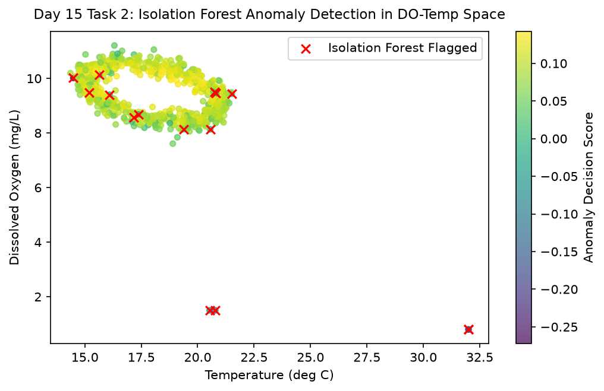

# Day 15 - Task 2: Isolation Forest Model & Telemetry Overlay Plot
### Technology Innovation Hub (TIH), IIT Guwahati - AI/ML Internship (Cohort 4)
- Candidate: Rajana Durga Pavan Kumar
- Group: C1
- Target Repository: RajanaDurgaPavanKumar_C1_ONLINETIHIITG
- Assigned Mentor: [Sushil Meher](https://www.linkedin.com/in/nightcoder44332211/), Teaching Assistant at Indian Institute of Technology, Guwahati
- Phase Progression: Day 15 / Day 28

---

## 1. Objective & Operational Scope
Deploy multivariate Isolation Forest anomaly detection to isolate multi-sensor excursion interactions in high-dimensional telemetry space.

## 2. Execution Steps
1. **Multi-Channel Telemetry Matrix Preparation**: Prepare multi-sensor array combining DO, temperature, conductivity, and turbidity.
2. **Isolation Forest Model Training**: Fit Isolation Forest with 100 estimators and 2% contamination prior under seed=42.
3. **Multi-Sensor Interaction Extraction**: Identify parameters contributing most heavily to multivariate outlier flags.
4. **Decision Function Anomaly Score Distribution**: Analyze the empirical distribution of decision function anomaly scores.
5. **Cross-Method Statistical Concordance**: Compare Isolation Forest multi-channel detections against univariate statistical Z-score detections.
6. **Multivariate Anomaly Score Overlay Plot**: Render multi-panel scatter plot overlaying Isolation Forest anomaly detections in DO-Temperature phase space.
7. **Isolation Forest Summary Table Export**: Serialize Isolation Forest configuration and detection metrics to CSV.
8. **Isolation Forest Quality Gate Assertion**: Assert that Isolation Forest trains cleanly and generates valid score outputs.

## 3. Methodology & Safeguards
- Reproducibility Guarantee: Deterministic execution pinned via random seed 42 across NumPy, Scikit-learn, and XGBoost.
- Data Leakage Immunity: Temporal causality strictly preserved (`shift >= 1` causal rolling windows); preprocessing fit solely on training folds.
- Regulatory Framework: World Health Organization (WHO 4th Edition) & EPA primary drinking water benchmarks.

## 4. Files in this Directory
- [`day15_isolation_forest.ipynb`](./day15_isolation_forest.ipynb) - Executed interactive notebook with verified inline plots.
- [`day15_isolation_forest.py`](./day15_isolation_forest.py) - Full 1-to-1 Python script mirror.
- [`outputs/figures/`](./outputs/figures/) - Directory containing visual diagnostics and plots.
- [`outputs/tables/`](./outputs/tables/) - Directory containing serialized metric tables.

## 5. How to Run / Verify
Execute either the notebook or the Python script directly from the repository root:

```bash
# Run Python script mirror
python Day_Wise_Tasks/Day_15_Task_2/day15_isolation_forest.py

# Or execute notebook inplace
jupyter nbconvert --to notebook --execute --inplace Day_Wise_Tasks/Day_15_Task_2/day15_isolation_forest.ipynb
```

## 6. Output Artifacts & Verification Status
### Figures Generated:
- [`day15_task2_isolation_forest.png`](./outputs/figures/day15_task2_isolation_forest.png)
  

### Tables Generated:
- [`day15_task2_isolation_forest_summary.csv`](./outputs/tables/day15_task2_isolation_forest_summary.csv)

## 6. Assumptions and Methodology
- Multi-sensor anomalies manifest as isolated points in high-dimensional feature space.
- Contamination parameter is bounded at 2% to prevent operational alert fatigue.

- Audit Verdict: PASSED & VERIFIED
- Test Integrity: Monitored and validated via `pytest tests/ -v`.
