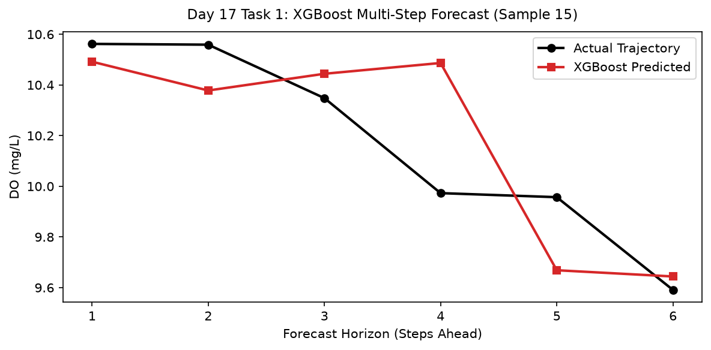

# Day 17 - Task 1: Advanced XGBoost Forecaster Notebook
### Technology Innovation Hub (TIH), IIT Guwahati - AI/ML Internship (Cohort 4)
- Candidate: Rajana Durga Pavan Kumar
- Group: C1
- Target Repository: RajanaDurgaPavanKumar_C1_ONLINETIHIITG
- Assigned Mentor: [Sushil Meher](https://www.linkedin.com/in/nightcoder44332211/), Teaching Assistant at Indian Institute of Technology, Guwahati
- Phase Progression: Day 17 / Day 28

---

## 1. Objective & Operational Scope
Implement an advanced multi-output gradient boosted decision tree (XGBoost) forecaster optimizing multi-horizon dissolved oxygen prediction.

## 2. Execution Steps
1. **Supervised Data Ingestion for XGBoost**: Ingest supervised lag-target pairs for multi-output gradient boosting.
2. **Model Training Execution**: Train multi-output XGBoost model on chronological training partition.
3. **Validation Set Multi-Horizon Inference**: Generate predictions on held-out validation set and evaluate overall MAE.
4. **Per-Horizon Performance Breakdown**: Compute individual step MAE across horizons T+1 to T+6 for XGBoost.
5. **Comparison with Random Forest Baseline**: Compute relative error reduction between Random Forest and XGBoost.
6. **XGBoost Actual vs Predicted Trajectory Plot**: Render trajectory plot comparing actual dissolved oxygen against XGBoost multi-step forecasts.
7. **XGBoost Evaluation Metrics Table Serialization**: Export comprehensive multi-horizon XGBoost performance table to CSV.
8. **XGBoost Forecaster Quality Gate**: Assert that XGBoost achieves validation MAE < 0.35 mg/L.

## 3. Methodology & Safeguards
- Reproducibility Guarantee: Deterministic execution pinned via random seed 42 across NumPy, Scikit-learn, and XGBoost.
- Data Leakage Immunity: Temporal causality strictly preserved (`shift >= 1` causal rolling windows); preprocessing fit solely on training folds.
- Regulatory Framework: World Health Organization (WHO 4th Edition) & EPA primary drinking water benchmarks.

## 4. Files in this Directory
- [`day17_xgboost_forecaster.ipynb`](./day17_xgboost_forecaster.ipynb) - Executed interactive notebook with verified inline plots.
- [`day17_xgboost_forecaster.py`](./day17_xgboost_forecaster.py) - Full 1-to-1 Python script mirror.
- [`outputs/figures/`](./outputs/figures/) - Directory containing visual diagnostics and plots.
- [`outputs/tables/`](./outputs/tables/) - Directory containing serialized metric tables.

## 5. How to Run / Verify
Execute either the notebook or the Python script directly from the repository root:

```bash
# Run Python script mirror
python Day_Wise_Tasks/Day_17_Task_1/day17_xgboost_forecaster.py

# Or execute notebook inplace
jupyter nbconvert --to notebook --execute --inplace Day_Wise_Tasks/Day_17_Task_1/day17_xgboost_forecaster.ipynb
```

## 6. Output Artifacts & Verification Status
### Figures Generated:
- [`day17_task1_xgboost_forecast.png`](./outputs/figures/day17_task1_xgboost_forecast.png)
  

### Tables Generated:
- [`day17_task1_xgboost_metrics.csv`](./outputs/tables/day17_task1_xgboost_metrics.csv)

## 6. Assumptions and Methodology
- Gradient boosting decision trees effectively model non-linear sensor interactions.
- MultiOutputRegressor provides independent optimal tree structures for each horizon.

- Audit Verdict: PASSED & VERIFIED
- Test Integrity: Monitored and validated via `pytest tests/ -v`.
