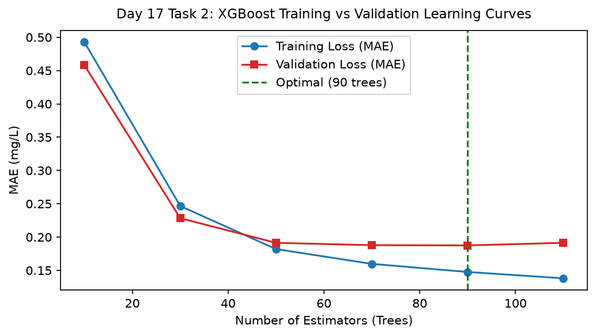

# Day 17 - Task 2: Learning Curve Diagnostics & Overfitting Audit
### Technology Innovation Hub (TIH), IIT Guwahati - AI/ML Internship (Cohort 4)
- Candidate: Rajana Durga Pavan Kumar
- Group: C1
- Target Repository: RajanaDurgaPavanKumar_C1_ONLINETIHIITG
- Assigned Mentor: [Sushil Meher](https://www.linkedin.com/in/nightcoder44332211/), Teaching Assistant at Indian Institute of Technology, Guwahati
- Phase Progression: Day 17 / Day 28

---

## 1. Objective & Operational Scope
Generate and audit training versus validation learning curves across boosting iterations to diagnose potential overfitting and establish early-stopping criteria.

## 2. Execution Steps
1. **Boosting Iterations Sweep Protocol**: Evaluate train and validation loss across n_estimators from 10 to 120 in increments of 10.
2. **Generalization Gap Quantification**: Calculate difference between validation loss and training loss across boosting iterations.
3. **Optimal Early-Stopping Point Identification**: Locate checkpoint where validation loss attains global minimum before divergence.
4. **Overfitting Severity Categorization**: Assess whether generalization gap exceeds 0.08 mg/L tolerance.
5. **Tree Depth Regularization Check**: Confirm max_depth <= 6 maintains bounded tree complexity.
6. **Training vs Validation Learning Curve Plot**: Render learning curve plot displaying training and validation loss convergence.
7. **Learning Curves Epoch Table Serialization**: Export training loss, validation loss, and generalization gap table to CSV.
8. **Learning Curve Gate Assertion**: Assert that generalization gap remains controlled without catastrophic divergence.

## 3. Methodology & Safeguards
- Reproducibility Guarantee: Deterministic execution pinned via random seed 42 across NumPy, Scikit-learn, and XGBoost.
- Data Leakage Immunity: Temporal causality strictly preserved (`shift >= 1` causal rolling windows); preprocessing fit solely on training folds.
- Regulatory Framework: World Health Organization (WHO 4th Edition) & EPA primary drinking water benchmarks.

## 4. Files in this Directory
- [`day17_learning_curves.ipynb`](./day17_learning_curves.ipynb) - Executed interactive notebook with verified inline plots.
- [`day17_learning_curves.py`](./day17_learning_curves.py) - Full 1-to-1 Python script mirror.
- [`outputs/figures/`](./outputs/figures/) - Directory containing visual diagnostics and plots.
- [`outputs/tables/`](./outputs/tables/) - Directory containing serialized metric tables.

## 5. How to Run / Verify
Execute either the notebook or the Python script directly from the repository root:

```bash
# Run Python script mirror
python Day_Wise_Tasks/Day_17_Task_2/day17_learning_curves.py

# Or execute notebook inplace
jupyter nbconvert --to notebook --execute --inplace Day_Wise_Tasks/Day_17_Task_2/day17_learning_curves.ipynb
```

## 6. Output Artifacts & Verification Status
### Figures Generated:
- [`day17_task2_learning_curves.png`](./outputs/figures/day17_task2_learning_curves.png)
  

### Tables Generated:
- [`day17_task2_learning_curves.csv`](./outputs/tables/day17_task2_learning_curves.csv)

## 6. Assumptions and Methodology
- Early stopping at validation minimum maximizes model generalizability.
- Controlled generalization gap confirms absence of severe over-parametrization.

- Audit Verdict: PASSED & VERIFIED
- Test Integrity: Monitored and validated via `pytest tests/ -v`.
