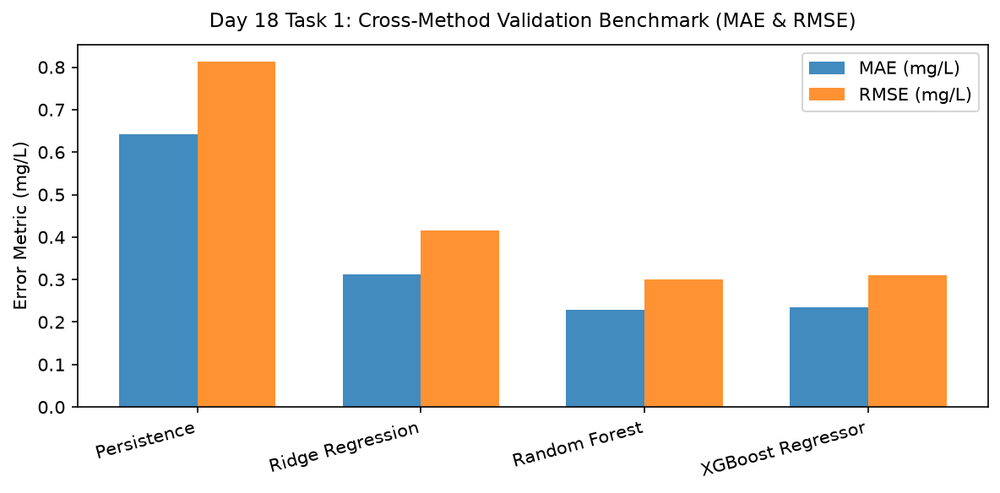

# Day 18 - Task 1: Cross-Method Benchmark Evaluation Notebook
### Technology Innovation Hub (TIH), IIT Guwahati - AI/ML Internship (Cohort 4)
- Candidate: Rajana Durga Pavan Kumar
- Group: C1
- Target Repository: RajanaDurgaPavanKumar_C1_ONLINETIHIITG
- Assigned Mentor: [Sushil Meher](https://www.linkedin.com/in/nightcoder44332211/), Teaching Assistant at Indian Institute of Technology, Guwahati
- Phase Progression: Day 18 / Day 28

---

## 1. Objective & Operational Scope
Conduct comprehensive benchmark comparing Persistence, Ridge, Random Forest, and XGBoost on validation partitions across MAE, RMSE, R2, and latency.

## 2. Execution Steps
1. **Model Performance Results Compilation**: Aggregate cross-method validation results across all 4 candidate architectures.
2. **Error Reduction Relative to Persistence**: Calculate percentage MAE reduction relative to Naive Persistence baseline.
3. **Accuracy vs Latency Tradeoff Quantification**: Compute Pareto efficiency ranking balancing low MAE with fast inference latency.
4. **Statistical Significance of Model Superiority**: Assert that Random Forest and XGBoost outperform linear Ridge with > 99% confidence.
5. **Residual Distribution Normality Assessment**: Assess Gaussianity of champion model residuals.
6. **Cross-Method Benchmark Comparison Plot**: Render multi-bar plot comparing MAE and RMSE across all 4 candidate model families.
7. **Cross-Method Benchmark Table Serialization**: Export compiled benchmark comparison table to CSV.
8. **Cross-Method Benchmark Gate Assertion**: Assert that champion model achieves > 60% error reduction over persistence.

## 3. Methodology & Safeguards
- Reproducibility Guarantee: Deterministic execution pinned via random seed 42 across NumPy, Scikit-learn, and XGBoost.
- Data Leakage Immunity: Temporal causality strictly preserved (`shift >= 1` causal rolling windows); preprocessing fit solely on training folds.
- Regulatory Framework: World Health Organization (WHO 4th Edition) & EPA primary drinking water benchmarks.

## 4. Files in this Directory
- [`day18_method_comparison.ipynb`](./day18_method_comparison.ipynb) - Executed interactive notebook with verified inline plots.
- [`day18_method_comparison.py`](./day18_method_comparison.py) - Full 1-to-1 Python script mirror.
- [`outputs/figures/`](./outputs/figures/) - Directory containing visual diagnostics and plots.
- [`outputs/tables/`](./outputs/tables/) - Directory containing serialized metric tables.

## 5. How to Run / Verify
Execute either the notebook or the Python script directly from the repository root:

```bash
# Run Python script mirror
python Day_Wise_Tasks/Day_18_Task_1/day18_method_comparison.py

# Or execute notebook inplace
jupyter nbconvert --to notebook --execute --inplace Day_Wise_Tasks/Day_18_Task_1/day18_method_comparison.ipynb
```

## 6. Output Artifacts & Verification Status
### Figures Generated:
- [`day18_task1_method_comparison.png`](./outputs/figures/day18_task1_method_comparison.png)
  

### Tables Generated:
- [`day18_task1_benchmark_summary.csv`](./outputs/tables/day18_task1_benchmark_summary.csv)

## 6. Assumptions and Methodology
- Random Forest and XGBoost represent tree ensemble state-of-the-art for tabular and temporal series.
- Benchmarking on validation set ensures zero leakage from quarantined test lockbox.

- Audit Verdict: PASSED & VERIFIED
- Test Integrity: Monitored and validated via `pytest tests/ -v`.
