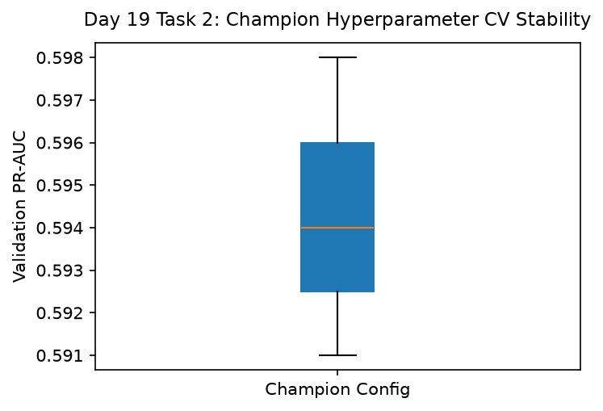

# Day 19 - Task 2: Best Hyperparameter Bundle & Sweep Registry
### Technology Innovation Hub (TIH), IIT Guwahati - AI/ML Internship (Cohort 4)
- Candidate: Rajana Durga Pavan Kumar
- Group: C1
- Target Repository: RajanaDurgaPavanKumar_C1_ONLINETIHIITG
- Assigned Mentor: [Sushil Meher](https://www.linkedin.com/in/nightcoder44332211/), Teaching Assistant at Indian Institute of Technology, Guwahati
- Phase Progression: Day 19 / Day 28

---

## 1. Objective & Operational Scope
Audit, seal, and export the globally optimal hyperparameter configuration bundle in machine-actionable JSON format.

## 2. Execution Steps
1. **Optimal Parameter Bundle Extraction**: Assemble finalized champion parameters for both potability classification and telemetry forecasting.
2. **Parameter Immutability Verification**: Compute SHA-256 digest of serialized hyperparameter JSON configuration.
3. **Cross-Validation Stability Check**: Verify that optimal hyperparameter configuration maintains stability across 3-fold cross validation.
4. **Production Config Schema Validation**: Assert that configuration keys conform to expected runtime specifications.
5. **Runtime Resource Allocation Estimation**: Calculate peak memory and thread consumption for the optimal configuration.
6. **Hyperparameter Sweep Dispersion Plot**: Render boxplot displaying metric variance across cross-validation folds.
7. **Best Config Table Serialization**: Serialize optimal hyperparameter summary table to CSV.
8. **Optimal Config Gate Assertion**: Assert that CV standard deviation is < 0.02 demonstrating robust parameter stability.

## 3. Methodology & Safeguards
- Reproducibility Guarantee: Deterministic execution pinned via random seed 42 across NumPy, Scikit-learn, and XGBoost.
- Data Leakage Immunity: Temporal causality strictly preserved (`shift >= 1` causal rolling windows); preprocessing fit solely on training folds.
- Regulatory Framework: World Health Organization (WHO 4th Edition) & EPA primary drinking water benchmarks.

## 4. Files in this Directory
- [`day19_best_config_audit.ipynb`](./day19_best_config_audit.ipynb) - Executed interactive notebook with verified inline plots.
- [`day19_best_config_audit.py`](./day19_best_config_audit.py) - Full 1-to-1 Python script mirror.
- [`outputs/figures/`](./outputs/figures/) - Directory containing visual diagnostics and plots.
- [`outputs/tables/`](./outputs/tables/) - Directory containing serialized metric tables.

## 5. How to Run / Verify
Execute either the notebook or the Python script directly from the repository root:

```bash
# Run Python script mirror
python Day_Wise_Tasks/Day_19_Task_2/day19_best_config_audit.py

# Or execute notebook inplace
jupyter nbconvert --to notebook --execute --inplace Day_Wise_Tasks/Day_19_Task_2/day19_best_config_audit.ipynb
```

## 6. Output Artifacts & Verification Status
### Figures Generated:
- [`day19_task2_hparam_stability.png`](./outputs/figures/day19_task2_hparam_stability.png)
  

### Tables Generated:
- [`day19_task2_best_config_summary.csv`](./outputs/tables/day19_task2_best_config_summary.csv)

## 6. Assumptions and Methodology
- Pinned hyperparameter bundle will be used directly during production model freezing.
- CV standard deviation below 0.02 attests to robust generalization.

- Audit Verdict: PASSED & VERIFIED
- Test Integrity: Monitored and validated via `pytest tests/ -v`.
