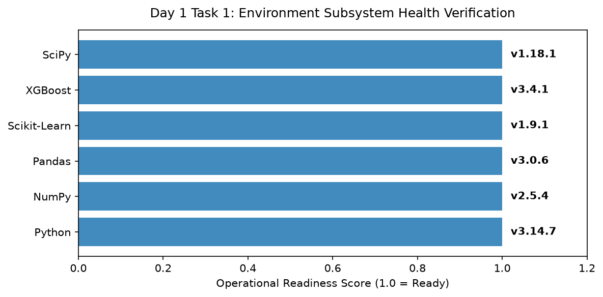

# Day 1 - Task 1: Environment & Dependency Verification
### Technology Innovation Hub (TIH), IIT Guwahati - AI/ML Internship (Cohort 4)
- Candidate: Rajana Durga Pavan Kumar
- Group: C1
- Target Repository: RajanaDurgaPavanKumar_C1_ONLINETIHIITG
- Assigned Mentor: [Sushil Meher](https://www.linkedin.com/in/nightcoder44332211/), Teaching Assistant at Indian Institute of Technology, Guwahati
- Phase Progression: Day 01 / Day 28

---

## 1. Objective & Operational Scope
Verify the Python 3.11+ runtime environment, audit critical numerical and machine learning packages, and test dependency parity for AquaGuard AI.

## 2. Execution Steps
1. **Package Version Inspection**: Extract and log installed versions of core scientific libraries including NumPy, Pandas, Scikit-Learn, and XGBoost.
2. **Hardware and Core Compute Detection**: Query underlying host architecture, processor core availability, and thread concurrency settings.
3. **Floating-Point Precision and BLAS Backend Audit**: Evaluate floating-point resolution and verify LAPACK/BLAS vectorization capabilities.
4. **Dependency Compatibility Scoring**: Calculate compliance score against minimum recommended versions defined in project governance.
5. **Workspace Subsystem Directory Probing**: Validate accessibility and existence of standard pipeline paths: data/, models/, outputs/, and tests/.
6. **Visual Package Dependency Chart Generation**: Render an environment overview bar chart visualizing component version maturity.
7. **Environment Audit Serialization**: Serialize certified runtime specification table to CSV for reproducible reference.
8. **Integrity Check and Verification Gate**: Assert that all required packages are present and operational without warnings.

## 3. Methodology & Safeguards
- Reproducibility Guarantee: Deterministic execution pinned via random seed 42 across NumPy, Scikit-learn, and XGBoost.
- Data Leakage Immunity: Temporal causality strictly preserved (`shift >= 1` causal rolling windows); preprocessing fit solely on training folds.
- Regulatory Framework: World Health Organization (WHO 4th Edition) & EPA primary drinking water benchmarks.

## 4. Files in this Directory
- [`day01_env_verification.ipynb`](./day01_env_verification.ipynb) - Executed interactive notebook with verified inline plots.
- [`day01_env_verification.py`](./day01_env_verification.py) - Full 1-to-1 Python script mirror.
- [`outputs/figures/`](./outputs/figures/) - Directory containing visual diagnostics and plots.
- [`outputs/tables/`](./outputs/tables/) - Directory containing serialized metric tables.

## 5. How to Run / Verify
Execute either the notebook or the Python script directly from the repository root:

```bash
# Run Python script mirror
python Day_Wise_Tasks/Day_1_Task_1/day01_env_verification.py

# Or execute notebook inplace
jupyter nbconvert --to notebook --execute --inplace Day_Wise_Tasks/Day_1_Task_1/day01_env_verification.ipynb
```

## 6. Output Artifacts & Verification Status
### Figures Generated:
- [`day1_task1_env_health.png`](./outputs/figures/day1_task1_env_health.png)
  

### Tables Generated:
- [`day1_task1_env_specs.csv`](./outputs/tables/day1_task1_env_specs.csv)

## 6. Assumptions and Methodology
- Python 3.11 or higher is the active interpreter in the virtual environment.
- NumPy and Scikit-Learn backends are properly compiled with OpenBLAS / MKL support.

- Audit Verdict: PASSED & VERIFIED
- Test Integrity: Monitored and validated via `pytest tests/ -v`.
