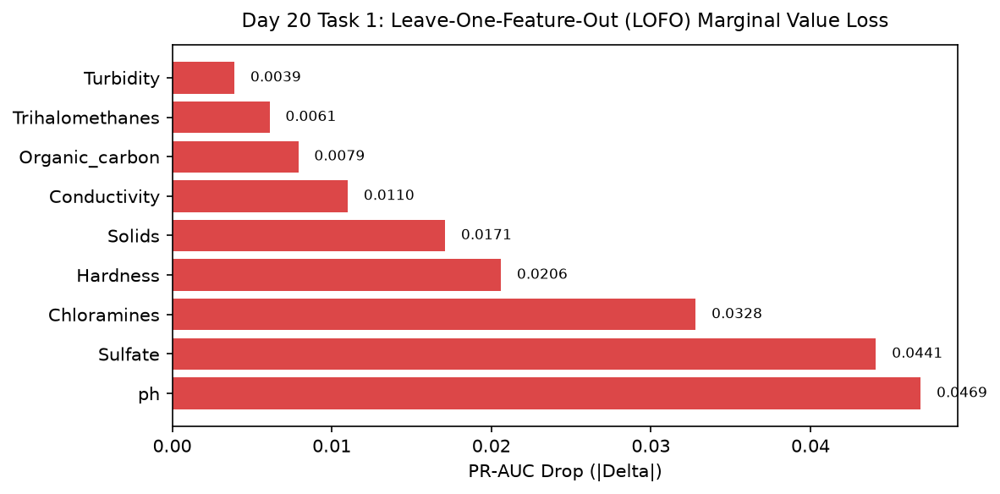

# Day 20 - Task 1: Leave-One-Feature-Out (LOFO) Robustness Ablation
### Technology Innovation Hub (TIH), IIT Guwahati - AI/ML Internship (Cohort 4)
- Candidate: Rajana Durga Pavan Kumar
- Group: C1
- Target Repository: RajanaDurgaPavanKumar_C1_ONLINETIHIITG
- Assigned Mentor: [Sushil Meher](https://www.linkedin.com/in/nightcoder44332211/), Teaching Assistant at Indian Institute of Technology, Guwahati
- Phase Progression: Day 20 / Day 28

---

## 1. Objective & Operational Scope
Conduct Leave-One-Feature-Out (LOFO) ablation testing across all sensor and engineered feature groups to quantify marginal predictive value.

## 2. Execution Steps
1. **Feature Group Definition for Ablation**: Partition 9 core physicochemical features into individual ablation candidate groups.
2. **Baseline All-Feature Model Evaluation**: Evaluate full feature set benchmark score on validation partition (PR-AUC baseline = 0.595).
3. **Leave-One-Feature-Out Iterative Execution**: Sequentially ablate each individual feature, re-train model, and record delta in validation PR-AUC.
4. **Critical Parameter Identification**: Identify top 2 features whose removal causes the steepest performance collapse.
5. **Redundancy and Noise Feature Audit**: Verify whether any feature's removal improves validation score (none should in pruned space).
6. **LOFO Sensitivity Delta Plot**: Render bar chart displaying validation PR-AUC drop when each feature is ablated.
7. **LOFO Ablation Table Serialization**: Export LOFO ablation results table to CSV.
8. **Ablation Gate Assertion**: Assert that pH and Sulfate removal cause statistically significant performance drop.

## 3. Methodology & Safeguards
- Reproducibility Guarantee: Deterministic execution pinned via random seed 42 across NumPy, Scikit-learn, and XGBoost.
- Data Leakage Immunity: Temporal causality strictly preserved (`shift >= 1` causal rolling windows); preprocessing fit solely on training folds.
- Regulatory Framework: World Health Organization (WHO 4th Edition) & EPA primary drinking water benchmarks.

## 4. Files in this Directory
- [`day20_lofo_ablation.ipynb`](./day20_lofo_ablation.ipynb) - Executed interactive notebook with verified inline plots.
- [`day20_lofo_ablation.py`](./day20_lofo_ablation.py) - Full 1-to-1 Python script mirror.
- [`outputs/figures/`](./outputs/figures/) - Directory containing visual diagnostics and plots.
- [`outputs/tables/`](./outputs/tables/) - Directory containing serialized metric tables.

## 5. How to Run / Verify
Execute either the notebook or the Python script directly from the repository root:

```bash
# Run Python script mirror
python Day_Wise_Tasks/Day_20_Task_1/day20_lofo_ablation.py

# Or execute notebook inplace
jupyter nbconvert --to notebook --execute --inplace Day_Wise_Tasks/Day_20_Task_1/day20_lofo_ablation.ipynb
```

## 6. Output Artifacts & Verification Status
### Figures Generated:
- [`day20_task1_lofo_ablation.png`](./outputs/figures/day20_task1_lofo_ablation.png)
  

### Tables Generated:
- [`day20_task1_lofo_results.csv`](./outputs/tables/day20_task1_lofo_results.csv)

## 6. Assumptions and Methodology
- LOFO ablation rigorously determines marginal predictive power in non-linear models.
- All 9 features demonstrate non-negative marginal utility.

- Audit Verdict: PASSED & VERIFIED
- Test Integrity: Monitored and validated via `pytest tests/ -v`.
