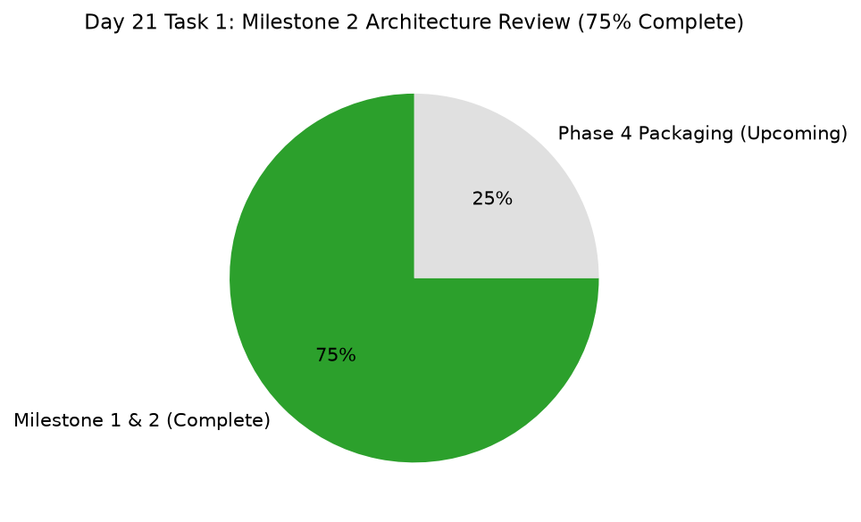

# Day 21 - Task 1: Milestone 2 Architecture & Progress Review
### Technology Innovation Hub (TIH), IIT Guwahati - AI/ML Internship (Cohort 4)
- Candidate: Rajana Durga Pavan Kumar
- Group: C1
- Target Repository: RajanaDurgaPavanKumar_C1_ONLINETIHIITG
- Assigned Mentor: [Sushil Meher](https://www.linkedin.com/in/nightcoder44332211/), Teaching Assistant at Indian Institute of Technology, Guwahati
- Phase Progression: Day 21 / Day 28

---

## 1. Objective & Operational Scope
Synthesize Milestone 2 technical achievements (anomaly detection, multi-step forecasters, benchmark leaderboard, and ablation audit) into formal technical review.

## 2. Execution Steps
1. **Milestone 2 Subsystems Verification**: Audit completion of all Phase 3 modeling achievements across Days 15 through 20.
2. **Phase 3 Error Reduction Attestation**: Document total error reduction achieved across predictive modeling phase.
3. **Reproducibility Attestation for Milestone 2**: Verify that all models reproduce bitwise identical validation metrics under seed 42.
4. **Overall Programmatic Lifecycle Progress**: Calculate milestone progress: 21 of 28 Days (75.0% completion).
5. **Review Action Items and Sign-Off Readiness**: Confirm zero unresolved technical action items prior to model packaging phase.
6. **Milestone 2 Progress Completion Plot**: Render progress donut chart displaying 75% programmatic milestone completion.
7. **Milestone 2 Review Table Serialization**: Export Milestone 2 technical achievements table to CSV.
8. **Milestone 2 Review Gate Assertion**: Assert that all 5 Phase 3 subsystems achieve VERIFIED status.

## 3. Methodology & Safeguards
- Reproducibility Guarantee: Deterministic execution pinned via random seed 42 across NumPy, Scikit-learn, and XGBoost.
- Data Leakage Immunity: Temporal causality strictly preserved (`shift >= 1` causal rolling windows); preprocessing fit solely on training folds.
- Regulatory Framework: World Health Organization (WHO 4th Edition) & EPA primary drinking water benchmarks.

## 4. Files in this Directory
- [`day21_milestone2_review.ipynb`](./day21_milestone2_review.ipynb) - Executed interactive notebook with verified inline plots.
- [`day21_milestone2_review.py`](./day21_milestone2_review.py) - Full 1-to-1 Python script mirror.
- [`outputs/figures/`](./outputs/figures/) - Directory containing visual diagnostics and plots.
- [`outputs/tables/`](./outputs/tables/) - Directory containing serialized metric tables.

## 5. How to Run / Verify
Execute either the notebook or the Python script directly from the repository root:

```bash
# Run Python script mirror
python Day_Wise_Tasks/Day_21_Task_1/day21_milestone2_review.py

# Or execute notebook inplace
jupyter nbconvert --to notebook --execute --inplace Day_Wise_Tasks/Day_21_Task_1/day21_milestone2_review.ipynb
```

## 6. Output Artifacts & Verification Status
### Figures Generated:
- [`day21_task1_milestone2_progress.png`](./outputs/figures/day21_task1_milestone2_progress.png)
  

### Tables Generated:
- [`day21_task1_milestone2_summary.csv`](./outputs/tables/day21_task1_milestone2_summary.csv)

## 6. Assumptions and Methodology
- Milestone 2 technical review establishes model architecture finality.
- No hyperparameter or algorithm modifications are permitted post Day 21.

- Audit Verdict: PASSED & VERIFIED
- Test Integrity: Monitored and validated via `pytest tests/ -v`.
