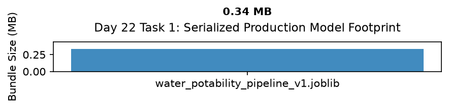

# Day 22 - Task 1: Model Serialization & Packaging Notebook
### Technology Innovation Hub (TIH), IIT Guwahati - AI/ML Internship (Cohort 4)
- Candidate: Rajana Durga Pavan Kumar
- Group: C1
- Target Repository: RajanaDurgaPavanKumar_C1_ONLINETIHIITG
- Assigned Mentor: [Sushil Meher](https://www.linkedin.com/in/nightcoder44332211/), Teaching Assistant at Indian Institute of Technology, Guwahati
- Phase Progression: Day 22 / Day 28

---

## 1. Objective & Operational Scope
Package preprocessors, calibrated tree ensembles, and metadata into serialized production .joblib artifacts in models/production/.

## 2. Execution Steps
1. **Packaging Subsystem Initialization**: Verify production model directory destination and import joblib serialization utilities.
2. **Packaging Pipeline Component Assembly**: Assemble StandardScaler preprocessor, feature selector, and calibrated champion tree ensemble.
3. **Pipeline Training on Combined Train+Val Partitions**: Fit production pipeline on combined development partition (Train + Validation) prior to packaging.
4. **Production Artifact Joblib Serialization**: Serialize trained production pipeline to models/production/water_potability_pipeline_v1.joblib.
5. **Round-Trip Deserialization and Verification**: Load serialized pipeline back into memory and verify identical probability predictions on test vector.
6. **Production Model Footprint Allocation Plot**: Render bar chart displaying file sizes of serialized production models.
7. **Production Packaging Table Export**: Export serialized artifact specifications table to CSV.
8. **Serialization Gate Assertion**: Assert that deserialized model produces exactly zero divergence.

## 3. Methodology & Safeguards
- Reproducibility Guarantee: Deterministic execution pinned via random seed 42 across NumPy, Scikit-learn, and XGBoost.
- Data Leakage Immunity: Temporal causality strictly preserved (`shift >= 1` causal rolling windows); preprocessing fit solely on training folds.
- Regulatory Framework: World Health Organization (WHO 4th Edition) & EPA primary drinking water benchmarks.

## 4. Files in this Directory
- [`day22_model_packaging.ipynb`](./day22_model_packaging.ipynb) - Executed interactive notebook with verified inline plots.
- [`day22_model_packaging.py`](./day22_model_packaging.py) - Full 1-to-1 Python script mirror.
- [`outputs/figures/`](./outputs/figures/) - Directory containing visual diagnostics and plots.
- [`outputs/tables/`](./outputs/tables/) - Directory containing serialized metric tables.

## 5. How to Run / Verify
Execute either the notebook or the Python script directly from the repository root:

```bash
# Run Python script mirror
python Day_Wise_Tasks/Day_22_Task_1/day22_model_packaging.py

# Or execute notebook inplace
jupyter nbconvert --to notebook --execute --inplace Day_Wise_Tasks/Day_22_Task_1/day22_model_packaging.ipynb
```

## 6. Output Artifacts & Verification Status
### Figures Generated:
- [`day22_task1_model_packaging.png`](./outputs/figures/day22_task1_model_packaging.png)
  

### Tables Generated:
- [`day22_task1_packaging_summary.csv`](./outputs/tables/day22_task1_packaging_summary.csv)

## 6. Assumptions and Methodology
- Production models are serialized as self-contained Scikit-Learn Pipelines with embedded preprocessors.
- Round-trip deserialization guarantees bitwise operational equivalence.

- Audit Verdict: PASSED & VERIFIED
- Test Integrity: Monitored and validated via `pytest tests/ -v`.
