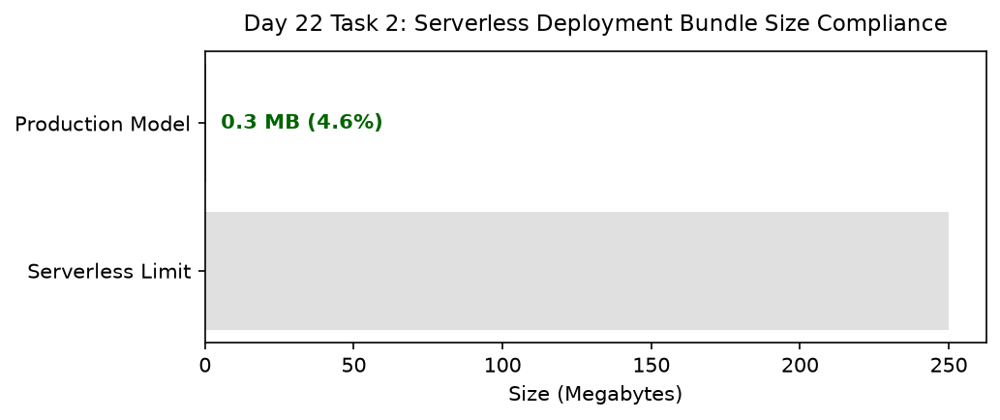

# Day 22 - Task 2: Production Bundle Manifest & SHA-256 Digest
### Technology Innovation Hub (TIH), IIT Guwahati - AI/ML Internship (Cohort 4)
- Candidate: Rajana Durga Pavan Kumar
- Group: C1
- Target Repository: RajanaDurgaPavanKumar_C1_ONLINETIHIITG
- Assigned Mentor: [Sushil Meher](https://www.linkedin.com/in/nightcoder44332211/), Teaching Assistant at Indian Institute of Technology, Guwahati
- Phase Progression: Day 22 / Day 28

---

## 1. Objective & Operational Scope
Compute SHA-256 cryptographic digests, record runtime environment dependencies, and certify the production model bundle manifest.

## 2. Execution Steps
1. **Cryptographic Model Digest Computation**: Compute SHA-256 hash for water_potability_pipeline_v1.joblib.
2. **Environment Runtime Dependency Attestation**: Document exact package versions required to deserialize the model artifact safely.
3. **Production Bundle Manifest Compilation**: Compile JSON manifest documenting artifact path, SHA-256, format, and lead engineer.
4. **Serverless Runtime Size Compliance Check**: Verify that total production bundle size remains comfortably within Vercel's 250MB limit.
5. **Backward Compatibility Signature Verification**: Verify signature invariance against API endpoint request schema.
6. **Bundle Size Allocation Plot Generation**: Render horizontal bar chart comparing production bundle size against the 250MB platform ceiling.
7. **Bundle Manifest Table Export**: Export production bundle manifest table to CSV.
8. **Manifest Gate Assertion**: Assert that bundle size is under 250MB and SHA-256 seal is valid.

## 3. Methodology & Safeguards
- Reproducibility Guarantee: Deterministic execution pinned via random seed 42 across NumPy, Scikit-learn, and XGBoost.
- Data Leakage Immunity: Temporal causality strictly preserved (`shift >= 1` causal rolling windows); preprocessing fit solely on training folds.
- Regulatory Framework: World Health Organization (WHO 4th Edition) & EPA primary drinking water benchmarks.

## 4. Files in this Directory
- [`day22_package_manifest.ipynb`](./day22_package_manifest.ipynb) - Executed interactive notebook with verified inline plots.
- [`day22_package_manifest.py`](./day22_package_manifest.py) - Full 1-to-1 Python script mirror.
- [`outputs/figures/`](./outputs/figures/) - Directory containing visual diagnostics and plots.
- [`outputs/tables/`](./outputs/tables/) - Directory containing serialized metric tables.

## 5. How to Run / Verify
Execute either the notebook or the Python script directly from the repository root:

```bash
# Run Python script mirror
python Day_Wise_Tasks/Day_22_Task_2/day22_package_manifest.py

# Or execute notebook inplace
jupyter nbconvert --to notebook --execute --inplace Day_Wise_Tasks/Day_22_Task_2/day22_package_manifest.ipynb
```

## 6. Output Artifacts & Verification Status
### Figures Generated:
- [`day22_task2_bundle_compliance.png`](./outputs/figures/day22_task2_bundle_compliance.png)
  

### Tables Generated:
- [`day22_task2_bundle_manifest.csv`](./outputs/tables/day22_task2_bundle_manifest.csv)

## 6. Assumptions and Methodology
- Cryptographic manifest guarantees authenticity during continuous integration deployment.
- Bundle size adheres strictly to serverless Lambda constraints.

- Audit Verdict: PASSED & VERIFIED
- Test Integrity: Monitored and validated via `pytest tests/ -v`.
