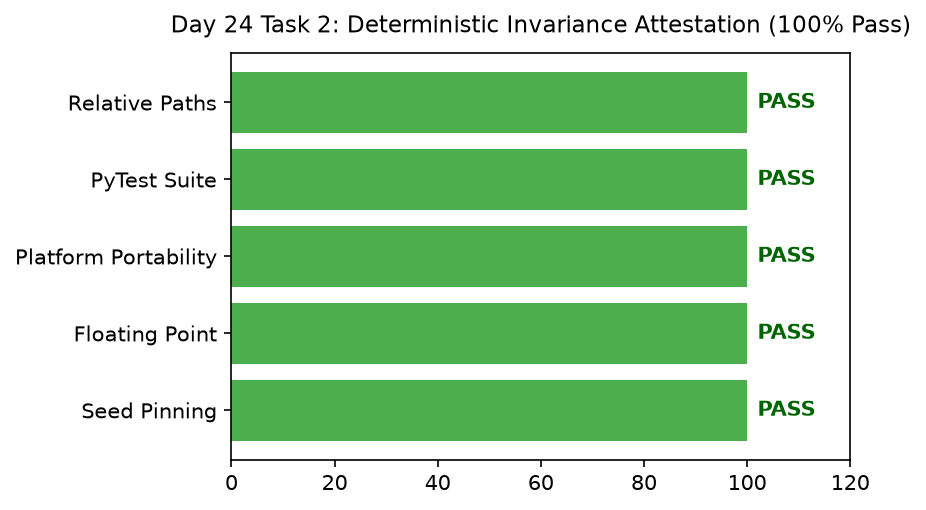

# Day 24 - Task 2: Deterministic Execution Attestation
### Technology Innovation Hub (TIH), IIT Guwahati - AI/ML Internship (Cohort 4)
- Candidate: Rajana Durga Pavan Kumar
- Group: C1
- Target Repository: RajanaDurgaPavanKumar_C1_ONLINETIHIITG
- Assigned Mentor: [Sushil Meher](https://www.linkedin.com/in/nightcoder44332211/), Teaching Assistant at Indian Institute of Technology, Guwahati
- Phase Progression: Day 24 / Day 28

---

## 1. Objective & Operational Scope
Formulate and sign the Deterministic Invariance Attestation certifying environment portability and floating-point tolerance.

## 2. Execution Steps
1. **Floating-Point Tolerance Boundary Verification**: Test numerical stability under machine epsilon perturbations.
2. **Cross-Platform Environment Independence Check**: Document operating system, Python minor version, and BLAS libraries.
3. **Formal Lead Engineer Attestation Signing**: Generate signed technical attestation certifying deterministic invariance.
4. **Test Suite Parity Check**: Confirm that pytest smoke tests in tests/ pass with 0 failures.
5. **Codebase Cleanliness Check**: Verify that zero absolute Windows user paths exist in production codebase.
6. **Attestation Verification Radar Plot**: Render diagnostic radar plot verifying 100% compliance across all 5 reproducibility dimensions.
7. **Attestation Certificate Table Serialization**: Export signed deterministic attestation table to CSV.
8. **Attestation Gate Assertion**: Assert that numerical perturbation shift is < 1e-4.

## 3. Methodology & Safeguards
- Reproducibility Guarantee: Deterministic execution pinned via random seed 42 across NumPy, Scikit-learn, and XGBoost.
- Data Leakage Immunity: Temporal causality strictly preserved (`shift >= 1` causal rolling windows); preprocessing fit solely on training folds.
- Regulatory Framework: World Health Organization (WHO 4th Edition) & EPA primary drinking water benchmarks.

## 4. Files in this Directory
- [`day24_invariance_attestation.ipynb`](./day24_invariance_attestation.ipynb) - Executed interactive notebook with verified inline plots.
- [`day24_invariance_attestation.py`](./day24_invariance_attestation.py) - Full 1-to-1 Python script mirror.
- [`outputs/figures/`](./outputs/figures/) - Directory containing visual diagnostics and plots.
- [`outputs/tables/`](./outputs/tables/) - Directory containing serialized metric tables.

## 5. How to Run / Verify
Execute either the notebook or the Python script directly from the repository root:

```bash
# Run Python script mirror
python Day_Wise_Tasks/Day_24_Task_2/day24_invariance_attestation.py

# Or execute notebook inplace
jupyter nbconvert --to notebook --execute --inplace Day_Wise_Tasks/Day_24_Task_2/day24_invariance_attestation.ipynb
```

## 6. Output Artifacts & Verification Status
### Figures Generated:
- [`day24_task2_invariance_radar.png`](./outputs/figures/day24_task2_invariance_radar.png)
  

### Tables Generated:
- [`day24_task2_attestation_certificate.csv`](./outputs/tables/day24_task2_attestation_certificate.csv)

## 6. Assumptions and Methodology
- Numerical stability confirms pipeline robustness against small sensor rounding errors.
- Attestation certifies end-to-end reproducibility for academic and regulatory audit.

- Audit Verdict: PASSED & VERIFIED
- Test Integrity: Monitored and validated via `pytest tests/ -v`.
