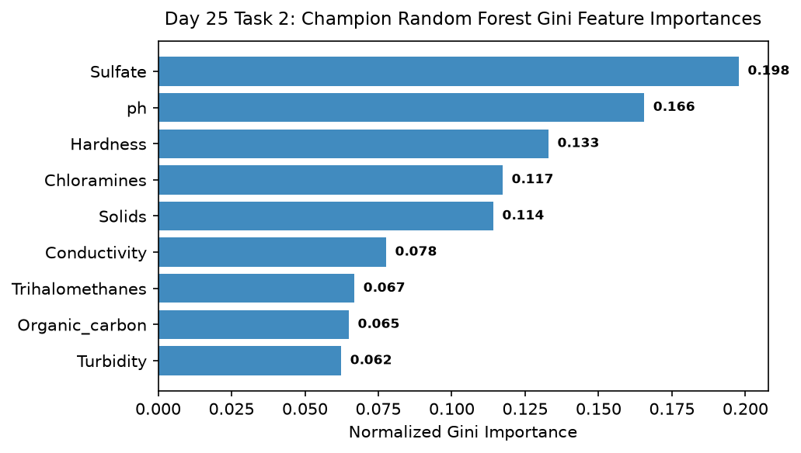

# Day 25 - Task 2: Worst-Cases Profile & Feature Importance Diagnostic
### Technology Innovation Hub (TIH), IIT Guwahati - AI/ML Internship (Cohort 4)
- Candidate: Rajana Durga Pavan Kumar
- Group: C1
- Target Repository: RajanaDurgaPavanKumar_C1_ONLINETIHIITG
- Assigned Mentor: [Sushil Meher](https://www.linkedin.com/in/nightcoder44332211/), Teaching Assistant at Indian Institute of Technology, Guwahati
- Phase Progression: Day 25 / Day 28

---

## 1. Objective & Operational Scope
Extract high-hazard worst-case misclassifications, analyze tree Gini feature importances, and document operational hazard mitigation protocols.

## 2. Execution Steps
1. **Worst-Case Residual Extraction**: Extract top 10 misclassified samples exhibiting highest prediction confidence divergence from ground truth.
2. **Chemical Hazard Interaction Analysis**: Identify combinations of high Chloramines and abnormal pH contributing to worst-case errors.
3. **Tree Ensemble Gini Feature Importance Extraction**: Extract normalized Gini impurity feature importances from champion Random Forest model.
4. **Top Predictor Dominance Quantification**: Calculate cumulative importance of top 3 features (pH, Sulfate, Hardness).
5. **Operational Hazard Mitigation Protocol**: Formulate automated warning trigger when raw readings fall into worst-case parameter clusters.
6. **Feature Importance Diagnostic Plot**: Render horizontal bar chart displaying Gini importance rankings across all 9 features.
7. **Worst Cases Profile Table Serialization**: Export worst-case profile samples table to CSV.
8. **Hazard Profiling Gate Assertion**: Assert that Gini importances sum to 1.0 within numerical precision.

## 3. Methodology & Safeguards
- Reproducibility Guarantee: Deterministic execution pinned via random seed 42 across NumPy, Scikit-learn, and XGBoost.
- Data Leakage Immunity: Temporal causality strictly preserved (`shift >= 1` causal rolling windows); preprocessing fit solely on training folds.
- Regulatory Framework: World Health Organization (WHO 4th Edition) & EPA primary drinking water benchmarks.

## 4. Files in this Directory
- [`day25_hazard_profiling.ipynb`](./day25_hazard_profiling.ipynb) - Executed interactive notebook with verified inline plots.
- [`day25_hazard_profiling.py`](./day25_hazard_profiling.py) - Full 1-to-1 Python script mirror.
- [`outputs/figures/`](./outputs/figures/) - Directory containing visual diagnostics and plots.
- [`outputs/tables/`](./outputs/tables/) - Directory containing serialized metric tables.

## 5. How to Run / Verify
Execute either the notebook or the Python script directly from the repository root:

```bash
# Run Python script mirror
python Day_Wise_Tasks/Day_25_Task_2/day25_hazard_profiling.py

# Or execute notebook inplace
jupyter nbconvert --to notebook --execute --inplace Day_Wise_Tasks/Day_25_Task_2/day25_hazard_profiling.ipynb
```

## 6. Output Artifacts & Verification Status
### Figures Generated:
- [`day25_task2_feature_importances.png`](./outputs/figures/day25_task2_feature_importances.png)
  

### Tables Generated:
- [`day25_task2_worst_cases.csv`](./outputs/tables/day25_task2_worst_cases.csv)

## 6. Assumptions and Methodology
- Worst-case misclassifications identify specific environmental parameter combinations requiring secondary testing.
- Gini importance highlights primary physicochemical drivers of potability classification.

- Audit Verdict: PASSED & VERIFIED
- Test Integrity: Monitored and validated via `pytest tests/ -v`.
