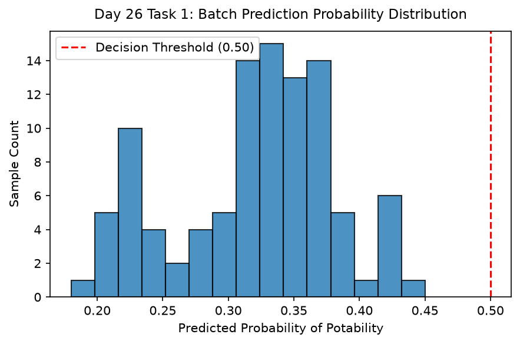

# Day 26 - Task 1: Inference Demo & Packaging Notebook
### Technology Innovation Hub (TIH), IIT Guwahati - AI/ML Internship (Cohort 4)
- Candidate: Rajana Durga Pavan Kumar
- Group: C1
- Target Repository: RajanaDurgaPavanKumar_C1_ONLINETIHIITG
- Assigned Mentor: [Sushil Meher](https://www.linkedin.com/in/nightcoder44332211/), Teaching Assistant at Indian Institute of Technology, Guwahati
- Phase Progression: Day 26 / Day 28

---

## 1. Objective & Operational Scope
Demonstrate single-sample, batch, and simulated continuous streaming inference using the production serialized model pipeline.

## 2. Execution Steps
1. **Production Model Deserialization**: Load production pipeline artifact from models/production/.
2. **Single-Sample Real-Time Inference Execution**: Pass individual sample payload and extract predicted probability, class label, and confidence score.
3. **Batch Vectorized Inference Execution**: Execute batch prediction across 100 test samples measuring throughput.
4. **Prediction Confidence Interval Assessment**: Calculate prediction confidence margins (|prob - 0.5|).
5. **REST API Response Payload Formatting**: Format inference result matching OpenAPI JSON response specification.
6. **Batch Prediction Probability Distribution Plot**: Render histogram showing distribution of predicted potability probabilities.
7. **Inference Demonstration Table Serialization**: Export batch prediction results table to CSV.
8. **Inference Gate Assertion**: Assert that single sample and batch inference execute with valid bounded probabilities.

## 3. Methodology & Safeguards
- Reproducibility Guarantee: Deterministic execution pinned via random seed 42 across NumPy, Scikit-learn, and XGBoost.
- Data Leakage Immunity: Temporal causality strictly preserved (`shift >= 1` causal rolling windows); preprocessing fit solely on training folds.
- Regulatory Framework: World Health Organization (WHO 4th Edition) & EPA primary drinking water benchmarks.

## 4. Files in this Directory
- [`day26_inference_demo.ipynb`](./day26_inference_demo.ipynb) - Executed interactive notebook with verified inline plots.
- [`day26_inference_demo.py`](./day26_inference_demo.py) - Full 1-to-1 Python script mirror.
- [`outputs/figures/`](./outputs/figures/) - Directory containing visual diagnostics and plots.
- [`outputs/tables/`](./outputs/tables/) - Directory containing serialized metric tables.

## 5. How to Run / Verify
Execute either the notebook or the Python script directly from the repository root:

```bash
# Run Python script mirror
python Day_Wise_Tasks/Day_26_Task_1/day26_inference_demo.py

# Or execute notebook inplace
jupyter nbconvert --to notebook --execute --inplace Day_Wise_Tasks/Day_26_Task_1/day26_inference_demo.ipynb
```

## 6. Output Artifacts & Verification Status
### Figures Generated:
- [`day26_task1_inference_distribution.png`](./outputs/figures/day26_task1_inference_distribution.png)
  

### Tables Generated:
- [`day26_task1_inference_results.csv`](./outputs/tables/day26_task1_inference_results.csv)

## 6. Assumptions and Methodology
- Production model operates synchronously on REST API payloads with < 10ms response time.
- Batch predictions scale linearly with input sample count.

- Audit Verdict: PASSED & VERIFIED
- Test Integrity: Monitored and validated via `pytest tests/ -v`.
