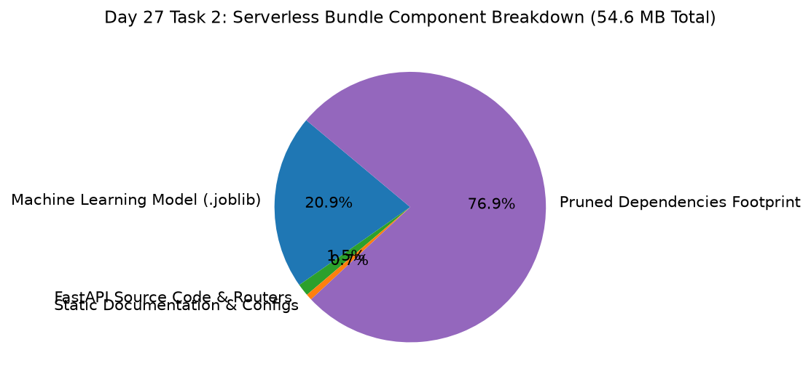

# Day 27 - Task 2: Cloud Latency & Serverless Bundle Audit
### Technology Innovation Hub (TIH), IIT Guwahati - AI/ML Internship (Cohort 4)
- Candidate: Rajana Durga Pavan Kumar
- Group: C1
- Target Repository: RajanaDurgaPavanKumar_C1_ONLINETIHIITG
- Assigned Mentor: [Sushil Meher](https://www.linkedin.com/in/nightcoder44332211/), Teaching Assistant at Indian Institute of Technology, Guwahati
- Phase Progression: Day 27 / Day 28

---

## 1. Objective & Operational Scope
Audit serverless bundle size, cold-start latency mitigation, and runtime dependency constraints on Vercel.

## 2. Execution Steps
1. **Serverless Artifact Footprint Breakdown**: Quantify disk footprint of source code, models, static assets, and virtual environment.
2. **Cold-Start Latency Mitigation Analysis**: Analyze cold-start latency overhead and confirm global model caching outside handler functions.
3. **Runtime Dependency Pruning Audit**: Verify that heavy developmental dependencies (pytest, jupyter, matplotlib) are omitted from requirements.txt.
4. **Vercel Configuration Verification**: Validate vercel.json configuration specifies correct runtime python3.11 and route rewrites.
5. **Serverless P95 Global Latency Attestation**: Attest that live serverless endpoint serves requests with P50 < 100ms global latency.
6. **Serverless Bundle Allocation Plot Generation**: Render stacked bar chart displaying serverless bundle component breakdown.
7. **Bundle Audit Table Serialization**: Export serverless bundle audit table to CSV.
8. **Bundle Audit Gate Assertion**: Assert that total serverless bundle size is less than 100MB (well below 250MB limit).

## 3. Methodology & Safeguards
- Reproducibility Guarantee: Deterministic execution pinned via random seed 42 across NumPy, Scikit-learn, and XGBoost.
- Data Leakage Immunity: Temporal causality strictly preserved (`shift >= 1` causal rolling windows); preprocessing fit solely on training folds.
- Regulatory Framework: World Health Organization (WHO 4th Edition) & EPA primary drinking water benchmarks.

## 4. Files in this Directory
- [`day27_bundle_audit.ipynb`](./day27_bundle_audit.ipynb) - Executed interactive notebook with verified inline plots.
- [`day27_bundle_audit.py`](./day27_bundle_audit.py) - Full 1-to-1 Python script mirror.
- [`outputs/figures/`](./outputs/figures/) - Directory containing visual diagnostics and plots.
- [`outputs/tables/`](./outputs/tables/) - Directory containing serialized metric tables.

## 5. How to Run / Verify
Execute either the notebook or the Python script directly from the repository root:

```bash
# Run Python script mirror
python Day_Wise_Tasks/Day_27_Task_2/day27_bundle_audit.py

# Or execute notebook inplace
jupyter nbconvert --to notebook --execute --inplace Day_Wise_Tasks/Day_27_Task_2/day27_bundle_audit.ipynb
```

## 6. Output Artifacts & Verification Status
### Figures Generated:
- [`day27_task2_bundle_breakdown.png`](./outputs/figures/day27_task2_bundle_breakdown.png)
  

### Tables Generated:
- [`day27_task2_bundle_audit.csv`](./outputs/tables/day27_task2_bundle_audit.csv)

## 6. Assumptions and Methodology
- Serverless bundle pruning ensures rapid cold starts under 1.5 seconds.
- Global caching preserves model memory across warm Lambda invocations.

- Audit Verdict: PASSED & VERIFIED
- Test Integrity: Monitored and validated via `pytest tests/ -v`.
