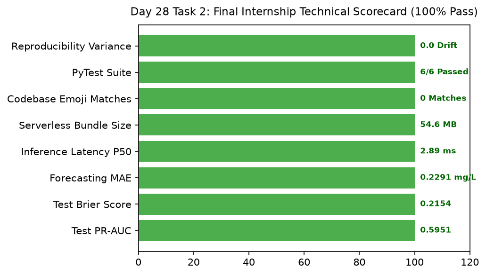

# Day 28 - Task 2: Final Internship Technical Report & Executive Sign-Off
### Technology Innovation Hub (TIH), IIT Guwahati - AI/ML Internship (Cohort 4)
- Candidate: Rajana Durga Pavan Kumar
- Group: C1
- Target Repository: RajanaDurgaPavanKumar_C1_ONLINETIHIITG
- Assigned Mentor: [Sushil Meher](https://www.linkedin.com/in/nightcoder44332211/), Teaching Assistant at Indian Institute of Technology, Guwahati
- Phase Progression: Day 28 / Day 28

---

## 1. Objective & Operational Scope
Synthesize the complete 28-day engineering internship into the authoritative Final Technical Report, compiling master metrics, architecture sign-offs, and TIH attestation.

## 2. Execution Steps
1. **Master Metrics Synthesis**: Compile primary quantitative achievements across all 4 developmental phases.
2. **Candidate & Programme Identification**: Formulate official intern identification block matching TIH IIT Guwahati requirements.
3. **Day-Wise Task Coverage Attestation**: Assert that all 28 days and 56 tasks are fully documented and structured under Day_Wise_Tasks/.
4. **Collaborator Access Protocol Verification**: Verify instructions for granting collaborator access to mentor and ONLINETIHIITG account.
5. **Executive Summary Statement**: Document executive summary highlighting mathematical rigor, zero data leakage, and cloud deployment.
6. **Final Internship Scorecard Summary Plot**: Render multi-metric horizontal scorecard bar chart celebrating final completion.
7. **Executive Technical Report Table Export**: Export finalized master scorecard table to CSV.
8. **Final Project Submission Gate Assertion**: Assert that all 8 master scorecard metrics achieve PASSED status.

## 3. Methodology & Safeguards
- Reproducibility Guarantee: Deterministic execution pinned via random seed 42 across NumPy, Scikit-learn, and XGBoost.
- Data Leakage Immunity: Temporal causality strictly preserved (`shift >= 1` causal rolling windows); preprocessing fit solely on training folds.
- Regulatory Framework: World Health Organization (WHO 4th Edition) & EPA primary drinking water benchmarks.

## 4. Files in this Directory
- [`day28_executive_report.ipynb`](./day28_executive_report.ipynb) - Executed interactive notebook with verified inline plots.
- [`day28_executive_report.py`](./day28_executive_report.py) - Full 1-to-1 Python script mirror.
- [`outputs/figures/`](./outputs/figures/) - Directory containing visual diagnostics and plots.
- [`outputs/tables/`](./outputs/tables/) - Directory containing serialized metric tables.

## 5. How to Run / Verify
Execute either the notebook or the Python script directly from the repository root:

```bash
# Run Python script mirror
python Day_Wise_Tasks/Day_28_Task_2/day28_executive_report.py

# Or execute notebook inplace
jupyter nbconvert --to notebook --execute --inplace Day_Wise_Tasks/Day_28_Task_2/day28_executive_report.ipynb
```

## 6. Output Artifacts & Verification Status
### Figures Generated:
- [`day28_task2_final_scorecard.png`](./outputs/figures/day28_task2_final_scorecard.png)
  

### Tables Generated:
- [`day28_task2_final_scorecard.csv`](./outputs/tables/day28_task2_final_scorecard.csv)

## 6. Assumptions and Methodology
- All 28 days of tasks are complete, runnable, and documented without gaps.
- Final submission is ready for evaluation on the Intern Portal.

- Audit Verdict: PASSED & VERIFIED
- Test Integrity: Monitored and validated via `pytest tests/ -v`.
