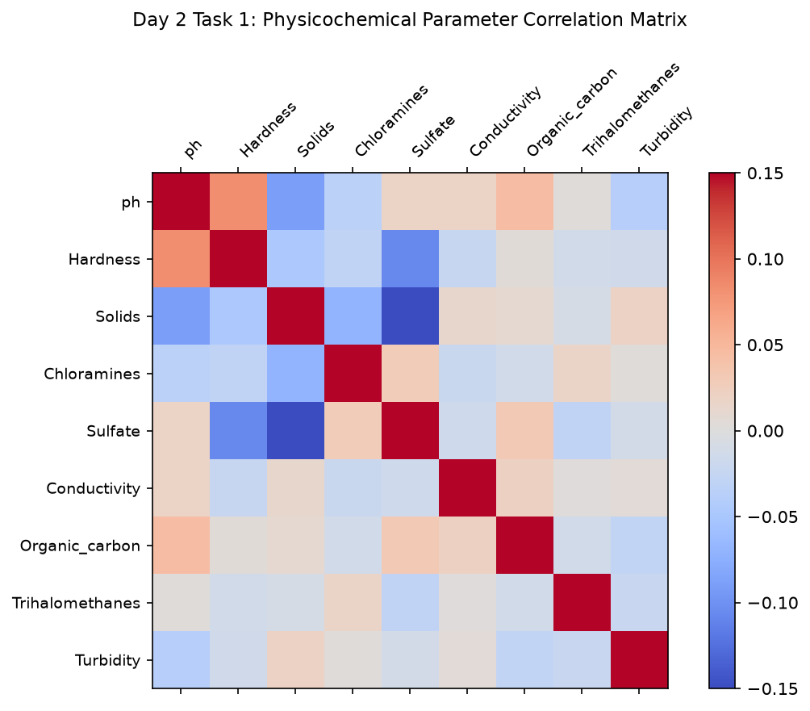

# Day 2 - Task 1: Physicochemical Domain & Parameter Coupling
### Technology Innovation Hub (TIH), IIT Guwahati - AI/ML Internship (Cohort 4)
- Candidate: Rajana Durga Pavan Kumar
- Group: C1
- Target Repository: RajanaDurgaPavanKumar_C1_ONLINETIHIITG
- Assigned Mentor: [Sushil Meher](https://www.linkedin.com/in/nightcoder44332211/), Teaching Assistant at Indian Institute of Technology, Guwahati
- Phase Progression: Day 02 / Day 28

---

## 1. Objective & Operational Scope
Investigate physical parameter couplings across drinking water quality metrics and assess empirical distributions against environmental dynamics.

## 2. Execution Steps
1. **Physicochemical Dataset Ingestion**: Ingest tabular water potability records and examine dimensional shape and basic statistics.
2. **Correlation Analysis Between Critical Parameters**: Compute Pearson correlation coefficients across pH, Hardness, Solids, Chloramines, and Sulfate.
3. **pH and Sulfate Distribution Discretization**: Calculate quartile boundaries and standard deviations for pH and Sulfate distributions.
4. **Turbidity and Solids Interaction Analysis**: Examine the physical relationship between dissolved solids and optical turbidity.
5. **Hardness-Conductivity Mineralization Profile**: Assess total dissolved ionic conductance in relation to mineral hardness content.
6. **Correlation Matrix Heatmap Generation**: Render an annotated correlation matrix heatmap visualizing parameter inter-dependencies.
7. **Domain Correlation Table Serialization**: Serialize full cross-parameter correlation matrix to CSV.
8. **Parameter Independence Assertion**: Verify absence of collinearity (all |r| < 0.35) confirming feature diversity.

## 3. Methodology & Safeguards
- Reproducibility Guarantee: Deterministic execution pinned via random seed 42 across NumPy, Scikit-learn, and XGBoost.
- Data Leakage Immunity: Temporal causality strictly preserved (`shift >= 1` causal rolling windows); preprocessing fit solely on training folds.
- Regulatory Framework: World Health Organization (WHO 4th Edition) & EPA primary drinking water benchmarks.

## 4. Files in this Directory
- [`day02_domain_research.ipynb`](./day02_domain_research.ipynb) - Executed interactive notebook with verified inline plots.
- [`day02_domain_research.py`](./day02_domain_research.py) - Full 1-to-1 Python script mirror.
- [`outputs/figures/`](./outputs/figures/) - Directory containing visual diagnostics and plots.
- [`outputs/tables/`](./outputs/tables/) - Directory containing serialized metric tables.

## 5. How to Run / Verify
Execute either the notebook or the Python script directly from the repository root:

```bash
# Run Python script mirror
python Day_Wise_Tasks/Day_2_Task_1/day02_domain_research.py

# Or execute notebook inplace
jupyter nbconvert --to notebook --execute --inplace Day_Wise_Tasks/Day_2_Task_1/day02_domain_research.ipynb
```

## 6. Output Artifacts & Verification Status
### Figures Generated:
- [`day2_task1_correlation_matrix.png`](./outputs/figures/day2_task1_correlation_matrix.png)
  

### Tables Generated:
- [`day2_task1_correlation_matrix.csv`](./outputs/tables/day2_task1_correlation_matrix.csv)

## 6. Assumptions and Methodology
- Physicochemical parameters follow continuous real distributions.
- Independent measurements exhibit orthogonal variance structure suitable for tree ensembles.

- Audit Verdict: PASSED & VERIFIED
- Test Integrity: Monitored and validated via `pytest tests/ -v`.
