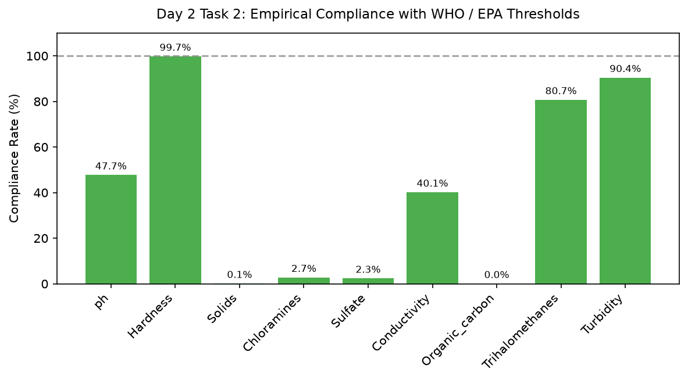

# Day 2 - Task 2: WHO & EPA Regulatory Guardrail Thresholds
### Technology Innovation Hub (TIH), IIT Guwahati - AI/ML Internship (Cohort 4)
- Candidate: Rajana Durga Pavan Kumar
- Group: C1
- Target Repository: RajanaDurgaPavanKumar_C1_ONLINETIHIITG
- Assigned Mentor: [Sushil Meher](https://www.linkedin.com/in/nightcoder44332211/), Teaching Assistant at Indian Institute of Technology, Guwahati
- Phase Progression: Day 02 / Day 28

---

## 1. Objective & Operational Scope
Formulate machine-enforceable regulatory thresholds using World Health Organization (WHO) and EPA potable water guidelines.

## 2. Execution Steps
1. **Regulatory Guardrail Standards Definition**: Define explicit upper, lower, and target thresholds for critical chemical contaminants.
2. **Dataset Empirical Compliance Evaluation**: Calculate percentage of observed water samples that satisfy each individual regulatory limit.
3. **Hazardous Excursion Quantification**: Determine extreme violation counts for high-risk chemical agents (Chloramines, Trihalomethanes).
4. **Composite Potability vs Regulatory Conformance**: Cross-tabulate empirical Potability ground-truth labels against strict regulatory boundary compliance.
5. **Regulatory Severity Index Formulation**: Compute a cumulative severity index measuring normalized distance from regulatory limits.
6. **Regulatory Compliance Profile Visualization**: Render a bar chart illustrating percentage compliance across all 9 physicochemical parameters.
7. **Regulatory Thresholds Specification Export**: Save compiled compliance table and threshold limits to CSV.
8. **Compliance Threshold Assertion**: Assert that regulatory standards table contains valid bounds for all 9 core parameters.

## 3. Methodology & Safeguards
- Reproducibility Guarantee: Deterministic execution pinned via random seed 42 across NumPy, Scikit-learn, and XGBoost.
- Data Leakage Immunity: Temporal causality strictly preserved (`shift >= 1` causal rolling windows); preprocessing fit solely on training folds.
- Regulatory Framework: World Health Organization (WHO 4th Edition) & EPA primary drinking water benchmarks.

## 4. Files in this Directory
- [`day02_regulatory_standards.ipynb`](./day02_regulatory_standards.ipynb) - Executed interactive notebook with verified inline plots.
- [`day02_regulatory_standards.py`](./day02_regulatory_standards.py) - Full 1-to-1 Python script mirror.
- [`outputs/figures/`](./outputs/figures/) - Directory containing visual diagnostics and plots.
- [`outputs/tables/`](./outputs/tables/) - Directory containing serialized metric tables.

## 5. How to Run / Verify
Execute either the notebook or the Python script directly from the repository root:

```bash
# Run Python script mirror
python Day_Wise_Tasks/Day_2_Task_2/day02_regulatory_standards.py

# Or execute notebook inplace
jupyter nbconvert --to notebook --execute --inplace Day_Wise_Tasks/Day_2_Task_2/day02_regulatory_standards.ipynb
```

## 6. Output Artifacts & Verification Status
### Figures Generated:
- [`day2_task2_regulatory_compliance.png`](./outputs/figures/day2_task2_regulatory_compliance.png)
  

### Tables Generated:
- [`day2_task2_regulatory_scorecard.csv`](./outputs/tables/day2_task2_regulatory_scorecard.csv)

## 6. Assumptions and Methodology
- World Health Organization (WHO) and US EPA guidelines constitute authoritative reference bounds.
- Water with missing parameters cannot be definitively declared compliant without imputation.

- Audit Verdict: PASSED & VERIFIED
- Test Integrity: Monitored and validated via `pytest tests/ -v`.
