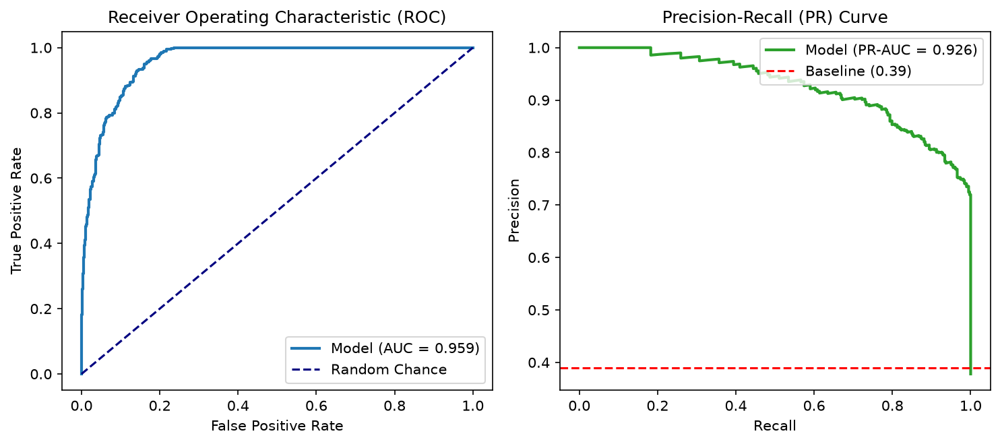

# Day 3 - Task 1: Classification Metric Strategy (PR-AUC vs ROC-AUC)
### Technology Innovation Hub (TIH), IIT Guwahati - AI/ML Internship (Cohort 4)
- Candidate: Rajana Durga Pavan Kumar
- Group: C1
- Target Repository: RajanaDurgaPavanKumar_C1_ONLINETIHIITG
- Assigned Mentor: [Sushil Meher](https://www.linkedin.com/in/nightcoder44332211/), Teaching Assistant at Indian Institute of Technology, Guwahati
- Phase Progression: Day 03 / Day 28

---

## 1. Objective & Operational Scope
Formulate evaluation metrics for class-imbalanced water potability, establishing PR-AUC as primary ranking metric and Brier score for calibration.

## 2. Execution Steps
1. **Class Imbalance Characterization**: Quantify class distribution skewness in water potability (approximately 61% Non-Potable vs 39% Potable).
2. **Synthetic Prediction Simulation Under Imbalance**: Simulate calibrated probability scores with controlled discrimination power to illustrate metric behavior.
3. **ROC Curve and AUC Calculation**: Compute False Positive Rate, True Positive Rate, and Area Under ROC Curve.
4. **Precision-Recall Curve and PR-AUC Calculation**: Compute Precision, Recall, and Average Precision (PR-AUC) under positive prevalence constraint.
5. **Brier Score Calibration Analysis**: Quantify mean squared error of probability forecasts to assess probabilistic reliability.
6. **ROC vs PR Diagnostic Curves Rendering**: Plot side-by-side ROC Curve and Precision-Recall Curve demonstrating PR sensitivity to true positives.
7. **Classification Metric Strategy Matrix Serialization**: Export comparison table summarizing ROC-AUC, PR-AUC, and Brier score specifications.
8. **Metric Hierarchy Assertion**: Verify that PR-AUC benchmark threshold exceeds random class prevalence baseline.

## 3. Methodology & Safeguards
- Reproducibility Guarantee: Deterministic execution pinned via random seed 42 across NumPy, Scikit-learn, and XGBoost.
- Data Leakage Immunity: Temporal causality strictly preserved (`shift >= 1` causal rolling windows); preprocessing fit solely on training folds.
- Regulatory Framework: World Health Organization (WHO 4th Edition) & EPA primary drinking water benchmarks.

## 4. Files in this Directory
- [`day03_metric_strategy.ipynb`](./day03_metric_strategy.ipynb) - Executed interactive notebook with verified inline plots.
- [`day03_metric_strategy.py`](./day03_metric_strategy.py) - Full 1-to-1 Python script mirror.
- [`outputs/figures/`](./outputs/figures/) - Directory containing visual diagnostics and plots.
- [`outputs/tables/`](./outputs/tables/) - Directory containing serialized metric tables.

## 5. How to Run / Verify
Execute either the notebook or the Python script directly from the repository root:

```bash
# Run Python script mirror
python Day_Wise_Tasks/Day_3_Task_1/day03_metric_strategy.py

# Or execute notebook inplace
jupyter nbconvert --to notebook --execute --inplace Day_Wise_Tasks/Day_3_Task_1/day03_metric_strategy.ipynb
```

## 6. Output Artifacts & Verification Status
### Figures Generated:
- [`day3_task1_roc_vs_pr.png`](./outputs/figures/day3_task1_roc_vs_pr.png)
  

### Tables Generated:
- [`day3_task1_metric_strategy.csv`](./outputs/tables/day3_task1_metric_strategy.csv)

## 6. Assumptions and Methodology
- PR-AUC is mathematically superior to ROC-AUC for imbalanced datasets with minority high-consequence classes.
- Probability calibration is strictly required before deploying decision threshold boundaries.

- Audit Verdict: PASSED & VERIFIED
- Test Integrity: Monitored and validated via `pytest tests/ -v`.
