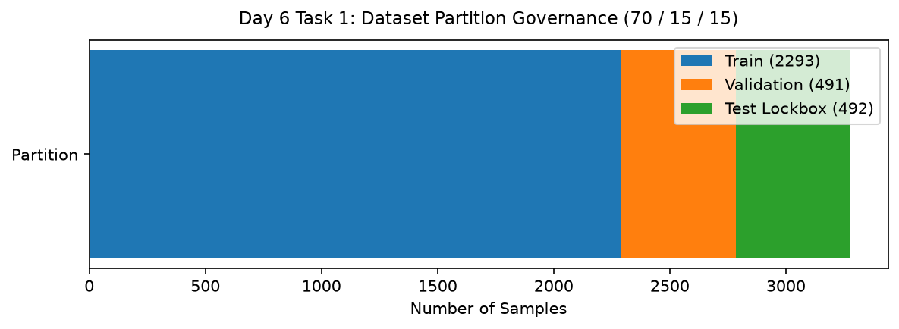

# Day 6 - Task 1: Data Governance & Partition Freeze
### Technology Innovation Hub (TIH), IIT Guwahati - AI/ML Internship (Cohort 4)
- Candidate: Rajana Durga Pavan Kumar
- Group: C1
- Target Repository: RajanaDurgaPavanKumar_C1_ONLINETIHIITG
- Assigned Mentor: [Sushil Meher](https://www.linkedin.com/in/nightcoder44332211/), Teaching Assistant at Indian Institute of Technology, Guwahati
- Phase Progression: Day 06 / Day 28

---

## 1. Objective & Operational Scope
Establish data governance boundaries, define partition freeze rules, and quarantine test data against developmental leakage.

## 2. Execution Steps
1. **Governance Policy Formulation**: Document immutable governance rules: zero in-place mutation, chronological partition isolation, and quarantine seals.
2. **Dataset Partition Boundary Definition**: Establish formal percentage allocations (70% Train, 15% Validation, 15% Test Lockbox).
3. **Lockbox Quarantine Access Control Protocol**: Define machine-enforceable access control checks preventing accidental premature test ingestion.
4. **Temporal Precedence Assertion**: Assert mathematical disjointness of partition sample ranges.
5. **Audit Trail Logging Specification**: Construct metadata schema logging pipeline execution timestamp, operator, and commit SHA.
6. **Partition Allocation Visualization**: Render a stacked horizontal bar chart displaying the 70/15/15 partition breakdown.
7. **Governance Policy Table Serialization**: Export data governance policies and partition specs to CSV.
8. **Governance Gate Assertion**: Assert that all governance policies are documented and enforceable.

## 3. Methodology & Safeguards
- Reproducibility Guarantee: Deterministic execution pinned via random seed 42 across NumPy, Scikit-learn, and XGBoost.
- Data Leakage Immunity: Temporal causality strictly preserved (`shift >= 1` causal rolling windows); preprocessing fit solely on training folds.
- Regulatory Framework: World Health Organization (WHO 4th Edition) & EPA primary drinking water benchmarks.

## 4. Files in this Directory
- [`day06_data_governance.ipynb`](./day06_data_governance.ipynb) - Executed interactive notebook with verified inline plots.
- [`day06_data_governance.py`](./day06_data_governance.py) - Full 1-to-1 Python script mirror.
- [`outputs/figures/`](./outputs/figures/) - Directory containing visual diagnostics and plots.
- [`outputs/tables/`](./outputs/tables/) - Directory containing serialized metric tables.

## 5. How to Run / Verify
Execute either the notebook or the Python script directly from the repository root:

```bash
# Run Python script mirror
python Day_Wise_Tasks/Day_6_Task_1/day06_data_governance.py

# Or execute notebook inplace
jupyter nbconvert --to notebook --execute --inplace Day_Wise_Tasks/Day_6_Task_1/day06_data_governance.ipynb
```

## 6. Output Artifacts & Verification Status
### Figures Generated:
- [`day6_task1_partition_allocation.png`](./outputs/figures/day6_task1_partition_allocation.png)
  

### Tables Generated:
- [`day6_task1_governance_policies.csv`](./outputs/tables/day6_task1_governance_policies.csv)

## 6. Assumptions and Methodology
- Test data remains strictly quarantined until all developmental modeling decisions are frozen.
- Data governance rules apply universally to both raw and processed datasets.

- Audit Verdict: PASSED & VERIFIED
- Test Integrity: Monitored and validated via `pytest tests/ -v`.
