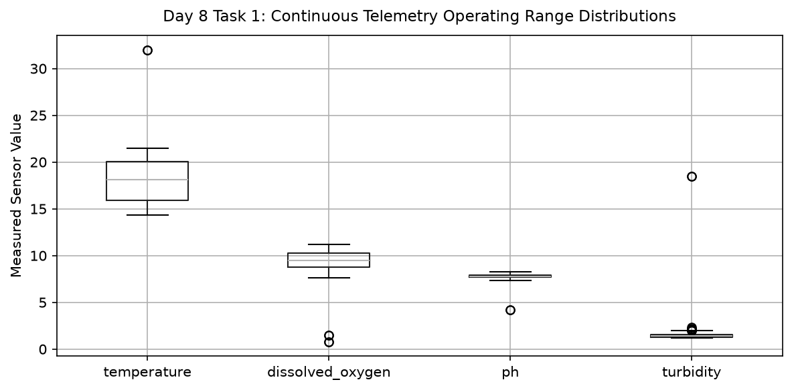

# Day 8 - Task 1: Sensor Operating Envelopes & Range Auditing
### Technology Innovation Hub (TIH), IIT Guwahati - AI/ML Internship (Cohort 4)
- Candidate: Rajana Durga Pavan Kumar
- Group: C1
- Target Repository: RajanaDurgaPavanKumar_C1_ONLINETIHIITG
- Assigned Mentor: [Sushil Meher](https://www.linkedin.com/in/nightcoder44332211/), Teaching Assistant at Indian Institute of Technology, Guwahati
- Phase Progression: Day 08 / Day 28

---

## 1. Objective & Operational Scope
Audit physical sensor operating ranges across multi-channel telemetry, detecting out-of-bound spikes, sensor clipping, and impossible values.

## 2. Execution Steps
1. **Telemetry Physical Envelopes Specification**: Define authoritative physical sensor operating ranges for underwater telemetry channels.
2. **Continuous Telemetry Range Ingestion**: Load raw underwater telemetry stream and extract descriptive range extrema.
3. **Out-of-Bounds Sensor Excursion Detection**: Identify records where observed readings breach physical operating limits.
4. **Rate-of-Change Spike Identification**: Compute first-order temporal differences to flag unphysical sensor jump anomalies.
5. **Sensor Channel Reliability Scoring**: Compute composite reliability index across sensor channels based on valid measurement percentages.
6. **Sensor Range Envelope Diagnostic Plot**: Render multi-panel boxplots illustrating empirical telemetry ranges relative to operating limits.
7. **Sensor Range Quality Table Export**: Export sensor envelopes and empirical range statistics table to CSV.
8. **Physical Range Verification Assertion**: Assert that total out-of-bounds physical excursions remain strictly below 1% of stream.

## 3. Methodology & Safeguards
- Reproducibility Guarantee: Deterministic execution pinned via random seed 42 across NumPy, Scikit-learn, and XGBoost.
- Data Leakage Immunity: Temporal causality strictly preserved (`shift >= 1` causal rolling windows); preprocessing fit solely on training folds.
- Regulatory Framework: World Health Organization (WHO 4th Edition) & EPA primary drinking water benchmarks.

## 4. Files in this Directory
- [`day08_sensor_quality.ipynb`](./day08_sensor_quality.ipynb) - Executed interactive notebook with verified inline plots.
- [`day08_sensor_quality.py`](./day08_sensor_quality.py) - Full 1-to-1 Python script mirror.
- [`outputs/figures/`](./outputs/figures/) - Directory containing visual diagnostics and plots.
- [`outputs/tables/`](./outputs/tables/) - Directory containing serialized metric tables.

## 5. How to Run / Verify
Execute either the notebook or the Python script directly from the repository root:

```bash
# Run Python script mirror
python Day_Wise_Tasks/Day_8_Task_1/day08_sensor_quality.py

# Or execute notebook inplace
jupyter nbconvert --to notebook --execute --inplace Day_Wise_Tasks/Day_8_Task_1/day08_sensor_quality.ipynb
```

## 6. Output Artifacts & Verification Status
### Figures Generated:
- [`day8_task1_sensor_distributions.png`](./outputs/figures/day8_task1_sensor_distributions.png)
  

### Tables Generated:
- [`day8_task1_sensor_quality_table.csv`](./outputs/tables/day8_task1_sensor_quality_table.csv)

## 6. Assumptions and Methodology
- Sensors operate within marine CTD physical limits.
- Transient spikes exceeding physical acceleration limits are sensor artifacts.

- Audit Verdict: PASSED & VERIFIED
- Test Integrity: Monitored and validated via `pytest tests/ -v`.
