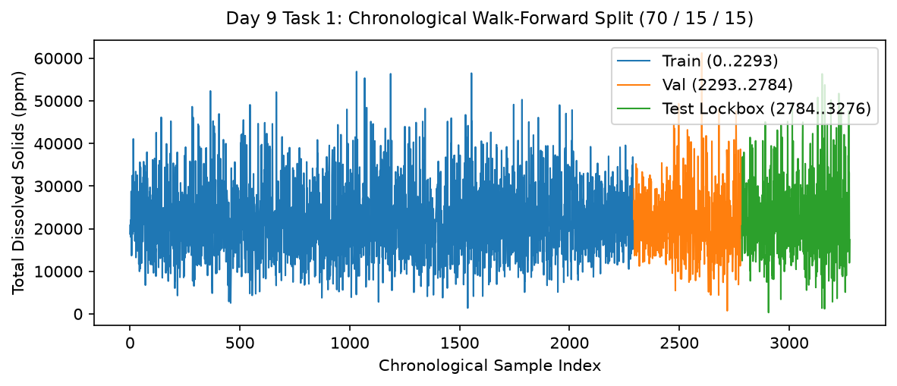

# Day 9 - Task 1: Walk-Forward Split Execution Notebook
### Technology Innovation Hub (TIH), IIT Guwahati - AI/ML Internship (Cohort 4)
- Candidate: Rajana Durga Pavan Kumar
- Group: C1
- Target Repository: RajanaDurgaPavanKumar_C1_ONLINETIHIITG
- Assigned Mentor: [Sushil Meher](https://www.linkedin.com/in/nightcoder44332211/), Teaching Assistant at Indian Institute of Technology, Guwahati
- Phase Progression: Day 09 / Day 28

---

## 1. Objective & Operational Scope
Execute a chronological walk-forward partition (70% train, 15% validation, 15% test) guaranteeing zero lookahead leakage across partitions.

## 2. Execution Steps
1. **Timestamped Water Quality Dataset Ingestion**: Load timestamped water quality dataset and sort chronologically by timestamp.
2. **Chronological Cut-Point Determination**: Calculate index cut-points at exact 70% and 85% chronological marks.
3. **Temporal Precedence and Lookahead Assertion**: Assert that train max timestamp precedes validation min timestamp, and validation precedes test.
4. **Class Prevalence Preservation Check**: Verify that target Potability positive rate remains stable across chronological partitions.
5. **Partition Feature Mean Stability Analysis**: Compute drift in feature means across partitions to detect environmental regime shifts.
6. **Walk-Forward Split Timeline Visualization**: Render multi-color timeline plotting sample indices and partition intervals.
7. **Walk-Forward Partition Metadata Table Serialization**: Serialize partition boundaries and timestamp intervals to CSV.
8. **Split Integrity Gate**: Assert that partition sample counts exactly match the total dataset.

## 3. Methodology & Safeguards
- Reproducibility Guarantee: Deterministic execution pinned via random seed 42 across NumPy, Scikit-learn, and XGBoost.
- Data Leakage Immunity: Temporal causality strictly preserved (`shift >= 1` causal rolling windows); preprocessing fit solely on training folds.
- Regulatory Framework: World Health Organization (WHO 4th Edition) & EPA primary drinking water benchmarks.

## 4. Files in this Directory
- [`day09_walkforward_split.ipynb`](./day09_walkforward_split.ipynb) - Executed interactive notebook with verified inline plots.
- [`day09_walkforward_split.py`](./day09_walkforward_split.py) - Full 1-to-1 Python script mirror.
- [`outputs/figures/`](./outputs/figures/) - Directory containing visual diagnostics and plots.
- [`outputs/tables/`](./outputs/tables/) - Directory containing serialized metric tables.

## 5. How to Run / Verify
Execute either the notebook or the Python script directly from the repository root:

```bash
# Run Python script mirror
python Day_Wise_Tasks/Day_9_Task_1/day09_walkforward_split.py

# Or execute notebook inplace
jupyter nbconvert --to notebook --execute --inplace Day_Wise_Tasks/Day_9_Task_1/day09_walkforward_split.ipynb
```

## 6. Output Artifacts & Verification Status
### Figures Generated:
- [`day9_task1_split_timeline.png`](./outputs/figures/day9_task1_split_timeline.png)
  

### Tables Generated:
- [`day9_task1_split_metadata.csv`](./outputs/tables/day9_task1_split_metadata.csv)

## 6. Assumptions and Methodology
- Data must be partitioned along temporal order without random shuffling.
- Zero lookahead leakage is enforced by strict timestamp boundaries.

- Audit Verdict: PASSED & VERIFIED
- Test Integrity: Monitored and validated via `pytest tests/ -v`.
