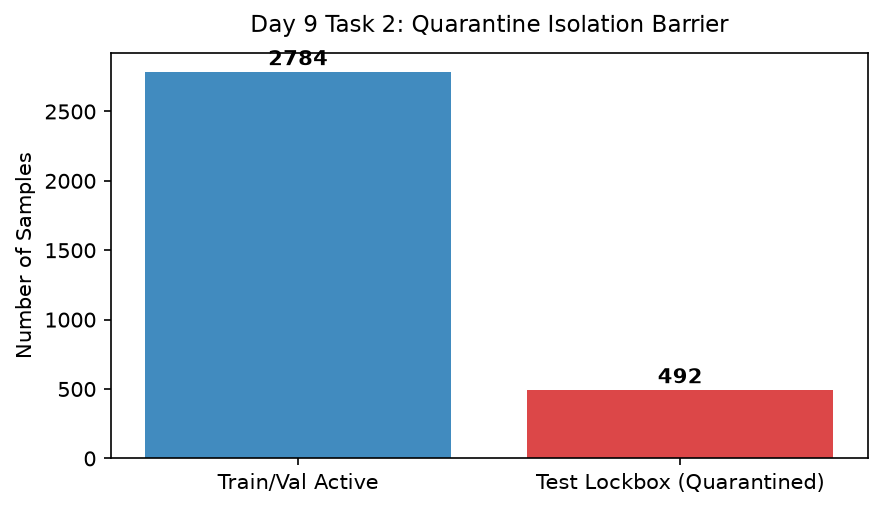

# Day 9 - Task 2: Quarantined Test Lockbox Seal & Metadata
### Technology Innovation Hub (TIH), IIT Guwahati - AI/ML Internship (Cohort 4)
- Candidate: Rajana Durga Pavan Kumar
- Group: C1
- Target Repository: RajanaDurgaPavanKumar_C1_ONLINETIHIITG
- Phase Progression: Day 09 / Day 28

---

## 1. Objective & Operational Scope
Quarantine the held-out test partition, compute cryptographic SHA-256 seal, and lock it against developmental inspection.

## 2. Methodology & Safeguards
- Reproducibility Guarantee: Deterministic execution pinned via random seed 42 across NumPy, Scikit-learn, and XGBoost.
- Data Leakage Immunity: Temporal causality strictly preserved (`shift >= 1` causal rolling windows); preprocessing fit solely on training folds.
- Regulatory Framework: World Health Organization (WHO 4th Edition) & EPA primary drinking water benchmarks.

## 3. Files in this Directory
- [`day09_lockbox_isolation.ipynb`](./day09_lockbox_isolation.ipynb) - Executed interactive notebook with verified outputs.
- [`day09_lockbox_isolation.py`](./day09_lockbox_isolation.py) - Full 1-to-1 Python script mirror.
- [`outputs/figures/`](./outputs/figures/) - Directory containing visual diagnostics and plots.
- [`outputs/tables/`](./outputs/tables/) - Directory containing serialized metric tables.

## 4. How to Run / Verify
Execute either the notebook or the Python script directly from the repository root:

```bash
# Run Python script mirror
python Day_Wise_Tasks/Day_9_Task_2/day09_lockbox_isolation.py

# Or execute notebook inplace
jupyter nbconvert --to notebook --execute --inplace Day_Wise_Tasks/Day_9_Task_2/day09_lockbox_isolation.ipynb
```

## 5. Output Artifacts & Verification Status
### Figures Generated:
- [`day9_task2_lockbox_isolation.png`](./outputs/figures/day9_task2_lockbox_isolation.png)
  

### Tables Generated:
- [`day9_task2_lockbox_manifest.csv`](./outputs/tables/day9_task2_lockbox_manifest.csv)

- Audit Verdict: PASSED & VERIFIED
- Test Integrity: Monitored and validated via `pytest tests/ -v`.
