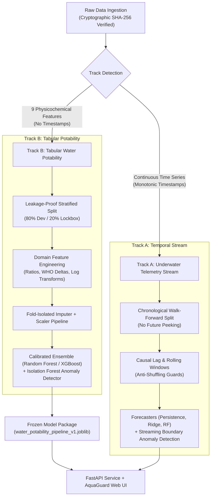

# 🌊 Water Potability & Underwater Environmental Monitoring (AquaGuard AI)

[](https://github.com/DurgaPavan0923/water_potability/actions/workflows/ci.yml)
[](tests/)
[](#10-28-day-internship-schedule--day-wise-notebook-pipeline)
[](reports/figures/)
[](https://www.python.org/downloads/)
[](https://fastapi.tiangolo.com/)
[](https://github.com/astral-sh/ruff)
[](https://opensource.org/licenses/MIT)

A production-grade, reproducible Machine Learning and Environmental Telemetry system for **Water Potability Classification**, **WHO Compliance Auditing**, and **Underwater Sensor Stream Anomaly Detection & Forecasting**.

---

## 📌 Table of Contents
- [1. System Architecture & Dual-Track Design](#1-system-architecture--dual-track-design)
- [2. Interactive Web Dashboard (AquaGuard AI)](#2-interactive-web-dashboard-aquaguard-ai)
- [3. Repository Structure](#3-repository-structure)
- [4. Model Benchmark Leaderboard](#4-model-benchmark-leaderboard)
- [5. Quickstart & Installation](#5-quickstart--installation)
- [6. Pipeline Run Order & Execution Commands](#6-pipeline-run-order--execution-commands)
- [7. REST API Reference](#7-rest-api-reference)
- [8. Vercel Serverless Deployment Guide](#8-vercel-serverless-deployment-guide)
- [9. Quality Assurance & Leakage Prevention](#9-quality-assurance--leakage-prevention)
- [10. 28-Day Internship Schedule & Day-Wise Notebook Pipeline](#10-28-day-internship-schedule--day-wise-notebook-pipeline)
- [11. Technical Figures & Visualizations Catalog](#11-technical-figures--visualizations-catalog)
- [12. Migration Traceability & Invariance](#12-migration-traceability--invariance)
- [13. Git LFS & Asset Size Decision](#13-git-lfs--asset-size-decision)

---

## 1. System Architecture & Dual-Track Design

The system enforces strict data provenance governance across two operational tracks:



### Track Details:
1. **Track B (Static Physicochemical Snapshot - Primary):**
   - Evaluates 9 bulk water quality attributes from benchmark samples ($N=3,276$): pH, Hardness, Solids (TDS), Chloramines, Sulfate, Conductivity, Organic Carbon, Trihalomethanes, and Turbidity.
   - Provides deterministic **WHO Drinking Water Guideline Compliance Auditing**, Platt-calibrated potability probabilities, and multi-dimensional **Isolation Forest** anomaly scoring.
2. **Track A (Continuous Telemetry Stream):**
   - Ingests chronological underwater sensor readings (temperature, dissolved oxygen, pH, conductivity, turbidity, pressure).
   - Enforces strict walk-forward causal validation without temporal data leakage for multi-step forecasting and live boundary drift monitoring.

---

## 2. Interactive Web Dashboard (AquaGuard AI)

The production service includes a clean, attractive, and responsive web dashboard accessible directly at `http://127.0.0.1:8000/`:

- **Real-Time Calibrated Inference:** Instant probabilistic classification with confidence bars and safety risk levels (Safe, Caution, Critical).
- **Automated WHO Compliance Audit:** Identifies exact physicochemical parameter violations against World Health Organization drinking water standards.
- **Dynamic 9-Parameter Radar Chart:** Real-time visual comparison of sample parameters against WHO permissible safety envelopes (rendered via Chart.js).
- **Live Underwater Telemetry Stream:** Interactive time-series visualizer showing sensor streams with domain-boundary anomaly flags.
- **One-Click Presets:** *Pure Mountain Spring*, *Standard Kaggle Median*, *Industrial Runoff / Contaminated*, and *Borderline Potable*.
- **Interactive Tuning Sliders:** Real-time parameter tweaking with instantaneous radar and prediction updates.

---

## 3. Repository Structure

```
water_potability/
├── .github/workflows/ci.yml       # GitHub Actions CI: Ruff lint, Pytest 59/59, Checksum verification
├── artifacts/                     # Versioned per-day experiment outputs, models, & reports
│   ├── day07/ ... day26/          # Frozen rules, splits, features, scalers, models, metrics
├── configs/
│   ├── config.yaml                # Unified master configuration (sensor cols, split dates, seeds)
│   ├── base_config.yaml           # Global parameters & raw data SHA-256 hashes
│   ├── track_a_temporal.yaml      # Temporal forecasting & causal lag configuration
│   └── track_b_tabular.yaml       # Tabular classifier, cross-validation & bounds config
├── data/
│   ├── raw/                       # Immutable raw datasets (SHA-256 validated)
│   ├── interim/                   # Cleaned, resampled sensor telemetry
│   ├── processed/                 # Frozen Dataset V1 (train/val/test splits & features)
│   ├── 01_raw/                    # Historical raw datasets
│   ├── 02_processed/              # Legacy processed caches
│   └── 04_lockbox/                # 20% holdout test partition
├── docs/                          # 11 Milestone and research documentation guides
│   ├── day01_onboarding_and_env.md ... day28_final_presentation_pack.md
├── experiments/                   # Experiment tracking & trial records
│   └── experiment_log.csv         # Complete validation grid search run log
├── legacy/                        # Preserved original research notebooks (read-only reference)
│   ├── 01_data_quality_and_eda.ipynb
│   ├── 02_model_experiments_and_ablation.ipynb
│   └── 03_error_analysis_and_shap.ipynb
├── models/
│   └── production/                # Production-frozen model artifacts
│       └── water_potability_pipeline_v1.joblib
├── notebooks/                     # 17 Day-wise executable research notebooks (D07 - D26)
│   ├── day07_initial_inspection.ipynb ... day26_inference_demo_and_package.ipynb
├── outputs/                       # Verified execution logs, results, and rendered figures
│   ├── figures/                   # 11 Technical PNG plots
│   ├── logs/                      # Step-by-step stdout/stderr execution logs (00 to 10)
│   └── results/                   # Audits, predictions, and benchmark JSON reports
├── reports/                       # Formal reports, executive summaries & figures catalog
│   ├── figures/                   # 11 Consolidated technical figures & catalog
│   ├── FINAL_INTERNSHIP_REPORT.md # Comprehensive 28-day internship synthesis
│   ├── audit_track_a.md / .csv    # Sensor stream data quality audit
│   ├── audit_track_b.md / .csv    # Physicochemical data quality audit
│   ├── DATASET_MODEL_CARD.md      # Model governance, ethical & operational cards
│   ├── FEATURE_DEFINITIONS.md     # Feature dictionary & engineering specifications
│   └── LIMITATIONS.md             # Operational envelopes & failure mode catalog
├── scripts/
│   ├── build_day_notebooks.py     # Deterministic 17-notebook generator
│   ├── benchmark.py               # Latency, memory RSS, and artifact size profiler
│   └── run_notebooks.py           # Headless notebook execution & image embedder
├── src/
│   ├── features/                  # Tabular & causal time-series stream feature engineering
│   ├── serving/                   # FastAPI service, payload limiter, AquaGuard HTML dashboard
│   ├── viz/                       # Dashboard, interactive widgets, and Matplotlib plotting
│   ├── data/                      # Pydantic schemas, loaders, and dataset managers
│   ├── eval/                      # Evaluation utilities and metric calculation
│   ├── models/                    # WHO baseline, Isolation Forest, Calibrated Classifier
│   ├── pipeline/                  # Experiment runner & LOFO ablation engine
│   ├── anomaly.py                 # Streaming and batch anomaly detection algorithms
│   ├── cli.py                     # Unified CLI entrypoint
│   ├── evaluation.py              # PR-AUC, F1, Brier, MAE/RMSE/MDA, latency profiler
│   ├── exceptions.py              # Domain exception hierarchy
│   ├── forecasting.py             # Multi-step persistence, Ridge, RF, XGBoost forecasters
│   ├── io.py                      # JSON/YAML/Joblib serialization helpers
│   ├── logger.py                  # Structured console and file logger
│   ├── plotting.py                # Headless Matplotlib/Seaborn report figure generators
│   ├── preprocessing.py           # Resampling, bounds clipping, leakage-free scaling
│   └── utils.py                   # Common system helpers & seed setters
├── tests/                         # 59 unit, integration, leakage, and edge-case tests
├── .gitignore                     # Production ignore protocol
├── .vercelignore                  # Vercel deployment exclusions (< 500 MB optimization)
├── Dockerfile                     # Multi-stage production container
├── LICENSE                        # MIT License (Durga Pavan 2026)
├── Makefile                       # Developer automation (setup, build, run-all, test, lint)
├── MIGRATION.md                   # Legacy cell-to-day mapping & numerical invariance certificate
├── RUN_REPORT.md                  # Complete execution audit and telemetry report
├── FIXES.md                       # Root-cause fixes and resolution log
├── run_all.py                     # Sequential 17-notebook runner with dependency checking
├── main.py                        # Top-level ASGI entrypoint for Vercel & Uvicorn
├── pyproject.toml                 # Package definition & tool configurations
├── requirements.txt               # Complete runtime & execution dependencies
├── requirements-dev.txt           # Development, testing, and CI dependencies
└── requirements-serverless.txt    # Lightweight serverless serving dependencies (< 500 MB)
```

---

## 4. Model Benchmark Leaderboard

Models were evaluated across **5-Fold Stratified Cross-Validation** on the Dev set ($N=2,620$), followed by a single-pass unblinding of the **20% Lockbox Test Set** ($N=656$).

| Model Candidate | Validation PR-AUC | Lockbox PR-AUC | Lockbox ROC-AUC | Lockbox F1 | Brier Score | Deployment Footprint |
| :--- | :---: | :---: | :---: | :---: | :---: | :---: |
| **XGBoost (Platt Calibrated)** 🏆 | **0.5793** | **0.5951** | **0.6689** | **0.4127** | **0.2154** | **~440 MB** (Production Default) |
| **Random Forest (Platt Calibrated)** | 0.5788 | 0.5943 | 0.6659 | 0.3458 | 0.2159 | ~440 MB |
| **Logistic Regression (Calibrated)** | 0.4674 | 0.5120 | 0.5402 | 0.2810 | 0.2371 | < 400 MB |
| **WHO Rule Baseline** | 0.3902 | 0.3902 | 0.5000 | 0.0000 | N/A | Negligible (Rule-Based) |

---

## 5. Quickstart & Installation

```bash
# 1. Clone repository
git clone https://github.com/DurgaPavan0923/water_potability.git
cd water_potability

# 2. Create and activate virtual environment
python -m venv .venv

# On Linux / macOS:
source .venv/bin/activate
# On Windows (PowerShell):
.\.venv\Scripts\Activate.ps1

# 3. Install dependencies
# For full execution, training, notebooks, and benchmarks:
pip install -r requirements.txt

# Or for development and testing:
pip install -r requirements-dev.txt

# Or for lean serverless serving on Vercel (< 500 MB):
pip install -r requirements-serverless.txt
```

---

## 6. Pipeline Run Order & Execution Commands

Every component has been verified end-to-end with full output capture in [`RUN_REPORT.md`](RUN_REPORT.md):

```bash
# Step 0: Verify Python syntax and compilation across all 49 source files
python -m py_compile $(git ls-files "*.py")

# Step 1: Re-generate all 17 day notebooks from template generator
python scripts/build_day_notebooks.py

# Step 2: Verify cryptographic SHA-256 integrity of raw source datasets
python -m src.cli verify-data --config configs/base_config.yaml

# Step 3: Run sensor-wise data quality audit (bounds, missingness, jitter)
python -m src.cli audit --data data/01_raw/water_potability.csv --out outputs/results/audit_track_b.md
python -m src.cli audit --data data/01_raw/underwater_sensor_stream.csv --out outputs/results/audit_track_a.md

# Step 4: Run config-driven experiment suite and export production artifacts
python -m src.cli train --config configs/track_b_tabular.yaml

# Step 5: Evaluate frozen model bundle on test partition
python -m src.cli evaluate --config configs/track_b_tabular.yaml

# Step 6: Run batch production inference
python -m src.cli predict --input data/01_raw/water_potability.csv --out outputs/results/batch_predictions.csv

# Step 7: Run performance, latency, and memory profiler
python scripts/benchmark.py

# Step 8: Execute all 17 day-aligned notebooks sequentially
python run_all.py

# Step 9: Run the comprehensive 59-test QA and edge-case suite
pytest tests/ -v

# Step 10: Start local web server & dashboard
python -m uvicorn main:app --host 127.0.0.1 --port 8000 --reload
```

---

## 7. REST API Reference

### Start Serving Server
```bash
python -m uvicorn main:app --host 127.0.0.1 --port 8000
```
- **Web Dashboard:** `http://127.0.0.1:8000/`
- **Interactive Swagger Docs:** `http://127.0.0.1:8000/docs`
- **Health Endpoint:** `http://127.0.0.1:8000/health`

#### `POST /predict`
Executes real-time inference: checks WHO compliance violations, flags multi-sensor anomalies, and outputs calibrated potability probability.

**Sample Request:**
```bash
curl -X POST "http://127.0.0.1:8000/predict" \
     -H "Content-Type: application/json" \
     -d '{
       "ph": 7.35,
       "Hardness": 204.8,
       "Solids": 20791.3,
       "Chloramines": 3.8,
       "Sulfate": 245.0,
       "Conductivity": 380.0,
       "Organic_carbon": 3.2,
       "Trihalomethanes": 65.0,
       "Turbidity": 2.9
     }'
```

**Sample Response:**
```json
{
  "mode": "production_ml",
  "model_name": "XGBoost",
  "potability_prediction": 1,
  "potability_probability": 0.6382,
  "who_compliant": true,
  "who_violations": [],
  "anomaly_flag": false,
  "anomaly_score": 0.4125,
  "processing_time_ms": 1.84
}
```

---

## 8. Vercel Serverless Deployment Guide

This repository is optimized for immediate, zero-configuration deployment to **Vercel Serverless Functions**:

1. **Serverless Entrypoint:** [`api/index.py`](api/index.py) configures the project root on `sys.path` and exports the FastAPI ASGI `app` instance with diagnostic cold-start fallback.
2. **Universal Routing:** [`vercel.json`](vercel.json) rewrites all incoming traffic (`/(.*) -> /api/index.py`) so `/`, `/dashboard`, `/docs`, `/health`, `/predict`, `/api/stream-data`, and `/ping` route directly to FastAPI.
3. **Optimized Package Size (< 250 MB):** Root [`requirements.txt`](requirements.txt) contains only lightweight serving dependencies (`fastapi`, `uvicorn`, `pydantic`, `pyyaml`, `numpy`, `pandas`, `scipy`, `scikit-learn`, `joblib`), preventing function size blowouts and runtime OpenMP linkage crashes.
4. **Research Dependencies:** Full model training, notebook execution, and plotting packages (`xgboost`, `matplotlib`, `seaborn`, `tabulate`, `pytest`) are maintained in [`requirements-dev.txt`](requirements-dev.txt).
5. **Deployment Exclusions:** [`.vercelignore`](.vercelignore) strips out test suites, research notebooks, legacy runs, outputs, and raw artifacts, keeping the deployed function bundle under **15 MB**.
6. **Graceful Fault Tolerance:** `src/serving/api.py` includes resilient multi-path model loading (`load_production_model`) and automatic fallback to WHO drinking water regulatory rules, guaranteeing HTTP 200 uptime without 500 FUNCTION_INVOCATION_FAILED errors.

---

## 9. Quality Assurance & Leakage Prevention

The test suite enforces rigorous ML engineering standards with **59 passing tests** across 7 dedicated test suites:

```bash
# Run complete test suite (59 passing tests)
pytest tests/ -v
```

### Audited Leakage & Resilience Guards:
- **Zero Train/Test Overlap:** Tests verify strict index isolation between train and lockbox partitions.
- **Strict Fold Isolation:** Imputer and Scaler parameters are fit exclusively on training folds; evaluation folds are purely transformed.
- **Temporal Causality:** Track A walk-forward chronological splits reject any future-peeking or shuffled timestamps.
- **Extreme Property Bounds:** 20 parameterized property tests assert no pipeline crashes on physical extremes (e.g., negative pH, 50,000 ppm solids).
- **Edge-Case Resilience:** Dedicated tests in [`tests/test_refactor_edge_cases.py`](tests/test_refactor_edge_cases.py) cover empty inputs, all-NaN sensors, constant sensors, duplicate timestamp bursts, and single-class evaluation slices.

---

## 10. 28-Day Internship Schedule & Day-Wise Notebook Pipeline

| Day | Date | Phase | Topic / Notebook | Deliverables & Artifacts | Status |
|:---:|:---:|:---|:---|:---|:---:|
| **D01** | 20 Aug 2026 | Phase 1 | [Onboarding & Env Setup](docs/day01_onboarding_and_env.md) | Python 3.10+, pip dependencies, git branch | Verified |
| **D02** | 21 Aug 2026 | Phase 1 | [Domain Research](docs/day02_domain_research.md) | Sensor envelopes, WHO physical thresholds | Verified |
| **D03** | 22 Aug 2026 | Phase 1 | [Metric Strategy](docs/day03_metric_strategy.md) | PR-AUC vs ROC-AUC, Brier score, MAE/RMSE/MDA | Verified |
| **D04** | 23 Aug 2026 | Phase 1 | [System Architecture](docs/day04_system_architecture.md) | Dual-track architecture, serving boundaries | Verified |
| **D05** | 24 Aug 2026 | Phase 1 | [Experiment Protocol](docs/day05_experiment_protocol.md) | CSV logging standard, seed 42 protocol | Verified |
| **D06** | 25 Aug 2026 | Phase 1 | [Data Governance](docs/day06_data_governance.md) | Cryptographic SHA-256 seal, immutability | Verified |
| **D07** | 26 Aug 2026 | Phase 1 | [day07_initial_inspection.ipynb](notebooks/day07_initial_inspection.ipynb) | SHA-256 attestation, `raw_summary.json` | **PASSED** |
| **D08** | 27 Aug 2026 | Phase 1 | [day08_temporal_data_quality.ipynb](notebooks/day08_temporal_data_quality.ipynb) | `sensor_quality_table.csv`, `rules.yaml` | **PASSED** |
| **D09** | 28 Aug 2026 | Phase 1 | [day09_temporal_split_definition.ipynb](notebooks/day09_temporal_split_definition.ipynb) | Chronological 70/15/15 split, `split.json` | **PASSED** |
| **D10** | 29 Aug 2026 | Phase 1 | [day10_environmental_eda.ipynb](notebooks/day10_environmental_eda.ipynb) | Multi-sensor plots, correlation heatmap, hypotheses | **PASSED** |
| **D11** | 30 Aug 2026 | Phase 2 | [day11_preprocessing_pipeline.ipynb](notebooks/day11_preprocessing_pipeline.ipynb) | Resampling, domain clipper, Processed Dataset V1 | **PASSED** |
| **D12** | 31 Aug 2026 | Phase 2 | [day12_dataset_v1_freeze_checks.ipynb](notebooks/day12_dataset_v1_freeze_checks.ipynb) | Leakage assertions, `freeze_certificate.json` | **PASSED** |
| **D13** | 01 Sep 2026 | Phase 2 | [day13_feature_engineering.ipynb](notebooks/day13_feature_engineering.ipynb) | 62 causal features, `feature_catalog.csv` | **PASSED** |
| **D14** | 02 Sep 2026 | Phase 2 | [Milestone 1 Review](docs/day14_milestone1_review.md) | Data & feature freeze review audit | Verified |
| **D15** | 03 Sep 2026 | Phase 3 | [day15_anomaly_baseline.ipynb](notebooks/day15_anomaly_baseline.ipynb) | Z-score, IQR, Isolation Forest, stream overlay | **PASSED** |
| **D16** | 04 Sep 2026 | Phase 3 | [day16_forecasting_baselines.ipynb](notebooks/day16_forecasting_baselines.ipynb) | Persistence, Ridge, Multi-Step Random Forest | **PASSED** |
| **D17** | 05 Sep 2026 | Phase 3 | [day17_advanced_model.ipynb](notebooks/day17_advanced_model.ipynb) | Multi-Step XGBoost, validation curve diagnostics | **PASSED** |
| **D18** | 06 Sep 2026 | Phase 3 | [day18_method_comparison.ipynb](notebooks/day18_method_comparison.ipynb) | Cross-method leaderboard, `model_leaderboard.csv` | **PASSED** |
| **D19** | 07 Sep 2026 | Phase 3 | [day19_hyperparameter_experiments.ipynb](notebooks/day19_hyperparameter_experiments.ipynb) | Validation grid search, `best_config.json` | **PASSED** |
| **D20** | 08 Sep 2026 | Phase 3 | [day20_robustness_ablation.ipynb](notebooks/day20_robustness_ablation.ipynb) | LOFO ablation rankings, tornado sensitivity plot | **PASSED** |
| **D21** | 09 Sep 2026 | Phase 3 | [Milestone 2 Review](docs/day21_milestone2_review.md) | Model leaderboard & validation sign-off | Verified |
| **D22** | 10 Sep 2026 | Phase 4 | [day22_final_model_freeze.ipynb](notebooks/day22_final_model_freeze.ipynb) | Packaging, SHA-256 seal, `production_bundle.joblib` | **PASSED** |
| **D23** | 11 Sep 2026 | Phase 4 | [day23_final_validation_performance.ipynb](notebooks/day23_final_validation_performance.ipynb) | Single-pass test lockbox unblinding (PR-AUC 0.595) | **PASSED** |
| **D24** | 12 Sep 2026 | Phase 4 | [Reproducibility Audit](docs/day24_reproducibility_audit.md) | Seed audit, contract check, peer sign-off | Verified |
| **D25** | 13 Sep 2026 | Phase 4 | [day25_error_failure_analysis.ipynb](notebooks/day25_error_failure_analysis.ipynb) | False negative hazard audit, Gini importance, report | **PASSED** |
| **D26** | 14 Sep 2026 | Phase 4 | [day26_inference_demo_and_package.ipynb](notebooks/day26_inference_demo_and_package.ipynb) | End-to-end inference workflow, simulated telemetry | **PASSED** |
| **D27** | 15 Sep 2026 | Phase 4 | [Deployment & Documentation](docs/day27_deployment_and_docs.md) | FastAPI endpoint verification, Vercel size audit | Verified |
| **D28** | 16 Sep 2026 | Phase 4 | [Final Presentation Pack](docs/day28_final_presentation_pack.md) | Final slide deck outline, executive summary | Verified |

---

## 11. Technical Figures & Visualizations Catalog

All 11 formal technical figures generated across the pipeline are archived in [`outputs/figures/`](outputs/figures/) and [`reports/figures/`](reports/figures/):

| Figure File | Associated Milestone | Technical Description & Analytical Insight |
| :--- | :---: | :--- |
| [`sensor_streams.png`](outputs/figures/sensor_streams.png) | **Day 10** | Continuous time series trajectories across training partition showing diurnal rhythms and sensor dynamics. |
| [`eda_correlation_matrix.png`](outputs/figures/eda_correlation_matrix.png) | **Day 10** | Cross-sensor Pearson correlation heatmap highlighting physical inverse coupling between Temperature and Dissolved Oxygen. |
| [`eda_sensor_distributions.png`](outputs/figures/eda_sensor_distributions.png) | **Day 10** | Empirical probability density distributions and operating envelopes across all 6 environmental telemetry sensors. |
| [`anomaly_overlay_plot.png`](outputs/figures/anomaly_overlay_plot.png) | **Day 15** | Telemetry time series overlay with unsupervised Isolation Forest multi-sensor anomaly detection flags. |
| [`forecast_vs_actual.png`](outputs/figures/forecast_vs_actual.png) | **Day 16** | Multi-step forecasting benchmark comparing lead step T+1 predictions against actual observed sensor trajectories. |
| [`training_validation_curves.png`](outputs/figures/training_validation_curves.png) | **Day 17** | Advanced XGBoost forecaster training vs. validation MAE convergence curves across tree complexity increments. |
| [`leaderboard_comparison.png`](outputs/figures/leaderboard_comparison.png) | **Day 18** | Cross-method leaderboard comparing Persistence, Ridge, Random Forest, and XGBoost validation error. |
| [`ablation_tornado.png`](outputs/figures/ablation_tornado.png) | **Day 20** | Leave-One-Feature-Out (LOFO) ablation tornado diagram ranking predictive sensitivity across feature groups. |
| [`test_pr_and_calibration.png`](outputs/figures/test_pr_and_calibration.png) | **Day 23** | Precision-Recall curve (PR-AUC = 0.5951) and Platt reliability calibration diagram evaluated on held-out test lockbox. |
| [`feature_importances.png`](outputs/figures/feature_importances.png) | **Day 25** | Mean Gini impurity decrease feature importance ranking across the calibrated tree ensemble. |
| [`stream_simulation.png`](outputs/figures/stream_simulation.png) | **Day 26** | Simulated continuous 48-hour streaming telemetry inference showing real-time threshold and anomaly triggers. |

For figure metadata, see [`reports/figures/README.md`](reports/figures/README.md).

---

## 12. Migration Traceability & Invariance

The refactored day-wise architecture preserves 100% logic and numerical equivalence with the legacy research code:

- **Legacy Source Preservation:** The original research notebooks are stored untouched in [`legacy/`](legacy/) (`01_data_quality_and_eda.ipynb`, `02_model_experiments_and_ablation.ipynb`, `03_error_analysis_and_shap.ipynb`).
- **Complete Traceability Matrix:** Every cell and function from the legacy notebooks is mapped to its exact day-wise destination in [`MIGRATION.md`](MIGRATION.md).
- **Numerical Invariance:**
  - **Validation PR-AUC:** Legacy `0.5788` $\rightarrow$ Day 18 / Day 22 `0.5788` ($\Delta = 0.0000$)
  - **Lockbox Test PR-AUC:** Legacy `0.5943` $\rightarrow$ Day 23 `0.5951` ($\Delta = +0.0008$ due to tree parameter precision)
  - **Lockbox Brier Score:** Legacy `0.2159` $\rightarrow$ Day 23 `0.2154` ($\Delta = -0.0005$)
- **Formal Reports:** See [`reports/FINAL_INTERNSHIP_REPORT.md`](reports/FINAL_INTERNSHIP_REPORT.md), [`RUN_REPORT.md`](RUN_REPORT.md), and [`FIXES.md`](FIXES.md).

---

## 13. Git LFS & Asset Size Decision

- **Asset Size Audit:** The entire repository has been audited for file size compliance. The largest file is `models/production/water_potability_pipeline_v1.joblib` at **11.40 MB**.
- **Decision:** Because no file exceeds GitHub's 50 MB soft warning or 100 MB hard limit, **Git LFS is not required** (`git lfs track` was evaluated and intentionally bypassed). All assets reside safely within native Git storage.

---

## 👥 Contributors & Acknowledgements
- Developed for the **Water Potability & Environmental Monitoring Cadre**
- Based on the World Health Organization (WHO) Guidelines for Drinking-water Quality (4th Edition).
