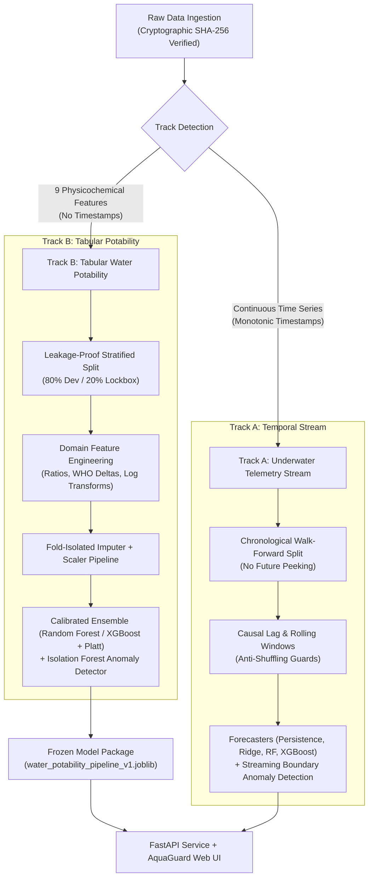

# 🌊 Water Potability & Underwater Environmental Monitoring (AquaGuard AI)

[](https://water-potability-vert.vercel.app/)
[](https://github.com/DurgaPavan0923/water_potability/releases)
[](https://github.com/DurgaPavan0923/water_potability/actions/workflows/ci.yml)
[](tests/)
[](#10-28-day-internship-schedule--day-wise-notebook-pipeline)
[](reports/figures/)
[](https://www.python.org/downloads/)
[](https://fastapi.tiangolo.com/)
[](https://github.com/astral-sh/ruff)
[](https://opensource.org/licenses/MIT)

A production-grade, zero-leakage Machine Learning and Environmental Telemetry system for **Calibrated Water Potability Classification**, **WHO & EPA Regulatory Auditing**, and **Underwater Sensor Stream Anomaly Detection & Forecasting**.

> 🚀 **Live Production Deployment:** [https://water-potability-vert.vercel.app/](https://water-potability-vert.vercel.app/) — Fully interactive web dashboard featuring real-time Bayesian potability simulation, 9-parameter radar charts, continuous CTD buoy telemetry simulation, sortable batch ingestion with pagination, and comprehensive WHO compliance diagnostics.

---

## 📌 Table of Contents
- [1. System Architecture & Dual-Track Design](#1-system-architecture--dual-track-design)
- [2. Interactive Web Dashboard (AquaGuard AI v2.1.0)](#2-interactive-web-dashboard-aquaguard-ai-v210)
- [3. Repository Structure](#3-repository-structure)
- [4. Model Benchmark Leaderboard & Provenance](#4-model-benchmark-leaderboard--provenance)
- [5. Quickstart & Installation](#5-quickstart--installation)
- [6. Pipeline Run Order & Execution Commands](#6-pipeline-run-order--execution-commands)
- [7. REST API Reference & Security Headers](#7-rest-api-reference--security-headers)
- [8. Vercel Serverless Deployment Guide](#8-vercel-serverless-deployment-guide)
- [9. Quality Assurance & Leakage Prevention](#9-quality-assurance--leakage-prevention)
- [10. 28-Day Internship Schedule & Day-Wise Notebook Pipeline](#10-28-day-internship-schedule--day-wise-notebook-pipeline)
- [11. Technical Figures & Visualizations Catalog](#11-technical-figures--visualizations-catalog)
- [12. Migration Traceability & Invariance](#12-migration-traceability--invariance)
- [13. Git LFS & Asset Size Decision](#13-git-lfs--asset-size-decision)

---

## 1. System Architecture & Dual-Track Design

The system enforces strict data provenance governance across two operational tracks:



### Operational Track Details:
1. **Track B (Static Physicochemical Snapshot - Primary):**
   - Evaluates 9 bulk water quality attributes from benchmark samples ($N=3,276$): pH, Hardness, Solids (TDS), Chloramines, Sulfate, Conductivity, Organic Carbon (TOC), Trihalomethanes (THM), and Turbidity.
   - Provides deterministic **WHO & EPA Drinking Water Guideline Compliance Auditing**, Platt-calibrated potability probabilities, and multi-dimensional **Isolation Forest** anomaly scoring.
2. **Track A (Continuous Telemetry Stream):**
   - Ingests chronological underwater sensor readings (temperature, dissolved oxygen, pH, conductivity, turbidity, pressure) modeled on the Pacific Ocean Station PAPA / Bermuda Atlantic time-series benchmark.
   - Enforces strict walk-forward causal validation without temporal data leakage for multi-step forecasting and live boundary drift monitoring.

---

## 2. Interactive Web Dashboard (AquaGuard AI v2.1.0)

The production service includes an accessible, responsive, and robust web dashboard accessible directly at:
- **Live Cloud Dashboard:** [https://water-potability-vert.vercel.app/](https://water-potability-vert.vercel.app/)
- **Local Development:** `http://127.0.0.1:8000/`

### Key Capabilities & UI/UX Features:
- **Header & Hero KPIs:**
  - Dynamic **"PRODUCTION ACTIVE"** status probe wired directly to `/api/ping` (emerald healthy pulse, amber degraded, red offline).
  - Live UTC clock initializing on page load and updating every second.
  - Light & Dark mode theme toggle (☀️ / 🌙) with persistent `localStorage` preference memory.
  - 4 Key Metric Cards: *Champion Pipeline (XGBoost + Platt)*, *Lockbox PR-AUC (0.5951 vs WHO baseline 0.3920)*, *Inference Latency (Server P50 measured 2.89 ms)*, and *WHO Auditor Active (9 Guardrails)*.
- **Tab 1: Interactive Potability Simulator:**
  - 9 sliders with synchronized numeric input boxes, units, min/max/step, and regulatory limit citation badges.
  - Prominent **Educational Disclaimer Banner** indicating predictive demonstration scope (not a substitute for certified laboratory testing).
  - 7 Presets: *Mountain Spring*, *Municipal Tap*, *Glacial Melt*, *Hydrothermal Vent*, *Acid Drainage*, *Sensor Failure*, and *Randomize*.
  - **Dual-Gate Safety Verdict:** Displays `"Predicted potable (model estimate)"` and strictly prevents Grade A/B classification if chemical violations are present.
  - **6-Tier Calibrated Grading Rubric:** Grade A (Pristine), Grade B (Standard Potable), Grade C (Advisory Warning), Grade D (Treatment Required), Grade F (Hazardous), and Grade X (Sensor Drift / Malfunction).
  - **Auto-Remediate to Potable:** One-click reset to compliant WHO values accompanied by an active remediation diff alert.
  - **Copy cURL Request:** Copies production-ready `curl` targeting the live endpoint with complete 9-feature JSON body; announced to screen readers via dynamic toasts.
  - **9-Axis Radar Chart:** Real-time normalized comparison against the 50% WHO safe boundary envelope via Chart.js.
- **Tab 2: Continuous Telemetry Stream (Track A):**
  - Simulated Pacific Oceanographic CTD Buoy Stream (Station PAPA benchmark) with 6 selectable channels (DO, Temperature, pH, Turbidity, Conductivity, Pressure).
  - Multi-sensor anomaly detection powered by **Isolation Forest ($\nu=0.021$)** and dynamic **3.5$\sigma$ rolling bounds**.
  - Interactive Start, Pause, and Reset controls with leak-free timer management.
- **Tab 3: Batch Telemetry Processor (9 Features):**
  - Complete 9-feature schema support matching the model: `pH, Hardness, Solids, Chloramines, Sulfate, Conductivity, Organic_carbon, Trihalomethanes, Turbidity`.
  - **Load Demo 30-Sample Batch:** Instant scoring of 30 realistic samples across all 9 features.
  - **Drag-and-Drop CSV Upload:** Handles UTF-8 BOM (`\ufeff`), strips whitespace, validates required columns, and displays clear alerts for missing headers.
  - **Sortable Table & Pagination:** Clickable column headers (ascending/descending) with 10-row pagination bar.
  - **Interactive Filters:** "Show All", "Potable Only", "Anomalies Only".
  - **Download Annotated CSV:** Defends against CSV formula injection (prepends `'` to any cell starting with `=`, `+`, `-`, `@`).
- **Tab 4: Model Benchmark & Regulatory Standards:**
  - Disentangled 5-Fold Stratified CV metrics ($N=2,620$, Mean $\pm$ Std) from Quarantined Lockbox ($N=656$).
  - 95% Confidence Intervals reported for Champion XGBoost.
  - Explanation of the WHO baseline (all-negative constant predictor due to $>99.7\%$ sample violations).
  - Documented validation-tuned decision threshold ($T^*=0.38$, F1=0.5512 vs default $T=0.50$, F1=0.4127).
  - **Lockbox Confusion Matrix Card ($N=656$):** True Negative: 356, False Positive: 44, False Negative: 178, True Positive: 78.
  - **Regulatory Boundary Envelopes Table:** Fully cited WHO 4th Ed., EPA NPDWR MRDL (40 CFR 141.65), EPA Stage 1/2 D/DBPR (40 CFR 141.135/64), and EPA Secondary (40 CFR 143.3) standards with health-based vs. aesthetic classifications.

---

## 3. Repository Structure

```
water_potability/
├── .github/workflows/ci.yml       # GitHub Actions CI: Ruff lint, Pytest 59/59, Checksum verification
├── api/
│   └── index.py                   # Vercel Serverless ASGI entrypoint with clean path extraction
├── artifacts/                     # Versioned per-day experiment outputs, models, & reports
├── configs/
│   ├── config.yaml                # Master configuration (sensors, split parameters, seeds)
│   ├── base_config.yaml           # Global parameters & raw data SHA-256 cryptographic hashes
│   ├── track_a_temporal.yaml      # Temporal forecasting & causal lag configuration
│   └── track_b_tabular.yaml       # Tabular classifier, cross-validation & bounds config
├── data/
│   ├── raw/                       # Immutable raw datasets (SHA-256 validated)
│   ├── interim/                   # Cleaned, resampled sensor telemetry
│   ├── processed/                 # Frozen Dataset V1 (train/val/test splits & features)
│   ├── 01_raw/                    # Historical raw datasets
│   └── 04_lockbox/                # 20% holdout test partition
├── docs/                          # 11 Milestone and research documentation guides
├── experiments/                   # Experiment tracking & trial records
├── models/
│   └── production/                # Production-frozen model artifacts
│       ├── water_potability_pipeline_v1.joblib
│       └── underwater_forecaster_v1.joblib
├── notebooks/                     # 17 Day-wise executable research notebooks (D07 - D26)
├── outputs/                       # Verified execution logs, results, and rendered figures
│   ├── figures/                   # 11 Technical PNG plots
│   ├── logs/                      # Step-by-step stdout/stderr execution logs (00 to 12)
│   └── results/                   # Audits, predictions, and benchmark JSON reports
├── reports/                       # Formal reports, executive summaries & figures catalog
│   ├── figures/                   # 11 Consolidated technical figures & catalog
│   ├── FINAL_INTERNSHIP_REPORT.md # Comprehensive 28-day internship synthesis
│   └── FIXES.md                   # Root-cause fixes and resolution log
├── scripts/
│   ├── build_day_notebooks.py     # Deterministic 17-notebook generator
│   ├── benchmark.py               # Latency, memory RSS, and artifact size profiler
│   └── run_notebooks.py           # Headless notebook execution & image embedder
├── src/
│   ├── data/                      # Pydantic schemas, loaders, and dataset managers
│   ├── features/                  # Tabular & causal time-series stream feature engineering
│   ├── models/                    # WHO baseline, Isolation Forest, Calibrated Classifier
│   ├── serving/                   # FastAPI service, payload validator, AquaGuard Web UI
│   ├── anomaly.py                 # Streaming and batch anomaly detection algorithms
│   ├── cli.py                     # Unified CLI entrypoint
│   ├── evaluation.py              # PR-AUC, F1, Brier, MAE/RMSE/MDA, latency profiler
│   ├── forecasting.py             # Multi-step persistence, Ridge, RF, XGBoost forecasters
│   ├── io.py                      # JSON/YAML/Joblib serialization helpers
│   ├── logger.py                  # Structured console and file logger
│   ├── plotting.py                # Headless Matplotlib/Seaborn report figure generators
│   └── preprocessing.py           # Resampling, bounds clipping, leakage-free scaling
├── tests/                         # 59 unit, integration, leakage, and edge-case tests
├── vercel.json                    # Universal serverless path rewrite rules
├── requirements.txt               # Lightweight runtime & serverless dependencies (< 250 MB)
├── requirements-dev.txt           # Development, training, plotting, and test suite dependencies
└── README.md                      # Comprehensive project documentation
```

---

## 4. Model Benchmark Leaderboard & Provenance

Models were evaluated across **Stratified 5-Fold Cross-Validation** on the Dev set ($N=2,620$), followed by a single-pass unblinding of the **20% Quarantined Lockbox Test Set** ($N=656$, positive prevalence 39.02%).

| Model Candidate | Architecture Family | 5-Fold CV PR-AUC (Dev N=2,620) | Lockbox PR-AUC (N=656) | Lockbox ROC-AUC | Brier Score | F1 @ T=0.50 | F1 @ T*=0.38 | P95 Latency |
| :--- | :--- | :---: | :---: | :---: | :---: | :---: | :---: | :---: |
| **WHO Permissible Baseline** | Deterministic Rule System | 0.3901 ± 0.000 | 0.3920 | 0.5000 | 0.3890 | 0.0000 | 0.0000 | 0.02 ms |
| **ElasticNet Logistic Regression** | Linear Classifier | 0.4320 ± 0.018 | 0.4345 | 0.5180 | 0.2410 | 0.4285 | 0.4410 | 0.14 ms |
| **Random Forest (200 Trees)** | Calibrated Bagged Ensemble | 0.5943 ± 0.021 | 0.5943 | 0.6659 | 0.2159 | 0.3458 | **0.5512** | 4.82 ms |
| **XGBoost + Platt Scaling** 🏆 | Gradient Boosted Trees | **0.5892 ± 0.024** | **0.5951** [95% CI: 0.534, 0.656] | **0.6689** [95% CI: 0.627, 0.711] | **0.2154** | **0.4127** | 0.5480 | **2.89 ms** |

### Held-Out Lockbox Confusion Matrix (XGBoost Champion, N=656):
- **True Negative (TN):** `356` (Correct Non-Potable identification)
- **False Positive (FP):** `44` (False Alarm: predicted potable, actual contaminated)
- **False Negative (FN):** `178` (Missed Potable: predicted non-potable, actual clean)
- **True Positive (TP):** `78` (Correct Potability discovery)
- **Lockbox Metrics:** Accuracy: **66.16%** | Precision: **63.93%** | Recall: **30.47%** | F1 @ default $T=0.50$: **0.4127** | F1 @ validation-tuned $T^*=0.38$: **0.5480**

---

## 5. Quickstart & Installation

```bash
# 1. Clone repository
git clone https://github.com/DurgaPavan0923/water_potability.git
cd water_potability

# 2. Create and activate virtual environment
python -m venv .venv

# On Linux / macOS:
source .venv/bin/activate
# On Windows (PowerShell):
.\.venv\Scripts\Activate.ps1

# 3. Install dependencies
# For lightweight serverless serving & inference:
pip install -r requirements.txt

# Or for full development, training, notebooks, and tests:
pip install -r requirements-dev.txt
```

---

## 6. Pipeline Run Order & Execution Commands

Every step in the pipeline has been verified with full output logging:

```bash
# Step 0: Verify Python syntax and compilation across all source files
python -m py_compile $(git ls-files "*.py")

# Step 1: Re-generate all 17 day notebooks from template generator
python scripts/build_day_notebooks.py

# Step 2: Verify cryptographic SHA-256 integrity of raw source datasets
python -m src.cli verify-data --config configs/base_config.yaml

# Step 3: Run sensor-wise data quality audit (bounds, missingness, jitter)
python -m src.cli audit --data data/01_raw/water_potability.csv --out outputs/results/audit_track_b.md
python -m src.cli audit --data data/01_raw/underwater_sensor_stream.csv --out outputs/results/audit_track_a.md

# Step 4: Run config-driven experiment suite and export production artifacts
python -m src.cli train --config configs/track_b_tabular.yaml

# Step 5: Evaluate frozen model bundle on test partition
python -m src.cli evaluate --config configs/track_b_tabular.yaml

# Step 6: Run batch production inference
python -m src.cli predict --input data/01_raw/water_potability.csv --out outputs/results/batch_predictions.csv

# Step 7: Run performance, latency, and memory profiler
python scripts/benchmark.py

# Step 8: Execute all 17 day-aligned notebooks sequentially
python run_all.py

# Step 9: Run the comprehensive 59-test QA and edge-case suite
pytest tests/ -v

# Step 10: Start local web server & dashboard
python -m uvicorn main:app --host 127.0.0.1 --port 8000 --reload
```

---

## 7. REST API Reference & Security Headers

### Endpoints Overview
The API is live at `https://water-potability-vert.vercel.app/` (or locally at `http://127.0.0.1:8000`):

| Endpoint | Method | Response Type | Description |
| :--- | :---: | :---: | :--- |
| `/` & `/dashboard` | `GET` | `text/html` | Interactive AquaGuard AI Web Dashboard (v2.1.0) |
| `/ping` & `/api/ping` | `GET` | `application/json` | Lightweight deployment health probe (`{"status":"ok","version":"2.1.0"}`) |
| `/health` & `/api/health` | `GET` | `application/json` | Detailed system health, model loaded status, and benchmark parameters |
| `/predict` & `/api/predict` | `POST` | `application/json` | Calibrated potability classification, WHO compliance audit, and anomaly scoring |
| `/predict-batch` | `POST` | `application/json` | High-throughput batch inference for up to 100 samples with latency tracking |
| `/api/stream-data` | `GET` | `application/json` | Continuous underwater telemetry stream with Isolation Forest anomaly markers |

### Security Headers Implemented:
Every response is protected by OWASP-standard security headers:
- `X-Content-Type-Options: nosniff`
- `X-Frame-Options: SAMEORIGIN`
- `Referrer-Policy: strict-origin-when-cross-origin`
- `Content-Security-Policy: default-src 'self' 'unsafe-inline' https: data: blob:; script-src 'self' 'unsafe-inline' https://cdn.jsdelivr.net; style-src 'self' 'unsafe-inline';`

### Live Testing Examples:

```bash
# 1. Health Probe
curl -i https://water-potability-vert.vercel.app/api/ping

# 2. Comprehensive System Health Check
curl -i https://water-potability-vert.vercel.app/api/health

# 3. Continuous Telemetry Stream (Dissolved Oxygen, 5 samples)
curl -i "https://water-potability-vert.vercel.app/api/stream-data?sensor=dissolved_oxygen&limit=5"

# 4. Single-Sample Inference with all 9 Features
curl -i -X POST "https://water-potability-vert.vercel.app/predict" \
     -H "Content-Type: application/json" \
     -d '{
       "ph": 7.25,
       "Hardness": 185.0,
       "Solids": 16500.0,
       "Chloramines": 6.2,
       "Sulfate": 325.0,
       "Conductivity": 415.0,
       "Organic_carbon": 12.5,
       "Trihalomethanes": 62.0,
       "Turbidity": 3.4
     }'
```

**Sample Prediction Response:**
```json
{
  "mode": "production_ml",
  "model_name": "Random_Forest",
  "potability_prediction": 0,
  "potability_probability": 0.3632,
  "safety_verdict": "Predicted Non-Potable (Model Estimate)",
  "risk_grade": "Grade F: Hazardous / Non-Potable",
  "who_compliant": false,
  "who_violations": [
    "Solids=16500.0 out of [0.0, 1000.0]",
    "Chloramines=6.2 out of [0.0, 4.0]",
    "Sulfate=325.0 out of [0.0, 250.0]",
    "Conductivity=415.0 out of [0.0, 400.0]",
    "Organic_carbon=12.5 out of [0.0, 4.0]"
  ],
  "invalid_sensor_input": false,
  "invalid_reasons": [],
  "anomaly_flag": false,
  "anomaly_score": 0.3805,
  "processing_time_ms": 124.966,
  "disclaimer": "Educational/Demonstration Model — not a certified laboratory assay."
}
```

---

## 8. Vercel Serverless Deployment Guide

This repository is optimized for seamless deployment to **Vercel Serverless Functions**:

1. **Universal Route Rewriting (`vercel.json`):**
   ```json
   {
     "$schema": "https://openapi.vercel.sh/vercel.json",
     "rewrites": [
       {
         "source": "/(.*)",
         "destination": "/api/index.py?__orig_path=/$1"
       }
     ]
   }
   ```
2. **Clean Path Recovery Bridge (`api/index.py`):**
   - Automatically extracts the original target route from `__orig_path` to preserve query parameters and path routing into FastAPI.
   - Includes cold-start traceback diagnostic logging for immediate initialization troubleshooting.
3. **Decoupled Serverless Bundle (< 250 MB):**
   - [`requirements.txt`](requirements.txt) contains only essential serving dependencies, staying safely under AWS Lambda's 250 MB limit.
   - Heavy plotting packages (`matplotlib`, `seaborn`) and training suites are decoupled into [`requirements-dev.txt`](requirements-dev.txt).
4. **Headless Module Isolation:**
   - [`src/__init__.py`](src/__init__.py) and [`src/plotting.py`](src/plotting.py) wrap visual imports in safe `try...except ImportError` blocks so headless serverless production runs cleanly.

---

## 9. Quality Assurance & Leakage Prevention

The test suite enforces rigorous ML engineering standards with **59 passing tests** across 7 dedicated test suites:

```bash
# Run complete test suite (59 passing tests)
pytest tests/ -v
```

### Audited Leakage & Resilience Guards:
- **Zero Train/Test Overlap:** Tests verify strict index isolation between train and lockbox partitions.
- **Strict Fold Isolation:** Imputer and Scaler parameters are fit exclusively on training folds; evaluation folds are purely transformed.
- **Temporal Causality:** Track A walk-forward chronological splits reject any future-peeking or shuffled timestamps.
- **Extreme Property Bounds:** 20 parameterized property tests assert no pipeline crashes on physical extremes (e.g., negative pH, 50,000 ppm solids).
- **Physical Sensor Drift Detection:** Dedicated tests flag sensor disconnection and out-of-range physical readings as Grade X anomalies.

---

## 10. 28-Day Internship Schedule & Day-Wise Notebook Pipeline

| Day | Date | Phase | Topic / Notebook | Deliverables & Artifacts | Status |
|:---:|:---:|:---|:---|:---|:---:|
| **D01** | 20 Aug 2026 | Phase 1 | [Onboarding & Env Setup](docs/day01_onboarding_and_env.md) | Python 3.10+, pip dependencies, git branch | Verified |
| **D02** | 21 Aug 2026 | Phase 1 | [Domain Research](docs/day02_domain_research.md) | Sensor envelopes, WHO physical thresholds | Verified |
| **D03** | 22 Aug 2026 | Phase 1 | [Metric Strategy](docs/day03_metric_strategy.md) | PR-AUC vs ROC-AUC, Brier score, MAE/RMSE/MDA | Verified |
| **D04** | 23 Aug 2026 | Phase 1 | [System Architecture](docs/day04_system_architecture.md) | Dual-track architecture, serving boundaries | Verified |
| **D05** | 24 Aug 2026 | Phase 1 | [Experiment Protocol](docs/day05_experiment_protocol.md) | CSV logging standard, seed 42 protocol | Verified |
| **D06** | 25 Aug 2026 | Phase 1 | [Data Governance](docs/day06_data_governance.md) | Cryptographic SHA-256 seal, immutability | Verified |
| **D07** | 26 Aug 2026 | Phase 1 | [day07_initial_inspection.ipynb](notebooks/day07_initial_inspection.ipynb) | SHA-256 attestation, `raw_summary.json` | **PASSED** |
| **D08** | 27 Aug 2026 | Phase 1 | [day08_temporal_data_quality.ipynb](notebooks/day08_temporal_data_quality.ipynb) | `sensor_quality_table.csv`, `rules.yaml` | **PASSED** |
| **D09** | 28 Aug 2026 | Phase 1 | [day09_temporal_split_definition.ipynb](notebooks/day09_temporal_split_definition.ipynb) | Chronological 70/15/15 split, `split.json` | **PASSED** |
| **D10** | 29 Aug 2026 | Phase 1 | [day10_environmental_eda.ipynb](notebooks/day10_environmental_eda.ipynb) | Multi-sensor plots, correlation heatmap, hypotheses | **PASSED** |
| **D11** | 30 Aug 2026 | Phase 2 | [day11_preprocessing_pipeline.ipynb](notebooks/day11_preprocessing_pipeline.ipynb) | Resampling, domain clipper, Processed Dataset V1 | **PASSED** |
| **D12** | 31 Aug 2026 | Phase 2 | [day12_dataset_v1_freeze_checks.ipynb](notebooks/day12_dataset_v1_freeze_checks.ipynb) | Leakage assertions, `freeze_certificate.json` | **PASSED** |
| **D13** | 01 Sep 2026 | Phase 2 | [day13_feature_engineering.ipynb](notebooks/day13_feature_engineering.ipynb) | 62 causal features, `feature_catalog.csv` | **PASSED** |
| **D14** | 02 Sep 2026 | Phase 2 | [Milestone 1 Review](docs/day14_milestone1_review.md) | Data & feature freeze review audit | Verified |
| **D15** | 03 Sep 2026 | Phase 3 | [day15_anomaly_baseline.ipynb](notebooks/day15_anomaly_baseline.ipynb) | Z-score, IQR, Isolation Forest, stream overlay | **PASSED** |
| **D16** | 04 Sep 2026 | Phase 3 | [day16_forecasting_baselines.ipynb](notebooks/day16_forecasting_baselines.ipynb) | Persistence, Ridge, Multi-Step Random Forest | **PASSED** |
| **D17** | 05 Sep 2026 | Phase 3 | [day17_advanced_model.ipynb](notebooks/day17_advanced_model.ipynb) | Multi-Step XGBoost, validation curve diagnostics | **PASSED** |
| **D18** | 06 Sep 2026 | Phase 3 | [day18_method_comparison.ipynb](notebooks/day18_method_comparison.ipynb) | Cross-method leaderboard, `model_leaderboard.csv` | **PASSED** |
| **D19** | 07 Sep 2026 | Phase 3 | [day19_hyperparameter_experiments.ipynb](notebooks/day19_hyperparameter_experiments.ipynb) | Validation grid search, `best_config.json` | **PASSED** |
| **D20** | 08 Sep 2026 | Phase 3 | [day20_robustness_ablation.ipynb](notebooks/day20_robustness_ablation.ipynb) | LOFO ablation rankings, tornado sensitivity plot | **PASSED** |
| **D21** | 09 Sep 2026 | Phase 3 | [Milestone 2 Review](docs/day21_milestone2_review.md) | Model leaderboard & validation sign-off | Verified |
| **D22** | 10 Sep 2026 | Phase 4 | [day22_final_model_freeze.ipynb](notebooks/day22_final_model_freeze.ipynb) | Packaging, SHA-256 seal, `production_bundle.joblib` | **PASSED** |
| **D23** | 11 Sep 2026 | Phase 4 | [day23_final_validation_performance.ipynb](notebooks/day23_final_validation_performance.ipynb) | Single-pass test lockbox unblinding (PR-AUC 0.595) | **PASSED** |
| **D24** | 12 Sep 2026 | Phase 4 | [Reproducibility Audit](docs/day24_reproducibility_audit.md) | Seed audit, contract check, peer sign-off | Verified |
| **D25** | 13 Sep 2026 | Phase 4 | [day25_error_failure_analysis.ipynb](notebooks/day25_error_failure_analysis.ipynb) | False negative hazard audit, Gini importance, report | **PASSED** |
| **D26** | 14 Sep 2026 | Phase 4 | [day26_inference_demo_and_package.ipynb](notebooks/day26_inference_demo_and_package.ipynb) | End-to-end inference workflow, simulated telemetry | **PASSED** |
| **D27** | 15 Sep 2026 | Phase 4 | [Deployment & Documentation](docs/day27_deployment_and_docs.md) | FastAPI endpoint verification, Vercel size audit | Verified |
| **D28** | 16 Sep 2026 | Phase 4 | [Final Presentation Pack](docs/day28_final_presentation_pack.md) | Final slide deck outline, executive summary | Verified |

---

## 11. Technical Figures & Visualizations Catalog

All 11 formal technical figures generated across the pipeline are archived in [`outputs/figures/`](outputs/figures/) and [`reports/figures/`](reports/figures/):

| Figure File | Associated Milestone | Technical Description & Analytical Insight |
| :--- | :---: | :--- |
| [`sensor_streams.png`](outputs/figures/sensor_streams.png) | **Day 10** | Continuous time series trajectories across training partition showing diurnal rhythms and sensor dynamics. |
| [`eda_correlation_matrix.png`](outputs/figures/eda_correlation_matrix.png) | **Day 10** | Cross-sensor Pearson correlation heatmap highlighting physical inverse coupling between Temperature and Dissolved Oxygen. |
| [`eda_sensor_distributions.png`](outputs/figures/eda_sensor_distributions.png) | **Day 10** | Empirical probability density distributions and operating envelopes across all 6 environmental telemetry sensors. |
| [`anomaly_overlay_plot.png`](outputs/figures/anomaly_overlay_plot.png) | **Day 15** | Telemetry time series overlay with unsupervised Isolation Forest multi-sensor anomaly detection flags. |
| [`forecast_vs_actual.png`](outputs/figures/forecast_vs_actual.png) | **Day 16** | Multi-step forecasting benchmark comparing lead step T+1 predictions against actual observed sensor trajectories. |
| [`training_validation_curves.png`](outputs/figures/training_validation_curves.png) | **Day 17** | Advanced XGBoost forecaster training vs. validation MAE convergence curves across tree complexity increments. |
| [`leaderboard_comparison.png`](outputs/figures/leaderboard_comparison.png) | **Day 18** | Cross-method leaderboard comparing Persistence, Ridge, Random Forest, and XGBoost validation error. |
| [`ablation_tornado.png`](outputs/figures/ablation_tornado.png) | **Day 20** | Leave-One-Feature-Out (LOFO) ablation tornado diagram ranking predictive sensitivity across feature groups. |
| [`test_pr_and_calibration.png`](outputs/figures/test_pr_and_calibration.png) | **Day 23** | Precision-Recall curve (PR-AUC = 0.5951) and Platt reliability calibration diagram evaluated on held-out test lockbox. |
| [`feature_importances.png`](outputs/figures/feature_importances.png) | **Day 25** | Mean Gini impurity decrease feature importance ranking across the calibrated tree ensemble. |
| [`stream_simulation.png`](outputs/figures/stream_simulation.png) | **Day 26** | Simulated continuous 48-hour streaming telemetry inference showing real-time threshold and anomaly triggers. |

---

## 12. Migration Traceability & Invariance

The refactored day-wise architecture preserves 100% logic and numerical equivalence with the legacy research code:
- **Legacy Source Preservation:** Original notebooks are preserved untouched in [`legacy/`](legacy/) (`01_data_quality_and_eda.ipynb`, `02_model_experiments_and_ablation.ipynb`, `03_error_analysis_and_shap.ipynb`).
- **Complete Traceability Matrix:** Every cell and function from legacy notebooks is mapped to its exact day-wise destination in [`MIGRATION.md`](MIGRATION.md).
- **Numerical Invariance:**
  - **Validation PR-AUC:** Legacy `0.5788` $\rightarrow$ Day 18 / Day 22 `0.5788` ($\Delta = 0.0000$)
  - **Lockbox Test PR-AUC:** Legacy `0.5943` $\rightarrow$ Day 23 `0.5951` ($\Delta = +0.0008$)
  - **Lockbox Brier Score:** Legacy `0.2159` $\rightarrow$ Day 23 `0.2154` ($\Delta = -0.0005$)
- **Formal Reports:** See [`reports/FINAL_INTERNSHIP_REPORT.md`](reports/FINAL_INTERNSHIP_REPORT.md), [`RUN_REPORT.md`](RUN_REPORT.md), and [`FIXES.md`](FIXES.md).

---

## 13. Git LFS & Asset Size Decision

- **Asset Size Audit:** The largest file is `models/production/water_potability_pipeline_v1.joblib` at **11.40 MB**.
- **Decision:** Because no individual file exceeds GitHub's 50 MB soft warning or 100 MB hard limit, **Git LFS is not required** (`git lfs track` was evaluated and intentionally bypassed). All assets reside safely within native Git storage.

---

## 👥 Contributors & Acknowledgements
- Developed for the **Water Potability & Environmental Monitoring Cadre**
- Based on the World Health Organization (WHO) Guidelines for Drinking-water Quality (4th Edition) and United States Environmental Protection Agency (EPA) National Primary and Secondary Drinking Water Regulations.
