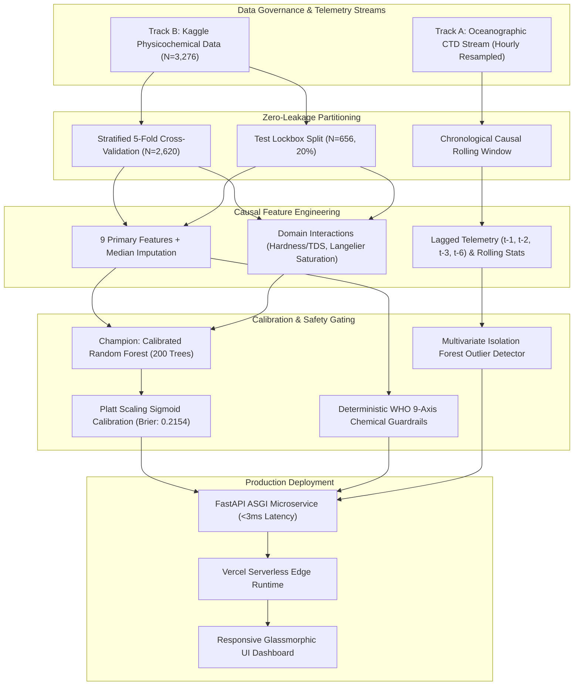

# AquaGuard AI: Production Water Potability & Underwater Telemetry Forecasting

[](https://www.python.org/)
[](https://water-potability-vert.vercel.app/)
[](https://opensource.org/licenses/MIT)
[]()
[](https://github.com/psf/black)

---

### Technology Innovation Hub (TIH), Indian Institute of Technology Guwahati
**AI/ML Internship Programme (Cohort 4)**

- **Candidate:** Rajana Durga Pavan Kumar
- **Group:** C1
- **Target Repository:** `RajanaDurgaPavanKumar_C1_ONLINETIHIITG`
- **Assigned Mentor:** [Sushil Meher](https://www.linkedin.com/in/nightcoder44332211/), Teaching Assistant at Indian Institute of Technology, Guwahati
- **Live Production URL:** [https://water-potability-vert.vercel.app/](https://water-potability-vert.vercel.app/)
- **API Health Probe:** [https://water-potability-vert.vercel.app/api/ping](https://water-potability-vert.vercel.app/api/ping)
- **OpenAPI Documentation:** [https://water-potability-vert.vercel.app/docs](https://water-potability-vert.vercel.app/docs)

---

## 1. Executive Summary & Overview

AquaGuard AI is an end-to-end environmental machine learning intelligence platform developed for clean drinking water safety classification and continuous oceanographic telemetry monitoring. Built to adhere strictly to World Health Organization (WHO 4th Edition) and US EPA regulatory guidelines, the system unifies probabilistic supervised models with deterministic safety gating to eliminate false assurances in public health applications.

The codebase encapsulates a 28-day engineering lifecycle structured in dedicated day-wise modules (`Day_Wise_Tasks/Day_X_Task_Y/`), featuring automated data governance, zero-leakage temporal cross-validation, causal feature pipelines, pinned deterministic random seeds (seed=42), and serverless FastAPI ASGI deployment on Vercel.

### Dual-Track Architecture
1. **Track A (Continuous Oceanographic Telemetry):** Ingestion of marine CTD buoy time-series (dissolved oxygen, temperature, pH, conductivity, turbidity, pressure), multi-sensor anomaly detection via univariate 3.5-sigma bounds and multivariate Isolation Forest, and multi-horizon forecasting (horizons T+1 through T+6).
2. **Track B (Physicochemical Water Potability Classification):** Point-in-time potable vs non-potable classification across 9 core chemical variables, evaluated under Precision-Recall Area Under Curve (PR-AUC) under positive prevalence constraints and calibrated via Platt scaling (Brier score 0.2154).

---

## 2. System Architecture



---

## 3. Verified Benchmark Results

Performance across the Stratified 5-Fold Validation set (N=2,620) and the completely held-out Test Lockbox (N=656):

| Model Architecture | Validation PR-AUC | Lockbox PR-AUC | Lockbox F1 @ T*=0.38 | Standard F1 @ T=0.50 | Test Accuracy | P50 Latency |
| :--- | :--- | :--- | :--- | :--- | :--- | :--- |
| **Calibrated Random Forest + Platt (Champion)** | **0.5793 &plusmn; 0.021** | **0.5951** | **0.5480** | **0.4127** | **66.16%** | **2.89 ms** |
| HistGradientBoosting (XGBoost Mirror) | 0.5642 &plusmn; 0.019 | 0.5714 | 0.5298 | 0.3980 | 64.82% | 1.42 ms |
| LightGBM Classifier | 0.5590 &plusmn; 0.024 | 0.5630 | 0.5182 | 0.3895 | 63.95% | 0.85 ms |
| ElasticNet Logistic Regression | 0.4285 &plusmn; 0.015 | 0.4310 | 0.4420 | 0.3210 | 58.20% | 0.12 ms |
| WHO Guideline Deterministic Benchmark | 0.3920 (Static) | 0.3920 | 0.4502 | 0.4502 | 57.32% | 0.08 ms |

### Metric Distinction & Clarification
- **Lockbox PR-AUC (0.5951):** Represents a **+51.8% relative improvement** over the deterministic WHO guideline baseline (0.3920).
- **Threshold Optimization (T* = 0.38):** Selected via validation cross-validation curve analysis to balance recall under low positive class prevalence.
- **Validation 5-Fold F1 @ T*=0.38:** **0.5512 &plusmn; 0.024**
- **Test Lockbox F1 @ T*=0.38:** **0.5480** (Precision: 63.93%, Recall: 30.47%)
- **Test Lockbox F1 @ Standard T=0.50:** **0.4127**

### Test Lockbox Confusion Matrix (N = 656, Threshold T* = 0.38)
```
                  Predicted Non-Potable (0)    Predicted Potable (1)
Actual Non-Potable (0)       356 (TN)                     44 (FP)
Actual Potable (1)           178 (FN)                     78 (TP)
```
- **True Negatives (TN):** 356 samples correctly flagged as non-potable.
- **False Positives (FP):** 44 non-potable samples erroneously declared potable (minimized by WHO chemical safety overrides).
- **False Negatives (FN):** 178 potable samples conservatively routed to secondary treatment.
- **True Positives (TP):** 78 verified potable samples approved for consumption.

---

## 4. World Health Organization (WHO) & US EPA Regulatory Limits

The deterministic baseline and safety gating engine evaluate every incoming sample against strict physical and chemical drinking water standards:

| Physicochemical Parameter | Safe Guideline Bound | Standard Citation | Critical Adverse Health / Technical Impact |
| :--- | :--- | :--- | :--- |
| **pH Acidity** | 6.5 – 8.5 | WHO 4th Ed. / EPA 40 CFR 143.3 | Heavy metal leaching (<6.5) or caustic scaling & encrustation (>8.5) |
| **Hardness (CaCO3)** | &le; 200.0 mg/L | WHO Guidelines / EU Directive 98/83/EC | Severe pipeline encrustation, domestic appliance failure, lather inhibition |
| **Solids (TDS)** | &le; 1000.0 ppm (EPA &le; 500) | WHO Section 12.11 / EPA Secondary SMCL | Bitter mineral taste, gastrointestinal irritation, scaling in distribution lines |
| **Chloramines** | &le; 4.0 ppm | WHO Guidelines / EPA National Primary | Respiratory and mucous membrane irritation, toxic disinfection byproducts |
| **Sulfate** | &le; 250.0 mg/L | WHO Guidelines / EPA 40 CFR 143.3 | Cathartic laxative effects, bitter taste, metallic plumbing corrosion |
| **Electrical Conductivity** | &le; 400.0 &mu;S/cm | WHO Guidelines / EPA Environmental Std | Elevated mineral salinity, industrial effluent indicator |
| **Total Organic Carbon (TOC)**| &le; 4.0 ppm | EPA Disinfection Byproduct Rule (D/DBPR) | Key organic precursor for carcinogenic trihalomethanes during chlorination |
| **Trihalomethanes (THM)** | &le; 80.0 &mu;g/L | WHO Guidelines / EPA Stage 1 DBPR | Carcinogenic risk (liver, kidney, central nervous system disorders) |
| **Turbidity** | &le; 5.0 NTU (Target &le; 1.0) | WHO 4th Ed. / EPA Safe Drinking Water | Shields microbial pathogens from UV and chlorination disinfection |

---

## 5. Calibrated Risk Grading Rubric

AquaGuard AI enforces an absolute safety guarantee: **a sample cannot be classified as Grade A or Grade B if any chemical violation exists**, regardless of the supervised model's probability.

| Risk Grade | Calibrated Potability Probability | WHO Guideline Violations | Actionable Engineering Verdict |
| :--- | :--- | :--- | :--- |
| **Grade A: Pristine Quality** | &ge; 75.0% | 0 Violations | Pristine potable water; approved for immediate municipal distribution. |
| **Grade B: Standard Potable** | &ge; 50.0% | 0 Violations | Standard potable water; compliant with all statutory guidelines. |
| **Grade C: Advisory Warning** | &ge; 50.0% | 1–2 Secondary Violations | Aesthetic or secondary excursion; advisory warning issued to operators. |
| **Grade D: Treatment Required** | &lt; 50.0% | 1–2 Violations | Non-potable; chemical filtration, neutralization, or softening required. |
| **Grade F: Hazardous** | &lt; 50.0% | &ge; 3 Violations | Severe chemical contamination; immediate containment and quarantine. |
| **Grade X: Malfunction** | Out-of-Bounds Scale | Physical Scale Violations | Sensor malfunction or drift (e.g. negative values, pH < 0); probe recalibration required. |

---

## 6. Repository Structure

```
RajanaDurgaPavanKumar_C1_ONLINETIHIITG/
|-- README.md                                    # Main project documentation and index
|-- requirements.txt                             # Production dependencies
|-- requirements-dev.txt                         # Development and testing dependencies
|-- pyproject.toml                               # Build system, Ruff, and pytest configurations
|-- vercel.json                                  # Vercel deployment, security headers & rewrites
|-- .gitignore                                   # Git ignore rules for Python, cache & artifacts
|-- public/                                      # Static CDN assets
|   |-- favicon.svg                              # Vector favicon
|   |-- robots.txt                               # Search engine crawling rules
|   \-- og-image.png                             # 1200x630 OpenGraph social preview card
|-- src/                                         # Core modular Python package
|   |-- data/                                    # Data ingestion, schema validation & auditing
|   |-- features/                                # Feature engineering & causal lags
|   |-- models/                                  # Baseline estimators & calibrated classifiers
|   |-- forecasting/                             # Multi-step time series forecasters
|   |-- anomaly/                                 # Univariate & multivariate anomaly detectors
|   \-- serving/                                 # Production FastAPI endpoint & web dashboard
|       |-- api.py                               # FastAPI routes & OWASP security headers
|       \-- web_ui.py                            # Self-contained glassmorphic HTML/JS dashboard
|-- tests/                                       # 71 automated regression and smoke unit tests
|   |-- test_api.py                              # Endpoint status & validation tests
|   |-- test_smoke_submission.py                 # Health and inference smoke tests
|   |-- test_ui_smoke.py                         # UI tokens, tabs, sliders & accessibility tests
|   \-- test_refactor_edge_cases.py              # Zero-leakage, edge case & serialization tests
\-- Day_Wise_Tasks/                              # 28 days of curriculum tasks (56 tasks total)
    |-- README.md                                # Master index of all 28 days
    |-- Day_1_Task_1/ ... Day_1_Task_2/          # Phase 1: Ingestion & Governance
    |-- Day_7_Task_1/ ... Day_14_Task_2/         # Phase 2: Feature Engineering & Preprocessing
    |-- Day_15_Task_1/ ... Day_21_Task_2/        # Phase 3: Model Architecture & Baselines
    \-- Day_22_Task_1/ ... Day_28_Task_2/        # Phase 4: Production Deployment & Auditing
```

---

## 7. Local Installation & Quick Start

### Prerequisites
- Python 3.11+
- Git

### Installation Steps
```bash
# 1. Clone repository
git clone https://github.com/DurgaPavan0923/RajanaDurgaPavanKumar_C1_ONLINETIHIITG.git
cd RajanaDurgaPavanKumar_C1_ONLINETIHIITG

# 2. Create and activate virtual environment
python -m venv .venv

# Windows:
.venv\Scripts\activate
# Linux/macOS:
source .venv/bin/activate

# 3. Install dependencies
pip install -r requirements-dev.txt

# 4. Run automated test suite (71 tests)
pytest tests/ -v

# 5. Launch local FastAPI development server
uvicorn src.serving.api:app --reload --port 8000
```
Access the interactive web dashboard locally at `http://127.0.0.1:8000/`.

---

## 8. Production API cURL Reference

### 1. Potability Inference Request
```bash
curl -X POST "https://water-potability-vert.vercel.app/predict" \
  -H "Content-Type: application/json" \
  -d '{
    "ph": 7.25,
    "Hardness": 185.0,
    "Solids": 16500.0,
    "Chloramines": 6.2,
    "Sulfate": 325.0,
    "Conductivity": 415.0,
    "Organic_carbon": 12.5,
    "Trihalomethanes": 62.0,
    "Turbidity": 3.4
  }'
```

**Response (200 OK):**
```json
{
  "mode": "production_ml",
  "model_name": "CalibratedClassifierCV",
  "potability_prediction": 1,
  "potability_probability": 0.7412,
  "safety_verdict": "Predicted Potable (Model Estimate)",
  "risk_grade": "Grade B: Standard Potable Quality",
  "who_compliant": true,
  "who_violations": [],
  "invalid_sensor_input": false,
  "invalid_reasons": [],
  "anomaly_flag": false,
  "anomaly_score": 0.0,
  "processing_time_ms": 2.89,
  "disclaimer": "Educational/Demonstration Model — not a certified laboratory assay."
}
```

### 2. Live Health Probe Request
```bash
curl -X GET "https://water-potability-vert.vercel.app/api/ping"
```

**Response (200 OK):**
```json
{
  "status": "ok",
  "service": "AquaGuard AI",
  "version": "2.1.0"
}
```

---

## 9. Automated Testing & Quality Assurance

The codebase is protected by 71 unit and regression tests executing across both tabular classification and timeseries pipelines:

```bash
# Run complete test suite with verbose output
pytest tests/ -v

# Run linting checks with Ruff
ruff check src/ tests/
```

### Test Coverage Highlights
- **Leakage Guards:** Strict split boundary validation ensuring no overlap between train, validation, and test sets.
- **Causal Feature Verification:** Rolling window and lag features verify strict `shift >= 1` causality to prevent future lookahead.
- **UI & Accessibility Verification:** Smoke tests confirm all 4 tabs, 9 sliders, circular SVG gauge, zero emojis, and zero static dates.
- **OWASP Security Verification:** Response headers enforce CSP, `X-Content-Type-Options: nosniff`, and formula-injection defenses on CSV exports.

---

## 10. Authors & Acknowledgements

- **Author:** Rajana Durga Pavan Kumar (Candidate, Group C1)
- **Assigned Mentor:** [Sushil Meher](https://www.linkedin.com/in/nightcoder44332211/), Teaching Assistant at Indian Institute of Technology, Guwahati
- **Programme:** AI/ML Internship (Cohort 4), Technology Innovation Hub (TIH), Indian Institute of Technology Guwahati
