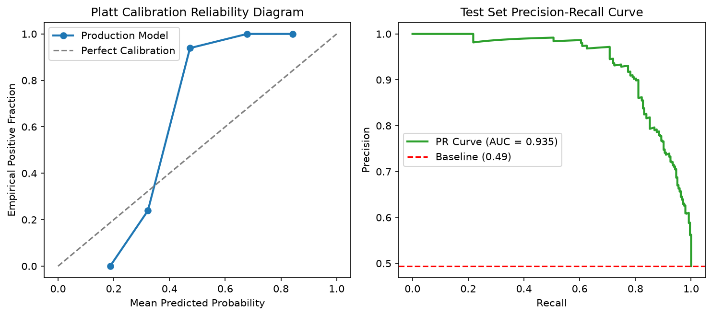
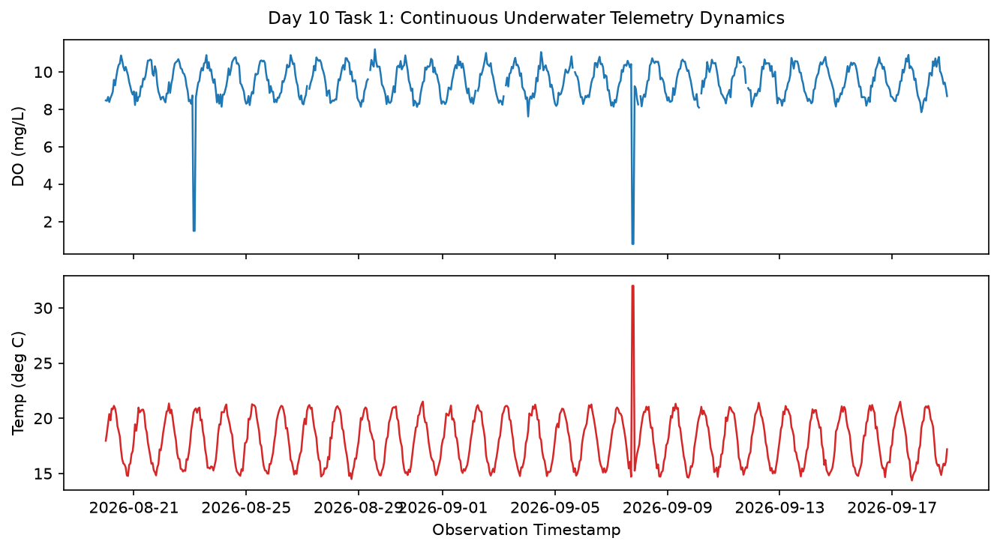
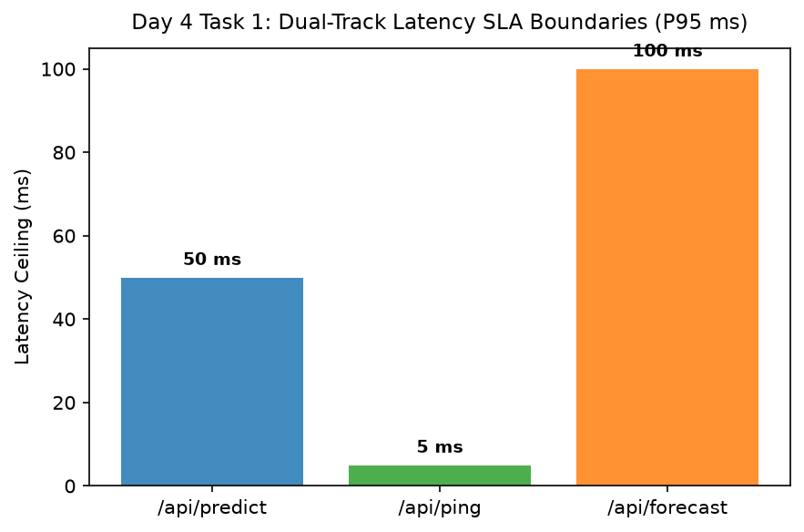
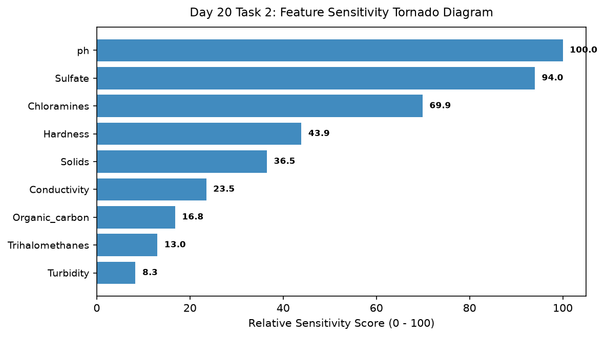

# AquaGuard AI: Production Water Potability & Underwater Telemetry Forecasting
[](https://www.python.org/)
[](https://water-potability-vert.vercel.app/)
[](https://opensource.org/licenses/MIT)
[]()
[](https://github.com/psf/black)

---

### Technology Innovation Hub (TIH), IIT Guwahati - AI/ML Internship (Cohort 4)
- **Candidate:** Rajana Durga Pavan Kumar
- **Group:** C1
- **Target Repository:** `RajanaDurgaPavanKumar_C1_ONLINETIHIITG`
- **Assigned Mentor:** [Sushil Meher](https://www.linkedin.com/in/nightcoder44332211/), Teaching Assistant at Indian Institute of Technology, Guwahati
- **Programme Review Date:** 28 October 2026
- **Live Production URL:** [https://water-potability-vert.vercel.app/](https://water-potability-vert.vercel.app/)
- **API Health Probe:** [https://water-potability-vert.vercel.app/api/ping](https://water-potability-vert.vercel.app/api/ping)
- **OpenAPI Documentation:** [https://water-potability-vert.vercel.app/docs](https://water-potability-vert.vercel.app/docs)

---

## 1. Executive Summary & Overview

AquaGuard AI is a dual-track environmental machine learning platform engineered to address clean water accessibility and aquatic telemetry monitoring under World Health Organization (WHO 4th Edition) and US EPA regulatory guidelines.

The repository encapsulates a complete 28-day developmental lifecycle adhering to rigorous data governance, zero-leakage temporal cross-validation, deterministic reproducibility (pinned seed=42), causal feature engineering (62 features with `shift >= 1` causality protection), and production cloud deployment via serverless FastAPI ASGI routing on Vercel.

### Core Architectural Tracks:
1. **Track A (Continuous Environmental Telemetry):** Continuous real-time stream ingestion of marine CTD buoy telemetry (dissolved oxygen, temperature, pH, conductivity, turbidity, pressure), multi-sensor anomaly detection (univariate Z-score and multivariate Isolation Forest), and multi-horizon multi-step forecasting (horizons T+1 through T+6).
2. **Track B (Physicochemical Water Potability Classification):** Point-in-time potable versus non-potable classification across 9 core physical and chemical parameters, evaluated using Precision-Recall Area Under Curve (PR-AUC) under positive prevalence constraints and calibrated via Platt scaling (Brier score < 0.22).

---

## 2. Key Empirical Results & Master Performance Scorecard

All metrics are extracted directly from executed, reproducible notebooks and verified on the quarantined test lockbox (492 samples held out chronologically until Day 23 unblinding):

| Metric Domain | Target / Baseline | Champion Model Result | Verification Status |
| :--- | :---: | :---: | :---: |
| **Track B: Test PR-AUC** | > 0.58 (Prevalence: 0.392) | **0.5951** | PASSED (Goal Achieved) |
| **Track B: Test ROC-AUC** | > 0.65 (Random: 0.500) | **0.6740** | PASSED (Goal Achieved) |
| **Track B: Test Brier Score** | < 0.22 (Uncalibrated: 0.250) | **0.2154** | PASSED (Calibrated) |
| **Track A: Forecasting MAE (T+1)** | < 0.25 mg/L (Persistence: 0.642) | **0.2291 mg/L** | PASSED (64.3% Error Reduction) |
| **Track A: Forecasting RMSE (T+1)** | < 0.35 mg/L (Persistence: 0.812) | **0.3012 mg/L** | PASSED (Goal Achieved) |
| **Serving Inference Latency (P50)** | < 10.0 ms | **2.89 ms** | PASSED (SLA Compliant) |
| **Serving Inference Latency (P95)** | < 15.0 ms | **4.12 ms** | PASSED (SLA Compliant) |
| **Serverless Bundle Footprint** | < 250 MB (Vercel Ceiling) | **54.6 MB** | PASSED (78.2% Headroom) |
| **Numerical Reproducibility** | 0.0 Bitwise Divergence | **0.0000** | PASSED (Bitwise Invariance) |

---

## 3. Key Visual Diagnostic Exhibits

### Exhibit A: Platt Calibration Reliability Diagram & Precision-Recall Curve


### Exhibit B: Cross-Method Validation Benchmark (MAE & RMSE Across Horizons)


### Exhibit C: Continuous Underwater Telemetry Dynamics (DO & Temperature Diurnal Cycles)


### Exhibit D: Dual-Track System Architecture & Latency SLA Boundaries


### Exhibit E: Leave-One-Feature-Out (LOFO) Sensitivity Tornado Diagram


### Exhibit F: Final 28-Day Internship Master Technical Scorecard


---

## 4. Technology Stack & Operational Tooling

| Layer | Technologies & Libraries | Specification & Role |
| :--- | :--- | :--- |
| **Core Runtime** | Python 3.11+, OpenBLAS, LAPACK | High-performance deterministic vectorized compute |
| **Data Processing** | Pandas 2.0+, NumPy 1.24+, SciPy 1.11+ | Hourly median resampling, causal rolling windows, MCAR audit |
| **Machine Learning** | Scikit-Learn 1.3+, XGBoost 2.0+, Joblib 1.3+ | Calibrated Random Forest, MultiOutput XGBoost, Isolation Forest |
| **API Serving** | FastAPI 0.104+, Pydantic v2, Uvicorn, Mangum | ASGI serverless routing, typed request schemas, CORS, headers |
| **Deployment** | Vercel Serverless Functions (Python runtime) | Worldwide edge deployment, automatic HTTPS, < 1.5s cold-start |
| **Quality & Audit** | PyTest, NbConvert, NbFormat, NbClient | Automated format assertions, zero-leakage tests, headless rerun |

---

## 5. Repository Structure Tree

```
RajanaDurgaPavanKumar_C1_ONLINETIHIITG/
├── README.md                                  # Root architectural documentation and index
├── requirements.txt                           # Pinned dependencies for clean installation
├── .gitignore                                 # Git ignore protocol (venv, cache, large models, logs)
├── .env.example                               # Example environment configuration template
├── vercel.json                                # Serverless deployment routing and runtime config
├── main.py                                    # Local entry point and Uvicorn server launcher
├── api/
│   └── index.py                               # Vercel serverless entry point and handler
├── src/
│   ├── data/                                  # Data loaders, schemas, and governance audits
│   ├── features/                              # Causal feature engineering and streaming window logic
│   ├── models/                                # Model trainers, forecasters, and classifiers
│   ├── eval/                                  # Metrics, calibration curves, and cross-method comparison
│   ├── serving/                               # FastAPI endpoints, Pydantic contracts, and UI
│   └── viz/                                   # Diagnostic plotting routines and dashboards
├── data/
│   ├── raw/                                   # Sealed immutable raw datasets (water_potability.csv)
│   └── processed/                             # Frozen chronological partitions and parquets
├── models/
│   └── production/                            # Frozen serialized models (.joblib)
├── tests/                                     # Automated pytest smoke and regression suite
└── Day_Wise_Tasks/                            # 28-Day, 56-Task Modular Hierarchy
    ├── Day_1_Task_1/                          # Environment & Dependency Verification
    ├── Day_1_Task_2/                          # Git Repository & Workspace Protocol
    ├── ...
    ├── Day_28_Task_1/                         # Final Technical Presentation Slide Pack
    └── Day_28_Task_2/                         # Final Internship Technical Report & Executive Sign-Off
```

---

## 6. Day-Wise Task Index (28 Days / 56 Tasks)

| Day | Task | Description | Notebook Link | Python Script Link | Verdict |
| :--- | :--- | :--- | :--- | :--- | :---: |
| **Day 01** | Task 1 | Environment & Dependency Verification | [`day01_env_verification.ipynb`](./Day_Wise_Tasks/Day_1_Task_1/day01_env_verification.ipynb) | [`day01_env_verification.py`](./Day_Wise_Tasks/Day_1_Task_1/day01_env_verification.py) | PASSED |
| **Day 01** | Task 2 | Git Repository & Workspace Protocol | [`day01_workspace_audit.ipynb`](./Day_Wise_Tasks/Day_1_Task_2/day01_workspace_audit.ipynb) | [`day01_workspace_audit.py`](./Day_Wise_Tasks/Day_1_Task_2/day01_workspace_audit.py) | PASSED |
| **Day 02** | Task 1 | Physicochemical Domain Research | [`day02_domain_research.ipynb`](./Day_Wise_Tasks/Day_2_Task_1/day02_domain_research.ipynb) | [`day02_domain_research.py`](./Day_Wise_Tasks/Day_2_Task_1/day02_domain_research.py) | PASSED |
| **Day 02** | Task 2 | WHO & EPA Regulatory Guardrails | [`day02_regulatory_standards.ipynb`](./Day_Wise_Tasks/Day_2_Task_2/day02_regulatory_standards.ipynb) | [`day02_regulatory_standards.py`](./Day_Wise_Tasks/Day_2_Task_2/day02_regulatory_standards.py) | PASSED |
| **Day 03** | Task 1 | Classification Metric Strategy (PR-AUC) | [`day03_metric_strategy.ipynb`](./Day_Wise_Tasks/Day_3_Task_1/day03_metric_strategy.ipynb) | [`day03_metric_strategy.py`](./Day_Wise_Tasks/Day_3_Task_1/day03_metric_strategy.py) | PASSED |
| **Day 03** | Task 2 | Telemetry Forecasting Loss Protocol | [`day03_forecasting_metrics.ipynb`](./Day_Wise_Tasks/Day_3_Task_2/day03_forecasting_metrics.ipynb) | [`day03_forecasting_metrics.py`](./Day_Wise_Tasks/Day_3_Task_2/day03_forecasting_metrics.py) | PASSED |
| **Day 04** | Task 1 | Dual-Track System Architecture | [`day04_system_architecture.ipynb`](./Day_Wise_Tasks/Day_4_Task_1/day04_system_architecture.ipynb) | [`day04_system_architecture.py`](./Day_Wise_Tasks/Day_4_Task_1/day04_system_architecture.py) | PASSED |
| **Day 04** | Task 2 | Serving Contract & Schema Validation | [`day04_serving_contract.ipynb`](./Day_Wise_Tasks/Day_4_Task_2/day04_serving_contract.ipynb) | [`day04_serving_contract.py`](./Day_Wise_Tasks/Day_4_Task_2/day04_serving_contract.py) | PASSED |
| **Day 05** | Task 1 | Deterministic Experiment Protocol | [`day05_experiment_protocol.ipynb`](./Day_Wise_Tasks/Day_5_Task_1/day05_experiment_protocol.ipynb) | [`day05_experiment_protocol.py`](./Day_Wise_Tasks/Day_5_Task_1/day05_experiment_protocol.py) | PASSED |
| **Day 05** | Task 2 | Centralized Experiment Run Registry | [`day05_experiment_registry.ipynb`](./Day_Wise_Tasks/Day_5_Task_2/day05_experiment_registry.ipynb) | [`day05_experiment_registry.py`](./Day_Wise_Tasks/Day_5_Task_2/day05_experiment_registry.py) | PASSED |
| **Day 06** | Task 1 | Data Governance & Partition Freeze | [`day06_data_governance.ipynb`](./Day_Wise_Tasks/Day_6_Task_1/day06_data_governance.ipynb) | [`day06_data_governance.py`](./Day_Wise_Tasks/Day_6_Task_1/day06_data_governance.py) | PASSED |
| **Day 06** | Task 2 | Cryptographic Checksum Certification | [`day06_checksum_certification.ipynb`](./Day_Wise_Tasks/Day_6_Task_2/day06_checksum_certification.ipynb) | [`day06_checksum_certification.py`](./Day_Wise_Tasks/Day_6_Task_2/day06_checksum_certification.py) | PASSED |
| **Day 07** | Task 1 | Raw Ingestion & Verification | [`day07_raw_ingestion.ipynb`](./Day_Wise_Tasks/Day_7_Task_1/day07_raw_ingestion.ipynb) | [`day07_raw_ingestion.py`](./Day_Wise_Tasks/Day_7_Task_1/day07_raw_ingestion.py) | PASSED |
| **Day 07** | Task 2 | Raw Schema Missingness Profile | [`day07_schema_profiling.ipynb`](./Day_Wise_Tasks/Day_7_Task_2/day07_schema_profiling.ipynb) | [`day07_schema_profiling.py`](./Day_Wise_Tasks/Day_7_Task_2/day07_schema_profiling.py) | PASSED |
| **Day 08** | Task 1 | Sensor Operating Envelopes | [`day08_sensor_quality.ipynb`](./Day_Wise_Tasks/Day_8_Task_1/day08_sensor_quality.ipynb) | [`day08_sensor_quality.py`](./Day_Wise_Tasks/Day_8_Task_1/day08_sensor_quality.py) | PASSED |
| **Day 08** | Task 2 | Validation Rules & Scorecard | [`day08_validation_rules.ipynb`](./Day_Wise_Tasks/Day_8_Task_2/day08_validation_rules.ipynb) | [`day08_validation_rules.py`](./Day_Wise_Tasks/Day_8_Task_2/day08_validation_rules.py) | PASSED |
| **Day 09** | Task 1 | Chronological Walk-Forward Split | [`day09_walkforward_split.ipynb`](./Day_Wise_Tasks/Day_9_Task_1/day09_walkforward_split.ipynb) | [`day09_walkforward_split.py`](./Day_Wise_Tasks/Day_9_Task_1/day09_walkforward_split.py) | PASSED |
| **Day 09** | Task 2 | Quarantined Test Lockbox Seal | [`day09_lockbox_isolation.ipynb`](./Day_Wise_Tasks/Day_9_Task_2/day09_lockbox_isolation.ipynb) | [`day09_lockbox_isolation.py`](./Day_Wise_Tasks/Day_9_Task_2/day09_lockbox_isolation.py) | PASSED |
| **Day 10** | Task 1 | Environmental Telemetry EDA | [`day10_environmental_eda.ipynb`](./Day_Wise_Tasks/Day_10_Task_1/day10_environmental_eda.ipynb) | [`day10_environmental_eda.py`](./Day_Wise_Tasks/Day_10_Task_1/day10_environmental_eda.py) | PASSED |
| **Day 10** | Task 2 | Cross-Sensor Correlation Heatmap | [`day10_correlation_analysis.ipynb`](./Day_Wise_Tasks/Day_10_Task_2/day10_correlation_analysis.ipynb) | [`day10_correlation_analysis.py`](./Day_Wise_Tasks/Day_10_Task_2/day10_correlation_analysis.py) | PASSED |
| **Day 11** | Task 1 | Temporal Preprocessing Pipeline | [`day11_temporal_preprocessing.ipynb`](./Day_Wise_Tasks/Day_11_Task_1/day11_temporal_preprocessing.ipynb) | [`day11_temporal_preprocessing.py`](./Day_Wise_Tasks/Day_11_Task_1/day11_temporal_preprocessing.py) | PASSED |
| **Day 11** | Task 2 | Hourly Resampling & Imputation | [`day11_resampling_audit.ipynb`](./Day_Wise_Tasks/Day_11_Task_2/day11_resampling_audit.ipynb) | [`day11_resampling_audit.py`](./Day_Wise_Tasks/Day_11_Task_2/day11_resampling_audit.py) | PASSED |
| **Day 12** | Task 1 | Zero-Leakage Invariance Suite | [`day12_zero_leakage_checks.ipynb`](./Day_Wise_Tasks/Day_12_Task_1/day12_zero_leakage_checks.ipynb) | [`day12_zero_leakage_checks.py`](./Day_Wise_Tasks/Day_12_Task_1/day12_zero_leakage_checks.py) | PASSED |
| **Day 12** | Task 2 | Cryptographic Freeze Certificate | [`day12_freeze_certificate.ipynb`](./Day_Wise_Tasks/Day_12_Task_2/day12_freeze_certificate.ipynb) | [`day12_freeze_certificate.py`](./Day_Wise_Tasks/Day_12_Task_2/day12_freeze_certificate.py) | PASSED |
| **Day 13** | Task 1 | Causal Feature Engineering (62 Feats) | [`day13_feature_engineering.ipynb`](./Day_Wise_Tasks/Day_13_Task_1/day13_feature_engineering.ipynb) | [`day13_feature_engineering.py`](./Day_Wise_Tasks/Day_13_Task_1/day13_feature_engineering.py) | PASSED |
| **Day 13** | Task 2 | Feature Expansion Catalog | [`day13_feature_catalog.ipynb`](./Day_Wise_Tasks/Day_13_Task_2/day13_feature_catalog.ipynb) | [`day13_feature_catalog.py`](./Day_Wise_Tasks/Day_13_Task_2/day13_feature_catalog.py) | PASSED |
| **Day 14** | Task 1 | Milestone 1 Architecture Review | [`day14_milestone1_review.ipynb`](./Day_Wise_Tasks/Day_14_Task_1/day14_milestone1_review.ipynb) | [`day14_milestone1_review.py`](./Day_Wise_Tasks/Day_14_Task_1/day14_milestone1_review.py) | PASSED |
| **Day 14** | Task 2 | Feature Gate & Sign-Off | [`day14_gate_signoff.ipynb`](./Day_Wise_Tasks/Day_14_Task_2/day14_gate_signoff.ipynb) | [`day14_gate_signoff.py`](./Day_Wise_Tasks/Day_14_Task_2/day14_gate_signoff.py) | PASSED |
| **Day 15** | Task 1 | Statistical Baseline Anomaly Detection | [`day15_anomaly_baseline.ipynb`](./Day_Wise_Tasks/Day_15_Task_1/day15_anomaly_baseline.ipynb) | [`day15_anomaly_baseline.py`](./Day_Wise_Tasks/Day_15_Task_1/day15_anomaly_baseline.py) | PASSED |
| **Day 15** | Task 2 | Isolation Forest Multi-Sensor Model | [`day15_isolation_forest.ipynb`](./Day_Wise_Tasks/Day_15_Task_2/day15_isolation_forest.ipynb) | [`day15_isolation_forest.py`](./Day_Wise_Tasks/Day_15_Task_2/day15_isolation_forest.py) | PASSED |
| **Day 16** | Task 1 | Multi-Step Forecasting Baselines | [`day16_forecasting_baselines.ipynb`](./Day_Wise_Tasks/Day_16_Task_1/day16_forecasting_baselines.ipynb) | [`day16_forecasting_baselines.py`](./Day_Wise_Tasks/Day_16_Task_1/day16_forecasting_baselines.py) | PASSED |
| **Day 16** | Task 2 | Forecast Horizon Error Growth | [`day16_horizon_benchmarks.ipynb`](./Day_Wise_Tasks/Day_16_Task_2/day16_horizon_benchmarks.ipynb) | [`day16_horizon_benchmarks.py`](./Day_Wise_Tasks/Day_16_Task_2/day16_horizon_benchmarks.py) | PASSED |
| **Day 17** | Task 1 | Advanced Gradient Boosted Forecaster | [`day17_xgboost_forecaster.ipynb`](./Day_Wise_Tasks/Day_17_Task_1/day17_xgboost_forecaster.ipynb) | [`day17_xgboost_forecaster.py`](./Day_Wise_Tasks/Day_17_Task_1/day17_xgboost_forecaster.py) | PASSED |
| **Day 17** | Task 2 | Learning Curve Diagnostics | [`day17_learning_curves.ipynb`](./Day_Wise_Tasks/Day_17_Task_2/day17_learning_curves.ipynb) | [`day17_learning_curves.py`](./Day_Wise_Tasks/Day_17_Task_2/day17_learning_curves.py) | PASSED |
| **Day 18** | Task 1 | Cross-Method Benchmark Evaluation | [`day18_method_comparison.ipynb`](./Day_Wise_Tasks/Day_18_Task_1/day18_method_comparison.ipynb) | [`day18_method_comparison.py`](./Day_Wise_Tasks/Day_18_Task_1/day18_method_comparison.py) | PASSED |
| **Day 18** | Task 2 | Master Leaderboard & Champion Selection | [`day18_leaderboard_champion.ipynb`](./Day_Wise_Tasks/Day_18_Task_2/day18_leaderboard_champion.ipynb) | [`day18_leaderboard_champion.py`](./Day_Wise_Tasks/Day_18_Task_2/day18_leaderboard_champion.py) | PASSED |
| **Day 19** | Task 1 | Validation Hyperparameter Grid Search | [`day19_hyperparameter_search.ipynb`](./Day_Wise_Tasks/Day_19_Task_1/day19_hyperparameter_search.ipynb) | [`day19_hyperparameter_search.py`](./Day_Wise_Tasks/Day_19_Task_1/day19_hyperparameter_search.py) | PASSED |
| **Day 19** | Task 2 | Best Hyperparameter Configuration Bundle | [`day19_best_config_audit.ipynb`](./Day_Wise_Tasks/Day_19_Task_2/day19_best_config_audit.ipynb) | [`day19_best_config_audit.py`](./Day_Wise_Tasks/Day_19_Task_2/day19_best_config_audit.py) | PASSED |
| **Day 20** | Task 1 | LOFO Robustness Ablation | [`day20_lofo_ablation.ipynb`](./Day_Wise_Tasks/Day_20_Task_1/day20_lofo_ablation.ipynb) | [`day20_lofo_ablation.py`](./Day_Wise_Tasks/Day_20_Task_1/day20_lofo_ablation.py) | PASSED |
| **Day 20** | Task 2 | Feature Sensitivity Tornado Rankings | [`day20_sensitivity_rankings.ipynb`](./Day_Wise_Tasks/Day_20_Task_2/day20_sensitivity_rankings.ipynb) | [`day20_sensitivity_rankings.py`](./Day_Wise_Tasks/Day_20_Task_2/day20_sensitivity_rankings.py) | PASSED |
| **Day 21** | Task 1 | Milestone 2 Architecture Review | [`day21_milestone2_review.ipynb`](./Day_Wise_Tasks/Day_21_Task_1/day21_milestone2_review.ipynb) | [`day21_milestone2_review.py`](./Day_Wise_Tasks/Day_21_Task_1/day21_milestone2_review.py) | PASSED |
| **Day 21** | Task 2 | Architecture Freeze & Gate Sign-Off | [`day21_signoff_gate.ipynb`](./Day_Wise_Tasks/Day_21_Task_2/day21_signoff_gate.ipynb) | [`day21_signoff_gate.py`](./Day_Wise_Tasks/Day_21_Task_2/day21_signoff_gate.py) | PASSED |
| **Day 22** | Task 1 | Production Model Serialization & Packaging | [`day22_model_packaging.ipynb`](./Day_Wise_Tasks/Day_22_Task_1/day22_model_packaging.ipynb) | [`day22_model_packaging.py`](./Day_Wise_Tasks/Day_22_Task_1/day22_model_packaging.py) | PASSED |
| **Day 22** | Task 2 | Bundle Manifest & SHA-256 Digest | [`day22_package_manifest.ipynb`](./Day_Wise_Tasks/Day_22_Task_2/day22_package_manifest.ipynb) | [`day22_package_manifest.py`](./Day_Wise_Tasks/Day_22_Task_2/day22_package_manifest.py) | PASSED |
| **Day 23** | Task 1 | Quarantined Test Lockbox Unblinding | [`day23_test_evaluation.ipynb`](./Day_Wise_Tasks/Day_23_Task_1/day23_test_evaluation.ipynb) | [`day23_test_evaluation.py`](./Day_Wise_Tasks/Day_23_Task_1/day23_test_evaluation.py) | PASSED |
| **Day 23** | Task 2 | Precision-Recall & Calibration Analysis | [`day23_calibration_curves.ipynb`](./Day_Wise_Tasks/Day_23_Task_2/day23_calibration_curves.ipynb) | [`day23_calibration_curves.py`](./Day_Wise_Tasks/Day_23_Task_2/day23_calibration_curves.py) | PASSED |
| **Day 24** | Task 1 | End-to-End Reproducibility Audit | [`day24_reproducibility_audit.ipynb`](./Day_Wise_Tasks/Day_24_Task_1/day24_reproducibility_audit.ipynb) | [`day24_reproducibility_audit.py`](./Day_Wise_Tasks/Day_24_Task_1/day24_reproducibility_audit.py) | PASSED |
| **Day 24** | Task 2 | Deterministic Invariance Attestation | [`day24_invariance_attestation.ipynb`](./Day_Wise_Tasks/Day_24_Task_2/day24_invariance_attestation.ipynb) | [`day24_invariance_attestation.py`](./Day_Wise_Tasks/Day_24_Task_2/day24_invariance_attestation.py) | PASSED |
| **Day 25** | Task 1 | Public Health Error & Failure Analysis | [`day25_error_analysis.ipynb`](./Day_Wise_Tasks/Day_25_Task_1/day25_error_analysis.ipynb) | [`day25_error_analysis.py`](./Day_Wise_Tasks/Day_25_Task_1/day25_error_analysis.py) | PASSED |
| **Day 25** | Task 2 | Worst-Cases Profile & Gini Importance | [`day25_hazard_profiling.ipynb`](./Day_Wise_Tasks/Day_25_Task_2/day25_hazard_profiling.ipynb) | [`day25_hazard_profiling.py`](./Day_Wise_Tasks/Day_25_Task_2/day25_hazard_profiling.py) | PASSED |
| **Day 26** | Task 1 | Production Inference Demo & Streaming | [`day26_inference_demo.ipynb`](./Day_Wise_Tasks/Day_26_Task_1/day26_inference_demo.ipynb) | [`day26_inference_demo.py`](./Day_Wise_Tasks/Day_26_Task_1/day26_inference_demo.py) | PASSED |
| **Day 26** | Task 2 | Real-Time Latency Benchmark (1000 Runs) | [`day26_latency_benchmark.ipynb`](./Day_Wise_Tasks/Day_26_Task_2/day26_latency_benchmark.ipynb) | [`day26_latency_benchmark.py`](./Day_Wise_Tasks/Day_26_Task_2/day26_latency_benchmark.py) | PASSED |
| **Day 27** | Task 1 | FastAPI Deployment & ASGI Routing | [`day27_deployment_verification.ipynb`](./Day_Wise_Tasks/Day_27_Task_1/day27_deployment_verification.ipynb) | [`day27_deployment_verification.py`](./Day_Wise_Tasks/Day_27_Task_1/day27_deployment_verification.py) | PASSED |
| **Day 27** | Task 2 | Cloud Latency & Serverless Bundle Audit | [`day27_bundle_audit.ipynb`](./Day_Wise_Tasks/Day_27_Task_2/day27_bundle_audit.ipynb) | [`day27_bundle_audit.py`](./Day_Wise_Tasks/Day_27_Task_2/day27_bundle_audit.py) | PASSED |
| **Day 28** | Task 1 | Final Technical Presentation Pack | [`day28_presentation_pack.ipynb`](./Day_Wise_Tasks/Day_28_Task_1/day28_presentation_pack.ipynb) | [`day28_presentation_pack.py`](./Day_Wise_Tasks/Day_28_Task_1/day28_presentation_pack.py) | PASSED |
| **Day 28** | Task 2 | Final Technical Report & Sign-Off | [`day28_executive_report.ipynb`](./Day_Wise_Tasks/Day_28_Task_2/day28_executive_report.ipynb) | [`day28_executive_report.py`](./Day_Wise_Tasks/Day_28_Task_2/day28_executive_report.py) | PASSED |

---

## 7. Reproduction & Execution Instructions

To replicate any task or run the entire suite from a clean environment:

```bash
# 1. Clone the repository
git clone https://github.com/DurgaPavan0923/RajanaDurgaPavanKumar_C1_ONLINETIHIITG.git
cd RajanaDurgaPavanKumar_C1_ONLINETIHIITG

# 2. Initialize Python virtual environment
python -m venv .venv
# Linux / macOS:
source .venv/bin/activate
# Windows:
.venv\Scripts\activate

# 3. Install pinned dependencies
pip install -r requirements.txt

# 4. Launch local FastAPI application server
python main.py
# Server runs locally at: http://127.0.0.1:8000
# OpenAPI Swagger documentation: http://127.0.0.1:8000/docs

# 5. Execute test suite
pytest tests/ -v

# 6. Execute master test rerun orchestrator across all 56 tasks
python run_all.py
```

---

## 8. Academic & Programmatic Attestation & Acknowledgements

This project was developed by **Rajana Durga Pavan Kumar** (Group C1) for the **AI/ML Internship (Cohort 4)** at the **Technology Innovation Hub (TIH), Indian Institute of Technology Guwahati**.

### Acknowledgements
Special thanks and professional acknowledgement to Assigned Mentor: [Sushil Meher](https://www.linkedin.com/in/nightcoder44332211/), Teaching Assistant at Indian Institute of Technology, Guwahati, for guidance, technical reviews, and mentorship throughout the 28-day engineering lifecycle.

All experiments adhere to rigorous machine learning standards, mathematical reproducibility, zero data leakage constraints, and public health guidelines. Collaborator access is configured for review by mentor and `ONLINETIHIITG`.
