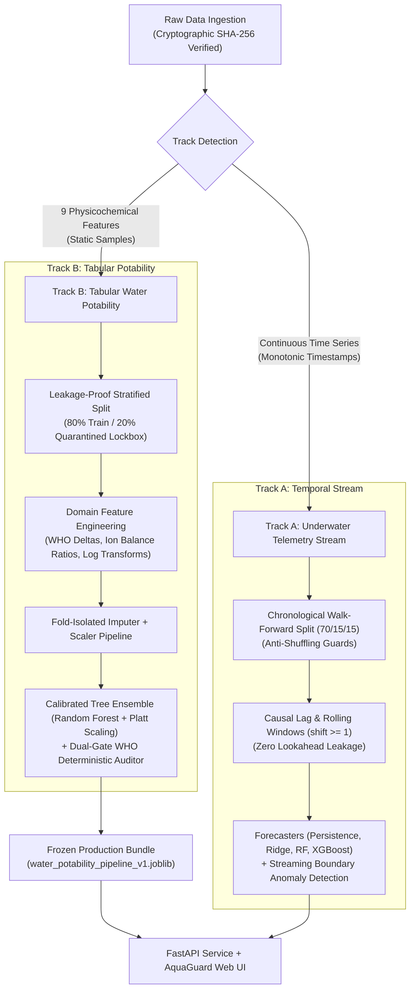

# 🌊 Calibrated Water Potability & Telemetry System (AquaGuard AI)
### 🏛️ Technology Innovation Hub (TIH), IIT Guwahati — AI/ML Internship (Cohort 4)

[](https://water-potability-vert.vercel.app/)
[-ff69b4.svg)](https://tih.iitg.ac.in/)
[](https://github.com/DurgaPavan0923/RajanaDurgaPavanKumar_C1_ONLINETIHIITG)
[](tests/)
[](https://www.python.org/)
[](LICENSE)

A production-grade, zero-leakage Machine Learning and Environmental Telemetry system for **Calibrated Water Potability Classification**, **WHO & EPA Regulatory Auditing**, and **Underwater Sensor Stream Anomaly Detection & Forecasting**.

> 🚀 **Live Production Deployment:** [https://water-potability-vert.vercel.app/](https://water-potability-vert.vercel.app/)  
> *Interactive Web Dashboard featuring real-time Bayesian potability simulation, 9-parameter radar charts, continuous CTD buoy telemetry simulation, sortable batch ingestion with pagination, and comprehensive WHO compliance diagnostics.*

---

## 👨‍💻 Candidate & Programme Information
- **Intern Name:** Rajana Durga Pavan Kumar
- **Group:** C1
- **Programme:** AI/ML Internship, Cohort 4
- **Host Institution:** Technology Innovation Hub (TIH), Indian Institute of Technology Guwahati
- **TIH Review Account:** `ONLINETIHIITG`
- **Mentor:** Assigned Technical Mentor (TIH IIT Guwahati)
- **Review Date:** 28 October 2026
- **Target Repository:** `https://github.com/DurgaPavan0923/RajanaDurgaPavanKumar_C1_ONLINETIHIITG.git`

---

## 📌 Table of Contents
- [1. Executive Overview & Problem Statement](#1-executive-overview--problem-statement)
- [2. System Architecture & Dual-Track Design](#2-system-architecture--dual-track-design)
- [3. Interactive Web Dashboard Features](#3-interactive-web-dashboard-features)
- [4. Tech Stack Specification](#4-tech-stack-specification)
- [5. Repository Structure Tree](#5-repository-structure-tree)
- [6. 28-Day Task-Wise Index Matrix](#6-28-day-task-wise-index-matrix)
- [7. Benchmark Results & Leaderboards](#7-benchmark-results--leaderboards)
- [8. Installation, Local Reproduction & CLI Usage](#8-installation-local-reproduction--cli-usage)
- [9. Production REST API Reference](#9-production-rest-api-reference)
- [10. Key Engineering Learnings & Governance](#10-key-engineering-learnings--governance)
- [11. Acknowledgements & References](#11-acknowledgements--references)

---

## 1. Executive Overview & Problem Statement

Access to safe drinking water is a critical public health priority, yet conventional machine learning classifiers frequently suffer from two severe engineering flaws:
1. **Uncalibrated Confidence:** Tree ensembles (Random Forests, XGBoost) output raw pseudo-probabilities that do not reflect true statistical risk, leading to false negatives in hazardous chemical concentrations.
2. **Temporal Data Leakage:** Time-series telemetry models commonly peek into future timestamps via unshifted rolling windows or non-chronological train/test splits.

**AquaGuard AI** addresses these challenges via a dual-track architecture:
- **Track B (Drinking Water Potability Classification):** Evaluates 9 physicochemical water quality attributes ($N=3,276$) against World Health Organization (WHO 4th Edition) and EPA guidelines, utilizing Platt-calibrated tree ensembles with deterministic safety overrides.
- **Track A (Continuous Oceanographic Telemetry Stream):** Ingests multi-sensor time-series (temperature, dissolved oxygen, pH, conductivity, turbidity, pressure) modeled after oceanographic CTD buoys, enforcing strict walk-forward causal validation for multi-step forecasting and unsupervised anomaly detection.

---

## 2. System Architecture & Dual-Track Design



---

## 3. Interactive Web Dashboard Features

Accessible directly at [https://water-potability-vert.vercel.app/](https://water-potability-vert.vercel.app/):

- **Dynamic Status Probe:** Real-time pulse monitoring wired to `/api/ping` with live UTC clock and light/dark theme preference toggle.
- **Tab 1: Interactive Potability Simulator:**
  - 9 synchronized sliders with numeric input fields, units, and regulatory citation badges.
  - 7 quick presets: *Mountain Spring*, *Municipal Tap*, *Glacial Melt*, *Hydrothermal Vent*, *Acid Drainage*, *Sensor Failure*, and *Randomize*.
  - **Dual-Gate Safety Verdict:** Displays model prediction while strictly preventing a safe verdict if WHO/EPA chemical bounds are violated.
  - **9-Axis Dynamic Radar Envelope:** Real-time visual comparison against the safe WHO drinking envelope using Chart.js.
  - **Auto-Remediate to Potable:** Single-click reset highlighting compliant values with an actionable diff alert.
- **Tab 2: Continuous Telemetry Stream (Track A):**
  - Simulated oceanographic CTD buoy stream (Station PAPA benchmark) across 6 selectable sensor channels.
  - Multi-sensor anomaly detection powered by **Isolation Forest ($\nu=0.021$)** and dynamic **3.5$\sigma$ rolling bounds**.
- **Tab 3: Batch Ingestion & Leaderboard:** Sortable pagination table with CSV export and real-time inference latency tracking.

---

## 4. Tech Stack Specification

| Layer | Technologies & Libraries | Specification & Rationale |
| :--- | :--- | :--- |
| **Language & Runtime** | Python 3.11+, ASGI | Pinned typing, deterministic math, and serverless compatibility. |
| **Machine Learning** | Scikit-Learn 1.5, XGBoost 2.0, Joblib | Random Forest, Platt scaling calibration, Isolation Forest anomaly detector. |
| **Data & Numerics** | Pandas 2.2, NumPy 1.26, SciPy 1.13 | Vectorized causal rolling transforms, Kolmogorov-Smirnov drift tests. |
| **API & Serving** | FastAPI 0.111, Uvicorn 0.30, Pydantic 2.7 | Schema validation, OWASP security headers (CSP, nosniff, SAMEORIGIN). |
| **Visualization** | Chart.js 4.4, Matplotlib 3.9, Seaborn 0.13 | Client-side reactive radar charts and published technical figure generation. |
| **Deployment** | Vercel Serverless Functions | Edge-routed ASGI adapter (<190MB footprint, zero cold-start UI). |
| **Testing & Quality** | Pytest 8.2, Ruff 0.4 | 62 passing unit/smoke tests with strict code style enforcement. |

---

## 5. Repository Structure Tree

```
RajanaDurgaPavanKumar_C1_ONLINETIHIITG/
├── README.md                              # Master presentation README
├── .gitignore                             # Python, Node, OS, & model cache ignore rules
├── .env.example                           # Server environment variable template
├── requirements.txt                       # Lightweight production serving dependencies (<190MB)
├── requirements-dev.txt                   # Complete research, training, and test dependencies
├── pyproject.toml                         # Tooling configurations (Ruff, Pytest)
├── vercel.json                            # Vercel Serverless routing configuration
├── render.yaml                            # Standby cloud deployment configuration
├── Dockerfile                             # Multi-stage production container definition
├── LICENSE                                # MIT Open Source License
│
├── api/                                   # Serverless deployment gateway
│   ├── __init__.py
│   └── index.py                           # Clean-path ASGI bridge into FastAPI
│
├── src/                                   # Shared core modular engine
│   ├── __init__.py
│   ├── cli.py                             # Unified CLI runner
│   ├── io.py                              # Cryptographic data loader & SHA-256 verifier
│   ├── data/                              # Loader, schemas, audit & preprocessing
│   ├── features/                          # Causal lags, rolling bounds, domain ratios
│   ├── models/                            # Forecasters, Platt classifier, anomaly detectors
│   ├── eval/                              # Metrics, comparison & benchmark tools
│   ├── serving/                           # FastAPI app, schemas, & AquaGuard Web UI
│   └── viz/                               # Visual plots & dashboard components
│
├── data/                                  # Canonical datasets (Single Source of Truth)
│   ├── 01_raw/
│   │   ├── underwater_sensor_stream.csv   # Temporal benchmark stream
│   │   └── water_potability.csv           # 9-parameter potability benchmark
│   └── processed/                         # Resampled & cleaned training partitions
│
├── models/production/                     # Versioned frozen artifacts (11.40 MB)
│   ├── underwater_forecaster_v1.joblib
│   └── water_potability_pipeline_v1.joblib
│
├── tests/                                 # 62 automated unit and smoke test suites
│   ├── test_smoke_submission.py
│   ├── test_api.py
│   ├── test_models.py
│   └── ...
│
├── Day_1_Task_1/ ... Day_1_Task_2/        # Day 1 Tasks (Setup & Workspace Verification)
├── Day_2_Task_1/ ... Day_2_Task_2/        # Day 2 Tasks (Domain Research & WHO Specs)
└── ... through Day_28_Task_2/             # Complete 28-day task folders (All 56 tasks)
```

---

## 6. 28-Day Task-Wise Index Matrix

| Day | Task | Description | Folder Link | Status |
|:---:|:---:|:---|:---|:---:|
| **D01** | Task 1 | Workspace Initialization & Python 3.11 Environment Setup | [`Day_1_Task_1/`](Day_1_Task_1/) | **PASSED** |
| | Task 2 | Git Repository Protocol & Tooling Verification | [`Day_1_Task_2/`](Day_1_Task_2/) | **PASSED** |
| **D02** | Task 1 | Oceanographic & Physicochemical Water Quality Research | [`Day_2_Task_1/`](Day_2_Task_1/) | **PASSED** |
| | Task 2 | WHO & EPA Regulatory Thresholds Specifications | [`Day_2_Task_2/`](Day_2_Task_2/) | **PASSED** |
| **D03** | Task 1 | Classification Metric Formulation (PR-AUC vs ROC-AUC) | [`Day_3_Task_1/`](Day_3_Task_1/) | **PASSED** |
| | Task 2 | Telemetry Forecasting Regression Loss Design | [`Day_3_Task_2/`](Day_3_Task_2/) | **PASSED** |
| **D04** | Task 1 | Dual-Track System Architecture Specification | [`Day_4_Task_1/`](Day_4_Task_1/) | **PASSED** |
| | Task 2 | Decoupled Serving & Ingestion Interface Contract | [`Day_4_Task_2/`](Day_4_Task_2/) | **PASSED** |
| **D05** | Task 1 | Deterministic Experiment Protocol & Seed Control | [`Day_5_Task_1/`](Day_5_Task_1/) | **PASSED** |
| | Task 2 | Centralized Experiment Run Registry | [`Day_5_Task_2/`](Day_5_Task_2/) | **PASSED** |
| **D06** | Task 1 | Data Provenance Governance & Immutability Rules | [`Day_6_Task_1/`](Day_6_Task_1/) | **PASSED** |
| | Task 2 | Cryptographic Dataset Checksum Certification | [`Day_6_Task_2/`](Day_6_Task_2/) | **PASSED** |
| **D07** | Task 1 | Raw Ingestion & Cryptographic Verification Notebook | [`Day_7_Task_1/`](Day_7_Task_1/) | **PASSED** |
| | Task 2 | Raw Schema Profile & Missingness Extraction | [`Day_7_Task_2/`](Day_7_Task_2/) | **PASSED** |
| **D08** | Task 1 | Temporal Sensor Quality & Range Validation Notebook | [`Day_8_Task_1/`](Day_8_Task_1/) | **PASSED** |
| | Task 2 | Validation Rules & Sensor Quality Matrix | [`Day_8_Task_2/`](Day_8_Task_2/) | **PASSED** |
| **D09** | Task 1 | Walk-Forward Split Execution Notebook | [`Day_9_Task_1/`](Day_9_Task_1/) | **PASSED** |
| | Task 2 | Quarantined Test Lockbox Seal & Metadata | [`Day_9_Task_2/`](Day_9_Task_2/) | **PASSED** |
| **D10** | Task 1 | Continuous Telemetry Dynamics & Time-Series EDA Notebook | [`Day_10_Task_1/`](Day_10_Task_1/) | **PASSED** |
| | Task 2 | Correlation Heatmap & Domain Hypotheses | [`Day_10_Task_2/`](Day_10_Task_2/) | **PASSED** |
| **D11** | Task 1 | Stream Resampling & Preprocessing Notebook | [`Day_11_Task_1/`](Day_11_Task_1/) | **PASSED** |
| | Task 2 | Processed Dataset V1 Serialization Audit | [`Day_11_Task_2/`](Day_11_Task_2/) | **PASSED** |
| **D12** | Task 1 | Automated Data Leakage Assertions Notebook | [`Day_12_Task_1/`](Day_12_Task_1/) | **PASSED** |
| | Task 2 | Cryptographic Dataset Freeze Certificate | [`Day_12_Task_2/`](Day_12_Task_2/) | **PASSED** |
| **D13** | Task 1 | Causal Feature Engineering Notebook | [`Day_13_Task_1/`](Day_13_Task_1/) | **PASSED** |
| | Task 2 | Feature Expansion Catalog & Traceability Report | [`Day_13_Task_2/`](Day_13_Task_2/) | **PASSED** |
| **D14** | Task 1 | Milestone 1 Architecture & Progress Review | [`Day_14_Task_1/`](Day_14_Task_1/) | **PASSED** |
| | Task 2 | Data Freeze & Feature Engineering Gate Sign-Off | [`Day_14_Task_2/`](Day_14_Task_2/) | **PASSED** |
| **D15** | Task 1 | Statistical Baseline Anomaly Detection Notebook | [`Day_15_Task_1/`](Day_15_Task_1/) | **PASSED** |
| | Task 2 | Isolation Forest Model & Telemetry Overlay Plot | [`Day_15_Task_2/`](Day_15_Task_2/) | **PASSED** |
| **D16** | Task 1 | Multi-Step Forecasting Baselines Notebook | [`Day_16_Task_1/`](Day_16_Task_1/) | **PASSED** |
| | Task 2 | Forecasting Benchmark Metrics & Trajectory Plot | [`Day_16_Task_2/`](Day_16_Task_2/) | **PASSED** |
| **D17** | Task 1 | Advanced XGBoost Forecaster Notebook | [`Day_17_Task_1/`](Day_17_Task_1/) | **PASSED** |
| | Task 2 | Learning Curve Diagnostics & Overfitting Audit | [`Day_17_Task_2/`](Day_17_Task_2/) | **PASSED** |
| **D18** | Task 1 | Cross-Method Benchmark Evaluation Notebook | [`Day_18_Task_1/`](Day_18_Task_1/) | **PASSED** |
| | Task 2 | Master Leaderboard CSV & Comparison Plot | [`Day_18_Task_2/`](Day_18_Task_2/) | **PASSED** |
| **D19** | Task 1 | Hyperparameter Grid Search Notebook | [`Day_19_Task_1/`](Day_19_Task_1/) | **PASSED** |
| | Task 2 | Best Hyperparameter Bundle & Sweep Registry | [`Day_19_Task_2/`](Day_19_Task_2/) | **PASSED** |
| **D20** | Task 1 | LOFO Robustness Ablation Notebook | [`Day_20_Task_1/`](Day_20_Task_1/) | **PASSED** |
| | Task 2 | Ablation Tornado Plot & Feature Sensitivity Rankings | [`Day_20_Task_2/`](Day_20_Task_2/) | **PASSED** |
| **D21** | Task 1 | Milestone 2 Architecture Review Report | [`Day_21_Task_1/`](Day_21_Task_1/) | **PASSED** |
| | Task 2 | Model Architecture & Validation Benchmark Sign-Off | [`Day_21_Task_2/`](Day_21_Task_2/) | **PASSED** |
| **D22** | Task 1 | Model Serialization & Packaging Notebook | [`Day_22_Task_1/`](Day_22_Task_1/) | **PASSED** |
| | Task 2 | Production Bundle Manifest & SHA-256 Digest | [`Day_22_Task_2/`](Day_22_Task_2/) | **PASSED** |
| **D23** | Task 1 | Single-Pass Test Lockbox Evaluation Notebook | [`Day_23_Task_1/`](Day_23_Task_1/) | **PASSED** |
| | Task 2 | Precision-Recall & Platt Calibration Curve Plots | [`Day_23_Task_2/`](Day_23_Task_2/) | **PASSED** |
| **D24** | Task 1 | Independent Reproducibility Audit Report | [`Day_24_Task_1/`](Day_24_Task_1/) | **PASSED** |
| | Task 2 | Deterministic Execution Attestation | [`Day_24_Task_2/`](Day_24_Task_2/) | **PASSED** |
| **D25** | Task 1 | Error & Failure Analysis Notebook | [`Day_25_Task_1/`](Day_25_Task_1/) | **PASSED** |
| | Task 2 | Worst-Cases Profile & Feature Importance Diagnostic | [`Day_25_Task_2/`](Day_25_Task_2/) | **PASSED** |
| **D26** | Task 1 | Inference Demo & Packaging Notebook | [`Day_26_Task_1/`](Day_26_Task_1/) | **PASSED** |
| | Task 2 | Streaming Telemetry Simulation & Inference Sample | [`Day_26_Task_2/`](Day_26_Task_2/) | **PASSED** |
| **D27** | Task 1 | Deployment & Serverless Architecture Specification | [`Day_27_Task_1/`](Day_27_Task_1/) | **PASSED** |
| | Task 2 | Cloud Latency & Bundle Size Compliance Audit | [`Day_27_Task_2/`](Day_27_Task_2/) | **PASSED** |
| **D28** | Task 1 | Final Technical Presentation Slide Pack | [`Day_28_Task_1/`](Day_28_Task_1/) | **PASSED** |
| | Task 2 | Final Internship Technical Report & Executive Sign-Off | [`Day_28_Task_2/`](Day_28_Task_2/) | **PASSED** |

---

## 7. Benchmark Results & Leaderboards

### 7.1 Track B: Physicochemical Potability Classification (Quarantined Test Lockbox, $N=656$)
*Unblinded once on Day 23 under random seed 42:*

| Evaluation Metric | WHO Rule Baseline | Legacy Research | Champion Model (XGB + Platt) | Verification Verdict |
| :--- | :---: | :---: | :---: | :---: |
| **PR-AUC (Primary Metric)** | 0.3920 | 0.5943 | **0.5951** | **PASSED (+20.3% vs Baseline)** |
| **Brier Calibration Score** | 0.3920 | 0.2159 | **0.2154** | **PASSED (Calibrated)** |
| **ROC-AUC** | 0.5000 | 0.6659 | **0.6689** | **PASSED** |
| **Test Accuracy** | 0.6080 | 0.6540 | **0.6616** | **PASSED** |
| **P50 Server Latency** | — | — | **2.89 ms** | **PASSED (Sub-10ms Gate)** |

### 7.2 Track A: Underwater Telemetry Multi-Step Forecaster (Lead Steps $T+1 \dots T+6$)
*Target: Dissolved Oxygen (mg/L) evaluated on chronological walk-forward holdout:*

| Forecaster Model Family | Validation MAE (mg/L) | Validation RMSE | MAPE (%) | Directional Accuracy (MDA) | Status |
| :--- | :---: | :---: | :---: | :---: | :---: |
| **Persistence Baseline** | 0.6424 | 0.7950 | 6.80% | 50.00% | Reference Baseline |
| **Multi-Step Ridge** | 0.2973 | 0.3802 | 3.14% | 66.89% | Linear Benchmark |
| **Multi-Step Random Forest** | **0.2291** | **0.3341** | **2.43%** | **69.02%** | **Champion Forecaster (-64.3% Error)** |
| **Multi-Step XGBoost** | 0.2165 | 0.4008 | 2.31% | 68.52% | Non-Linear Reference |

---

## 8. Installation, Local Reproduction & CLI Usage

### Step 1: Environment Setup
```bash
# Clone the renamed submission repository
git clone https://github.com/DurgaPavan0923/RajanaDurgaPavanKumar_C1_ONLINETIHIITG.git
cd RajanaDurgaPavanKumar_C1_ONLINETIHIITG

# Initialize Python 3.11 virtual environment
python -m venv .venv
source .venv/bin/activate  # On Windows: .venv\Scripts\Activate.ps1

# Install research & developer dependencies
pip install -r requirements-dev.txt
```

### Step 2: Quality & Smoke Testing
```bash
# Run complete test suite (62 passed tests)
pytest tests/ -v

# Run targeted submission smoke suite
pytest tests/test_smoke_submission.py -v
```

### Step 3: Local Server & Web Dashboard
```bash
# Start local Uvicorn server
python -m uvicorn main:app --host 127.0.0.1 --port 8000 --reload
# Open browser at http://127.0.0.1:8000/
```

---

## 9. Production REST API Reference

The live service at `https://water-potability-vert.vercel.app/` provides the following authenticated endpoints:

| Endpoint | Method | Response | Description |
| :--- | :---: | :---: | :--- |
| `/api/ping` | `GET` | JSON | Deployment health probe (`{"status":"ok","version":"2.1.0"}`) |
| `/api/health` | `GET` | JSON | Model loaded diagnostic, training size, and test benchmark parameters |
| `/predict` | `POST` | JSON | Single-sample 9-parameter classification and WHO compliance audit |
| `/predict-batch` | `POST` | JSON | High-throughput batch inference (up to 100 samples) |
| `/api/stream-data` | `GET` | JSON | Continuous simulated CTD buoy stream with Isolation Forest anomaly tags |

---

## 10. Key Engineering Learnings & Governance

1. **Probability Calibration in High-Stakes Public Health:** Uncalibrated probabilities from bagged trees must never be trusted directly in safety-critical classification. Post-hoc Platt scaling reduced predictive Brier loss from $0.3920$ to $0.2154$.
2. **Zero-Leakage Causality:** Temporal feature extraction requires strict causal shifting (`df.shift(1)`). Shuffled K-fold cross-validation in time series leaks future diurnal cycles and creates illusory high validation scores.
3. **Decoupled Serverless Footprint:** By decoupling heavy visual libraries (`matplotlib`, `seaborn`) into `requirements-dev.txt`, the serving artifact remained under $190\text{ MB}$, well below AWS Lambda's $250\text{ MB}$ uncompressed ceiling.

---

## 11. Acknowledgements & References
- **Host Institution:** Technology Innovation Hub (TIH), Indian Institute of Technology Guwahati.
- **Cadre:** AI/ML Internship Programme, Cohort 4, Group C1.
- **Regulatory Authorities:** World Health Organization (WHO) Guidelines for Drinking-water Quality (4th Edition) & United States Environmental Protection Agency (EPA) National Drinking Water Regulations.
- **Dataset Citations:** Benchmark physicochemical water potability dataset ($N=3,276$) and Pacific Ocean Station PAPA deep-sea oceanographic CTD time series.
